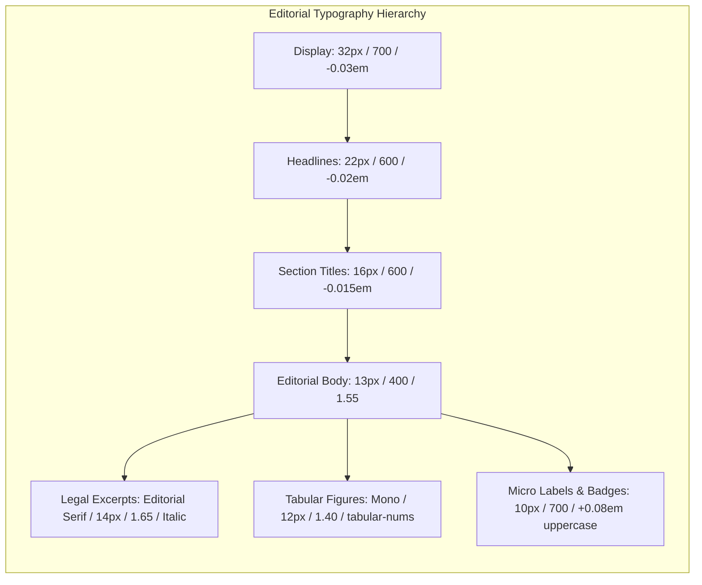

# SEANCE DESIGN SYSTEM & VISUAL FOUNDATION

**Platform:** Seance — Legislative Bill Impact Prediction & Decision Intelligence Platform  
**Document Version:** 1.0.0  
**Phase:** Phase 1 — Visual Foundation & Design System (Task 1.6B)  
**Status:** Canonical & Active

---

## 1. Architectural Philosophy: The Editorial-Finance Aesthetic

Seance is designed for institutions, market operators, legal scholars, and corporate officers navigating complex parliamentary and state enactments in India.

The platform deliberately rejects generic "AI SaaS" tropes:
- **No gratuitous gradients, glowing orbs, or pulsating neon borders.**
- **No nested "card-in-card" boxes** that create visual clutter and cognitive fatigue.
- **No dark-only bias** — Light, Dark, and System modes receive equal visual craftsmanship and strict contrast calibration.
- **No decorative animations or spinning glyphs** that distract from analytical rigor.

Instead, Seance adopts a **Premium Editorial-Finance Aesthetic**, inspired by the world's most trusted institutions of economic authority and computational rigor:
1. **Institutional Credibility:** Hairline geometric dividers, generous whitespace, and strict structural hierarchy.
2. **Editorial Typography:** High-contrast pairing of an authoritative Grotesque Sans (`Inter`) for interface chrome, paired with an elegant Editorial Serif accent (`Newsreader` / `Charter`) for long-form statutory text and legal provisions.
3. **Tabular Numerals & Mathematical Precision:** Tabular numbers (`tabular-nums lining-nums`, `font-mono`) across all financial predictions, p-values, dates, horizons, and identifiers.
4. **Purposeful Color Economy:** Neutral slate and parchment canvases where color is reserved strictly for semantic state: emerald for confirmed positive shocks, rose for regulatory downside/restriction, amber for pre-event diffusion, and institutional indigo/blue for econometric modeling and system navigation.
5. **Three-Tier Progressive Disclosure:** Clear separation between Tier 1 (Immediate Executive Clarity), Tier 2 (Contextual Expansion), and Tier 3 (Econometric & Provenance Deep-Dive).

---

## 2. Typography System & Hierarchy

The Seance typography system is structured into a 9-level scale combining Grotesque Sans, Editorial Serif, and Monospace tabular figures.



### 2.1 Font Families

| Font Role | CSS Variable | Fallback Stack | Usage Context |
|---|---|---|---|
| **Sans (Interface)** | `var(--font-sans)` | `"Inter", -apple-system, BlinkMacSystemFont, "Segoe UI", Roboto, sans-serif` | App shell, navigation, buttons, form controls, table headers, analytical text |
| **Serif (Editorial / Legal)** | `var(--font-serif)` | `"Newsreader", "Charter", "Bitstream Charter", "Georgia", "Cambria", "Times New Roman", serif` | Gazette legal text, official statutory quotes, preambles, executive policy commentary |
| **Mono (Tabular Figures)** | `var(--font-mono)` | `"JetBrains Mono", ui-monospace, SFMono-Regular, Menlo, Monaco, Consolas, monospace` | Financial predictions, CAR %, event study windows, t-stats, ISINs, timestamps |

### 2.2 Typography Scale Tokens

| Class Name | Family | Size / Line-Height | Weight | Tracking | Primary Usage |
|---|---|---|---|---|---|
| `.font-display` | Sans | `32px (2.0rem)` / `1.15` | `700` (Bold) | `-0.03em` | Command center titles, major platform milestones |
| `.font-headline` | Sans | `22px (1.375rem)` / `1.25` | `600` (Semibold) | `-0.02em` | Dossier headers, Portfolio workspace title, Settings header |
| `.font-title` | Sans | `16px (1.0rem)` / `1.35` | `600` (Semibold) | `-0.015em` | Section headers, card group titles, modal headers |
| `.font-subhead` | Sans | `14px (0.875rem)` / `1.40` | `500` (Medium) | `-0.01em` | Table column categories, module descriptions |
| `.font-body` | Sans | `13px (0.8125rem)` / `1.55` | `400` (Regular) | `0` | Primary analytical text, summaries, descriptions |
| `.font-legal` | Serif | `14px (0.875rem)` / `1.65` | `400` / Italic | `0` | Gazette legal text, official statutory quotes, preamble |
| `.font-tabular` | Mono | `12px (0.75rem)` / `1.40` | `500` (Medium) | `0` | Predictions, event windows, CAR values, ISINs, dates (`tabular-nums lining-nums`) |
| `.font-caption` | Sans | `11px (0.6875rem)` / `1.35` | `500` (Medium) | `+0.02em` | Column headers, footnotes, timestamps, data status |
| `.font-micro` | Sans | `10px (0.625rem)` / `1.20` | `700` (Bold) | `+0.08em` | Epistemic badges, firewall stamps, ticker chips (`uppercase`) |

> [!NOTE]
> For backward-compatibility with existing pages, the legacy utility aliases (`.text-display`, `.text-headline`, `.text-title`, `.text-subheading`, `.text-body`, `.text-caption`, `.text-micro`, `.font-mono-num`) remain fully supported.

---

## 3. Spacing Scale, Geometry & Density

### 3.1 8-Point Spatial Rhythm
All margins, paddings, and control dimensions follow an 8-point spatial scale:

| Token | CSS Variable | Value | Pixels | Example Usage |
|---|---|---|---|---|
| `0.5` | `--space-0-5` | `0.25rem` | `4px` | Badge vertical padding, hairline gap |
| `1` | `--space-1` | `0.5rem` | `8px` | Icon-to-text spacing, compact cell padding |
| `1.5` | `--space-1-5` | `0.75rem` | `12px` | Standard compact cell padding, input horizontal padding |
| `2` | `--space-2` | `1.0rem` | `16px` | Card internal padding, stack gaps |
| `3` | `--space-3` | `1.5rem` | `24px` | Drawer padding, section margins |
| `4` | `--space-4` | `2.0rem` | `32px` | Section dividers, header spacing |
| `6` | `--space-6` | `3.0rem` | `48px` | Major page section breaks |
| `8` | `--space-8` | `4.0rem` | `64px` | Page hero clearance, footer separation |

### 3.2 Restrained Corner Radii
Bulbous cards and generic SaaS rounded bubbles are strictly prohibited. The system enforces disciplined, institutional radii:

- `rounded-sm` (`4px`): Micro indicators, epistemic pills (`--radius-sm`).
- `rounded-md` (`6px`): Small controls, buttons, badges, chips (`--radius-md`).
- `rounded-lg` (`8px`): Form inputs, select menus, small containers (`--radius-lg`).
- `rounded-xl` (`12px`): Structural containers, inspection panels, modals, data tables (`--radius-xl`).
- `rounded-full` (`9999px`): Status pulse indicators, avatar chips (`--radius-full`).
- **Elimination:** `rounded-3xl` (24px+) is removed from all container specifications.

### 3.3 Hairline Precision Borders & Dividers
Structural separation uses hairline strokes with calibrated opacity:

| Token | CSS Variable | Dark Theme Value | Light Theme Value | Utility Class |
|---|---|---|---|---|
| **Subtle** | `--border-subtle` | `rgba(255, 255, 255, 0.06)` | `rgba(15, 23, 42, 0.06)` | `.border-subtle` |
| **Default** | `--border-default` | `rgba(255, 255, 255, 0.10)` | `rgba(15, 23, 42, 0.12)` | `.border-default` |
| **Strong** | `--border-strong` | `rgba(255, 255, 255, 0.18)` | `rgba(15, 23, 42, 0.22)` | `.border-strong` |
| **Hairline** | `--border-hairline` | `rgba(255, 255, 255, 0.07)` | `rgba(15, 23, 42, 0.08)` | `.border-hairline` |

Hairline directional divider utilities:
- `.hairline-t`: `border-top: 1px solid var(--border-hairline);`
- `.hairline-b`: `border-bottom: 1px solid var(--border-hairline);`
- `.hairline-l`: `border-left: 1px solid var(--border-hairline);`
- `.hairline-r`: `border-right: 1px solid var(--border-hairline);`
- `.divide-hairline > * + *`: `border-color: var(--border-hairline);`

### 3.4 Layout Density Modes

| Density Mode | Class | Row Height | Cell Padding | Font Size | Primary Use Case |
|---|---|---|---|---|---|
| **Compact** | `.density-compact` | `36px` | `py-2 px-3` (`0.5rem 0.75rem`) | `12px` | High-frequency analytical tables, predictions terminal, portfolio roster |
| **Standard** | `.density-standard` | `44px` | `py-3 px-4` (`0.75rem 1.0rem`) | `13px` | Personalized workbench, activity feed, settings panels |
| **Relaxed** | `.density-relaxed` | `auto` | `py-4 px-5` (`1.0rem 1.25rem`) | `14px` | Statutory reading, official gazette extracts, legal provisions |

### 3.5 Content Width Architecture

- **Prose Column (`.max-w-prose`):** `680px` — Used for plain-language summaries, statutory text, and legal analysis to preserve optimal ocular sweep (60–75 characters per line).
- **Editorial Container (`.container-editorial` / `max-w-7xl`):** `1280px` — Used for dashboards, workspaces, and standard analytical views.
- **Matrix Container (`.container-matrix` / `.max-w-matrix`):** `1440px` — Used for wide econometric tables, event-study matrices, and the 2-column portfolio workspace.

---

## 4. Dual-Theme Semantic Color System

Light, Dark, and System modes receive equal visual craftsmanship and strict luminance balancing:

```css
/* Dark Theme (Institutional Obsidian & Navy Baseline) */
[data-theme="dark"], .dark {
  --bg-base: #070b12;             /* Pure Obsidian Surface */
  --bg-surface: #0c1322;          /* Institutional Canvas */
  --bg-secondary: #121b2f;        /* Secondary Grouping */
  --bg-card: #0c1322;             /* Standard Card Surface */
  --bg-elevated: #162035;         /* Raised Drawer / Popover */
  --text-primary: #f8fafc;        /* Maximum Legibility White */
  --text-secondary: #94a3b8;      /* Supporting Slate */
  --text-muted: #64748b;          /* Column Headers & Metadata */
  --border-default: rgba(255, 255, 255, 0.10);
  --color-positive: #10b981;      /* Emerald 500 */
  --color-negative: #f43f5e;      /* Rose 500 */
  --color-warning: #f59e0b;       /* Amber 500 */
  --color-model: #6366f1;         /* Indigo 500 */
}

/* Light Theme (Institutional Paper & Clean Workspace) */
[data-theme="light"], .light {
  --bg-base: #f8fafc;             /* Slate 50 Paper Surface */
  --bg-surface: #ffffff;          /* Pure White Paper Surface */
  --bg-secondary: #f1f5f9;        /* Slate 100 Secondary */
  --bg-card: #ffffff;             /* Clean Card Surface */
  --bg-elevated: #ffffff;         /* Elevated Card with Subtle Shadow */
  --text-primary: #0f172a;        /* Deep Slate 900 (16.1:1 Contrast) */
  --text-secondary: #334155;      /* Slate 700 (9.5:1 Contrast) */
  --text-muted: #64748b;          /* Slate 500 (4.6:1 WCAG AAA) */
  --border-default: rgba(15, 23, 42, 0.12);
  --color-positive: #059669;      /* Emerald 600 */
  --color-negative: #e11d48;      /* Rose 600 */
  --color-warning: #d97706;      /* Amber 600 */
  --color-model: #4f46e5;         /* Indigo 600 */
}
```

### 4.1 Non-Color Glyph Indicators
Directional changes must never rely on color alone. Color must always be paired with explicit text and glyph markers:
- **Positive Shock:** `▲ +2.34% [POSITIVE]`
- **Negative Shock:** `▼ -1.85% [NEGATIVE]`
- **Neutral / Indeterminate:** `◆ 0.00% [NEUTRAL]`

---

## 5. Epistemic Classification Palette

Every analytical claim, score, or projection is strictly anchored to its verified epistemic tier:

| Epistemic Tier | Badge Label | Dark Colors (Text / BG / Border) | Light Colors (Text / BG / Border) | Meaning & Data Source |
|---|---|---|---|---|
| **FACT** | `[FACT]` | `#34d399` / `rgba(16,185,129,0.10)` / `0.25` | `#047857` / `rgba(5,150,105,0.08)` / `0.30` | Official Gazette, Passed Acts, Assent Dates, Statutory Provisions |
| **OBSERVED** | `[OBSERVED]` | `#38bdf8` / `rgba(14,165,233,0.10)` / `0.25` | `#0369a1` / `rgba(2,132,199,0.08)` / `0.30` | Historical BSE/NSE equity returns, trading volume, event timestamps |
| **DERIVED** | `[DERIVED]` | `#818cf8` / `rgba(99,102,241,0.10)` / `0.25` | `#4338ca` / `rgba(79,70,229,0.08)` / `0.30` | Econometric OLS residuals, CAR %, t-statistics, transmission scores |
| **INTERPRETATION** | `[INTERPRETATION]` | `#fbbf24` / `rgba(245,158,11,0.10)` / `0.25` | `#b45309` / `rgba(217,119,6,0.08)` / `0.30` | Grounded Groq AI executive summaries, multi-stakeholder impact assessments |
| **PREDICTION** | `[PREDICTION]` | `#c084fc` / `rgba(168,85,247,0.10)` / `0.25` | `#7e22ce` / `rgba(147,51,234,0.08)` / `0.30` | Central econometric event studies across 5 horizons (`[-1,+1]` to `[-10,+10]`) |
| **EVIDENCE** | `[EVIDENCE]` | `#2dd4bf` / `rgba(20,184,166,0.10)` / `0.25` | `#0f766e` / `rgba(13,148,136,0.08)` / `0.30` | Direct PIB citations, gazette PDF URLs, immutable SHA-256 hashes |

---

## 6. Motion Tokens & Accessibility

### 6.1 Motion Tokens
Motion in Seance is understated, functional, and purposeful:
- Fast transition: `150ms ease` (`--transition-fast`) — hover states, button clicks.
- Base transition: `200ms ease` (`--transition-base`) — surface shifts, tabs.
- Editorial transition: `200ms cubic-bezier(0.16, 1, 0.3, 1)` (`--ease-editorial`, `.transition-editorial`) — slide-over drawers, expandables.
- Reveal animation: `.reveal-fade` (subtle 4px translateY fade in).

### 6.2 Reduced Motion Compliance (`prefers-reduced-motion`)
The design system enforces strict compliance with `prefers-reduced-motion: reduce`:
- All animations and transitions are neutralized (`animation-duration: 0.01ms !important`, `transition-duration: 0.01ms !important`).
- Skeletons, pulses, and reveal fades immediately render at full opacity with no transforms.
- Scroll behavior reverts to `auto`.

### 6.3 Anti-Pattern Rules
- **No Disappearing Timers:** Crucial alerts, epistemic badges, and compliance warnings never automatically fade away on a timer.
- **No Hover-Locked Interactions:** Essential data, actions, and explanations must never require hover to discover. Hover is reserved strictly for subtle visual enhancement.

---

## 7. Shared Component Guidelines

| Component | Radius | Border | Density / Notes |
|---|---|---|---|
| `Button` | `rounded-md` (6px) | Hairline or transparent | Primary uses `text-white` for high contrast in all themes. 150ms subtle press. |
| `InstitutionalTable` | `rounded-xl` (12px) | `border-[var(--border-default)]` | Supports `compact` (36px), `dense`, and `normal` (44px) modes. Tabular numbers on numeric columns. |
| `Card` | `rounded-xl` (12px) | Hairline `var(--border-default)` | Avoid nested cards. Prefer hairline dividers inside a single card container. |
| `StatCard` | `rounded-xl` (12px) | Hairline `var(--border-default)` | Tabular numerals (`.font-tabular`, `.tabular-nums`) on metric values. Trend glyphs. |
| `ContextDrawer` | `rounded-none` (slide-over) | `border-l border-[var(--border-default)]` | 200ms ease-out slide. Focus trapped. Escape key listener. |
| `Modal` | `rounded-xl` (12px) | `border-[var(--border-default)]` | Restrained radius. Backdrop blur. Accessible title & description IDs. |
| `Input` / `Select` | `rounded-lg` (8px) | `border-[var(--input-border)]` | High-contrast placeholder and text in both themes. Clear focus ring. |
| `Badge` | `rounded-md` (6px) | `border` with 30% alpha | Symbolic glyph paired with text label. High-contrast foreground. |

---

## 8. Summary of Invariants & Compliance Rules

1. **Frozen Baseline:** Manifest hash `50ae76039bccf2e4a671cf2ae915889e490b17404db6eb2e49e7965ecd6400b7` is immutable.
2. **State Predictions:** Strictly 0 quantitative stock predictions on all sub-national bills.
3. **Intelligence Companies:** 23 non-quant corporate entities are strictly firewalled from stock prediction tables.
4. **No Financial Advice:** No Buy/Sell/Hold recommendations or price targets are permitted.
5. **Full Theme Parity:** Light, Dark, and System modes are equally intentional and fully accessible.

