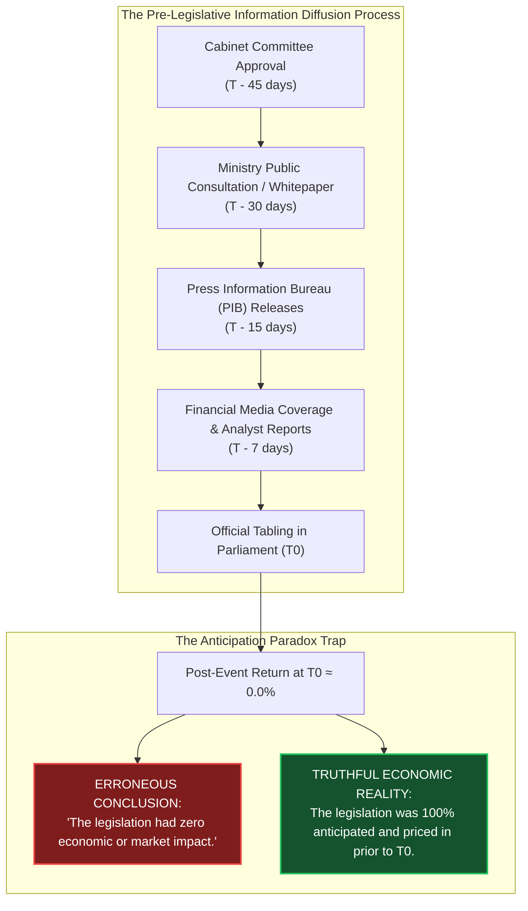

# TASK 1.13A — THE ANTICIPATION PARADOX METHODOLOGY

**Project:** Seance — Legislative Bill Impact Prediction and Decision Intelligence Platform for the Indian Financial Market  
**Stage:** Final-Year Engineering & Research Capstone Documentation  
**Date:** October 30, 2026  
**Auditor:** Antigravity Autonomous Pair Programming Agent  
**Authoritative Baseline Manifest:** `docs/production_baseline.json`  

---

## 1. The Anticipation Paradox Defined

In standard financial event studies, the researcher assumes that the arrival of information occurs at a discrete point in time: the official event timestamp ($T_0$). Under the Semi-Strong Efficient Market Hypothesis (Fama, 1970), security prices immediately adjust to new public information upon its release.

However, in legislative and public policy domains, this assumption frequently collapses, creating what Seance designates as the **Anticipation Paradox**:

When market participants obtain pre-event public signals, trading volume and price adjustments occur gradually across the pre-event window. By the time the bill is formally introduced on the floor of the Lok Sabha ($T_0$), the expected economic surplus or compliance cost has already been discounted into the stock price. An analyst observing only the post-event window $[0, +1]$ observes zero abnormal returns and commits a severe Type II econometric error (falsely concluding no impact).

---

## 2. Multi-Window Pre-Event Econometric Architecture

To detect, measure, and decompose pre-event information leakage, Seance constructs five discrete sub-windows and one cumulative benchmark window across the 30 trading days prior to introduction (`anticipation/engine.py`):

| Window Slug | Trading Day Offset | Diagnostic Objective |
| :---: | :---: | :--- |
| **`[-30,-21]`** | $T_{-30}$ to $T_{-21}$ | **Macro Diffusion Baseline:** Measures early drift coinciding with inter-ministerial reviews and cabinet approvals. |
| **`[-20,-11]`** | $T_{-20}$ to $T_{-11}$ | **Public Consultation Phase:** Captures market reactions to draft bills, stakeholder feedback, and PIB notices. |
| **`[-10,-6]`** | $T_{-10}$ to $T_{-6}$ | **Pre-Session Mobilization:** Evaluates positioning as parliamentary session schedules and order of business papers are finalized. |
| **`[-5,-3]`** | $T_{-5}$ to $T_{-3}$ | **Immediate Media Acceleration:** Monitors intense financial press speculation and industry representations. |
| **`[-2,-1]`** | $T_{-2}$ to $T_{-1}$ | **Immediate Pre-Event Window:** Captures immediate eve-of-tabling positioning. |
| **`[-30,-1]`** | $T_{-30}$ to $T_{-1}$ | **Full Cumulative Anticipation Benchmark:** Measures aggregate pre-event drift across the entire 30-day pre-event horizon. |

For each window $W = [w_1, w_2]$, the Pre-Event Market Analyzer computes:
1. Window Cumulative Abnormal Return: $CAR(w_1, w_2) = \sum_{t=w_1}^{w_2} AR_{i,t}$
2. Abnormal Return $z$-score: $z = \frac{CAR(w_1, w_2)}{\sqrt{|W|} \cdot \hat{\sigma}_{\epsilon_i}}$
3. Pre-event $p$-value: $p = 2 \cdot [1 - \Phi(|z|)]$
4. Average Daily Abnormal Volume: Ratio of trading volume during $W$ to the 111-day baseline volume.

---

## 3. Mathematical Scoring Engine

The Anticipation Scorer (`anticipation/scorer.py`) synthesizes market econometric signals and public information evidence into a normalized composite score $S_{\text{ant}} \in [0.0, 1.0]$.

### 3.1 Market Signal Score ($S_{\text{mkt}}$)
$$S_{\text{mkt}} = 0.35 \cdot C_{\text{car}} + 0.25 \cdot C_z + 0.25 \cdot C_{\text{acc}} + 0.15 \cdot C_{\text{sig}}$$

Where:
- **$C_{\text{car}}$ (CAR Magnitude):** $\min\left(1.0, \frac{|CAR_{[-30,-1]}|}{0.05}\right)$. Normalized such that a 5% pre-event cumulative abnormal return yields maximum points.
- **$C_z$ (Statistical Significance):** $\min\left(1.0, \frac{|z_{[-30,-1]}|}{3.0}\right)$. Target $|z| = 3.0$ ($p < 0.003$).
- **$C_{\text{acc}}$ (Proximity Acceleration):** $\min\left(1.0, \frac{|CAR_{[-5,-3]}| + |CAR_{[-2,-1]}|}{0.03}\right)$. Evaluates whether the rate of price adjustment accelerates in the final 5 trading days.
- **$C_{\text{sig}}$ (Signal Diversity):** $\min\left(1.0, \frac{N_{\text{signals}}}{4.0}\right)$. Count of discrete heuristic signals triggered (e.g., volume spikes, directional persistence, trend breaks).

### 3.2 Information Signal Score ($S_{\text{info}}$)
When external public evidence items $E = \{e_1, e_2, \dots, e_K\}$ are available (press releases, gazettes, news reports), each item is evaluated using exponential time-decay and credibility weighting:
$$w_k = \omega(\text{tier}_k) \cdot \exp\left(-\lambda \cdot \Delta t_k\right)$$
- **Half-Life Decay:** $\lambda = 0.05$ (corresponding to a half-life of $\sim 14$ calendar days prior to $T_0$). Information published 30 days prior carries lower weight than information published 2 days prior.
- **Credibility Tiers:**
  - `TIER_1` (Official Gazette, Parliament Bulletins, PIB): $\omega = 1.0$
  - `TIER_2` (Mainstream Financial Press - Mint, Economic Times, Business Standard): $\omega = 0.7$
  - `TIER_3` (Secondary News & Regional Outlets): $\omega = 0.5$
  - `TIER_4` (Search Trends & Social Attention): $\omega = 0.4$

The normalized information score is:
$$S_{\text{info}} = \min\left(1.0, \frac{\sum_{k} e_k.\text{relevance} \cdot w_k}{\sum_k w_k} \cdot \left[1.0 + 0.05 \cdot (K - 1)\right]\right)$$
where the bracketed term represents a small corroboration factor for multiple independent sources.

### 3.3 Composite Anticipation Score & Evidence Tiers
- **With Media Data Available:**
  $$S_{\text{ant}} = 0.60 \cdot S_{\text{mkt}} + 0.40 \cdot S_{\text{info}}$$
- **Market-Only Fallback (When External Media Data Is Sparse or Missing):**
  $$S_{\text{ant}} = S_{\text{mkt}}$$

#### Evidence Strength Classification:
- **`STRONG_EVIDENCE`:** $S_{\text{ant}} \ge 0.70$. Substantial pre-event price adjustment and corroborated public coverage indicate the bill's impact is largely priced in.
- **`MODERATE_EVIDENCE`:** $0.45 \le S_{\text{ant}} < 0.70$. Notable pre-event signals suggest partial pricing-in.
- **`WEAK_EVIDENCE`:** $0.20 \le S_{\text{ant}} < 0.45$. Inconclusive or faint pre-event drift.
- **`NO_EVIDENCE`:** $S_{\text{ant}} < 0.20$. Market appears completely unreactive prior to formal tabling.

---

## 4. Empirical Reality: Status of GDELT and Google Trends

To maintain strict academic fidelity, the implementation status of external media adapters must be transparently documented:

1. **Official Government Sources (`OfficialSourceAdapter`):** `[IMPLEMENTED & VERIFIED]`. Ingests official Lok Sabha/Rajya Sabha parliamentary bulletins, Press Information Bureau (PIB) press statements, and gazette notifications.
2. **Mainstream Media (`NewsAdapter`):** `[PARTIALLY IMPLEMENTED]`. Architectural adapter and Pydantic schemas exist. In tests and current baseline execution, it utilizes local cached records (`data/anticipation_evidence/contexts/`). Live web-scraping against NewsAPI or RSS feeds is not run as a continuous daemon.
3. **GDELT & Google Trends (`SearchTrendAdapter`):** `[PARTIALLY IMPLEMENTED / PLUGGABLE]`. The adapter architecture classifies Google Trends as a `PUBLIC_ATTENTION_SIGNAL` (`TIER_4`). Live, automated queries to the GDELT BigQuery API or Google Trends API are not connected in production; the system operates on static historical samples.
4. **`ingestion/external/news_loader.py`:** Explicitly marked as a placeholder raising `NotImplementedError`.

---

## 5. Ethical, Legal & Compliance Safeguards: Non-Accusation Mandate

A paramount methodological rule of the Seance platform is the **strict prohibition against characterizing anticipation signals as insider trading or illegal activity**:

1. **Pre-Legislative Information is Overwhelmingly Public:** In a functioning parliamentary democracy, pre-event drift is typically driven by legitimate public information diffusion: public consultation drafts, industry body submissions (FICCI, CII, ASSOCHAM), and parliamentary committee notices.
2. **Non-Accusatory Diagnostic Phrasing:** The platform code and decision-support narratives enforce standardized, neutral academic language:
   > *"Analysis indicates statistical patterns consistent with pre-event market anticipation (Score: 0.72). Pre-event metrics: CAR[-30,-1] = +4.82% (z = 2.45, p = 0.014). Note: This reflects quantitative diagnostic patterns of public information diffusion, not proof of non-public information leakage or illicit conduct under securities law."*
3. **SEBI Regulations Alignment:** Detecting pre-event abnormal returns provides market transparency; it does not satisfy the legal or forensic threshold required to allege insider trading under SEBI (Prohibition of Insider Trading) Regulations, 2015.

