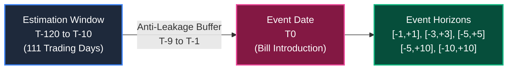

# TASK 1.13A — FINANCIAL EVENT-STUDY & ECONOMETRIC METHODOLOGY

**Project:** Seance — Legislative Bill Impact Prediction and Decision Intelligence Platform for the Indian Financial Market  
**Stage:** Final-Year Engineering & Research Capstone Documentation  
**Date:** October 30, 2026  
**Auditor:** Antigravity Autonomous Pair Programming Agent  
**Authoritative Baseline Manifest:** `docs/production_baseline.json`  

---

## 1. Econometric Foundation & Event-Study Framework

The quantitative financial analysis in Seance is grounded in classical event-study methodology as formalized by Fama et al. (1969), Brown and Warner (1985), and MacKinlay (1997). Event studies measure the magnitude and statistical significance of asset price deviations from expected equilibrium returns surrounding a specific economic catalyst.

In Seance, the catalyst is defined as the **official introduction date ($T_0$)** of a legislative bill in either the Lok Sabha or Rajya Sabha of the Indian Parliament.

---

## 2. Mathematical Formulation

### 2.1 Return Generation
Let $P_{i,t}$ denote the adjusted closing price of security $i$ on trading day $t$. The platform implements logarithmic daily returns:
$$R_{i,t} = \ln\left(\frac{P_{i,t}}{P_{i,t-1}}\right)$$
with arithmetic simple returns $(P_{i,t} - P_{i,t-1}) / P_{i,t-1}$ supported as a secondary convention.

### 2.2 Market Benchmark
The market return $R_{m,t}$ is measured against the **NIFTY 50 Index (`^NSEI`)**, the benchmark index representing the 50 largest, most liquid Indian equities listed on the National Stock Exchange.

### 2.3 Estimation Window & Parameters
To establish the normal expected return of a security in the absence of the legislative event, Ordinary Least Squares (OLS) regression is conducted over an estimation window:
$$\text{Estimation Window: } [\tau_1, \tau_2] = [T_{-120}, T_{-10}]$$
- **Duration:** 111 nominal trading days (approximately 5.5 calendar months).
- **Anti-Leakage Buffer:** A mandatory 9-trading-day buffer ($T_{-9}$ to $T_{-1}$) separates the estimation window from the event date $T_0$. This prevents immediate pre-event trading anomalies or media leaks from contaminating the baseline parameters $\hat{\alpha}_i$ and $\hat{\beta}_i$.

The regression equation is specified as:
$$R_{i,\tau} = \alpha_i + \beta_i R_{m,\tau} + \epsilon_{i,\tau}, \quad \tau \in [T_{-120}, T_{-10}]$$

Under classical Gauss-Markov assumptions ($E[\epsilon_{i,\tau}] = 0$, $\text{Var}(\epsilon_{i,\tau}) = \sigma^2_{\epsilon_i}$), the OLS estimators are:
$$\hat{\beta}_i = \frac{\sum_{\tau} (R_{m,\tau} - \bar{R}_m)(R_{i,\tau} - \bar{R}_i)}{\sum_{\tau} (R_{m,\tau} - \bar{R}_m)^2}$$
$$\hat{\alpha}_i = \bar{R}_i - \hat{\beta}_i \bar{R}_m$$
$$\hat{\sigma}^2_{\epsilon_i} = \frac{1}{N_{\text{est}} - 2} \sum_{\tau} (R_{i,\tau} - \hat{\alpha}_i - \hat{\beta}_i R_{m,\tau})^2$$
where $N_{\text{est}}$ is the number of valid observed trading days in the estimation window.

### 2.4 Abnormal Returns (AR)
During the event window $[t_1, t_2]$, the daily abnormal return ($AR_{i,t}$) represents the observed return minus the expected return conditional on the market performance:
$$AR_{i,t} = R_{i,t} - E[R_{i,t} \mid R_{m,t}] = R_{i,t} - (\hat{\alpha}_i + \hat{\beta}_i R_{m,t})$$

### 2.5 Cumulative Abnormal Returns (CAR)
To capture the total economic impact over the horizon, abnormal returns are aggregated:
$$CAR_i(t_1, t_2) = \sum_{t=t_1}^{t_2} AR_{i,t}$$

---

## 3. Supported Event Horizons & Implementation Verification

The platform implements five distinct, standardized event horizons (`services/event_study_service.py`):

| Horizon Slug | Trading Day Window | Total Trading Days ($N$) | Economic & Analytical Rationale |
| :--- | :---: | :---: | :--- |
| `[-1,+1]` | $T_{-1}$ to $T_{+1}$ | 3 days | **Immediate Announcement Window:** Captures immediate market reaction on introduction day with minimal confounding noise. |
| `[-3,+3]` | $T_{-3}$ to $T_{+3}$ | 7 days | **Short-Term Absorption Window:** Accommodates initial news digestion and institutional portfolio rebalancing. |
| `[-5,+5]` | $T_{-5}$ to $T_{+5}$ | 11 days | **Full Working Cycle Window:** Spans approximately two calendar weeks; captures parliamentary debate progression. |
| `[-5,+10]` | $T_{-5}$ to $T_{+10}$ | 16 days | **Asymmetric Legislative Window:** Allows extended post-tabling observation to capture committee referrals and standing committee reports. |
| `[-10,+10]` | $T_{-10}$ to $T_{+10}$ | 21 days | **Extended Horizon Window:** Evaluates persistent medium-term re-pricing, though subject to higher background macroeconomic volatility. |

*Note: Precomputed predictions in the baseline manifest (`data/predictions/`) reflect 940 Central bill-company pairs evaluated across all 5 horizons ($940 \times 5 = 4,700$ records).*

---

## 4. Statistical Significance & Hypothesis Testing

Following MacKinlay (1997), the variance of the cumulative abnormal return is:
$$\text{Var}(CAR_i(t_1, t_2)) = \sigma^2_{CAR_i} = N \cdot \hat{\sigma}^2_{\epsilon_i}$$
where $N = t_2 - t_1 + 1$ is the number of event window trading days, and $\hat{\sigma}^2_{\epsilon_i}$ is the residual variance from the estimation window.

The standard error is:
$$SE(CAR_i) = \sqrt{N \cdot \hat{\sigma}^2_{\epsilon_i}}$$

The test statistic $t$ follows a Student's $t$-distribution with $df = N_{\text{est}} - 2$ degrees of freedom:
$$t = \frac{CAR_i(t_1, t_2)}{SE(CAR_i)}$$

The two-tailed $p$-value is:
$$p = 2 \cdot \left[1 - F_t(|t|, df)\right]$$
where $F_t$ is the cumulative distribution function of the Student's $t$-distribution.

### Significance and Effect Size Tiers
- **Significance Levels:**
  - $p < 0.01$: Statistically Significant at 1% Level
  - $p < 0.05$: Statistically Significant at 5% Level
  - $p < 0.10$: Statistically Significant at 10% Level
  - $p \ge 0.10$: Not Statistically Significant
- **Economic Effect Size:**
  - Large: $|CAR| \ge 5.0\%$
  - Medium: $2.0\% \le |CAR| < 5.0\%$
  - Small: $|CAR| < 2.0\%$

---

## 5. Data Sufficiency & Validation Invariants

To prevent spurious statistical conclusions, the `EventStudyValidator` (`validation/event_study_validator.py`) enforces strict data quality invariants:

1. **Minimum Estimation Window Observations:** An estimation window must contain at least 60 valid trading days ($N_{\text{est}} \ge 60$) of joint security and benchmark returns. If fewer days are available (e.g., due to trading halts or recent IPO listing), the model is marked `INSUFFICIENT_DATA`.
2. **Event Window Completeness:** The security must have traded on at least 80% of the trading days within the event window. Missing prices are never fabricated or linearly interpolated.
3. **Finite Mathematical Operations:** Invariant checks guarantee that residual variance $\sigma^2_{\epsilon_i} > 0$, standard error is non-zero, and all calculated returns are finite (no `NaN`, `Inf`, or division-by-zero).
4. **Trading Day Calendar Synchronization:** All trading days are aligned strictly to the National Stock Exchange (NSE) official trading calendar. Public holidays, weekend closures, and exchange emergencies are explicitly excluded from trading-day offsets.

---

## 6. Distinguishing Descriptive Estimation from Causal Inference

A critical academic distinction maintained throughout Seance is the **separation of descriptive event-study estimates from causal effects**:

1. **Observational Nature of Financial Returns:** While a statistically significant $CAR$ indicates an abnormal price deviation coincident with a bill's introduction, it does not prove that the statutory text caused the return.
2. **Confounding Events:** In emerging markets, legislative sessions frequently coincide with other major economic catalysts:
   - Quarterly corporate earnings announcements.
   - Reserve Bank of India (RBI) Monetary Policy Committee (MPC) interest rate decisions.
   - Union Budget releases.
   - Global commodity price shocks (crude oil, foreign exchange fluctuations).
3. **Platform Disclaimers:** All API responses and dashboard visualizations report findings as:
   *"Observed abnormal return statistically consistent with legislative reaction (p = 0.034). Does not establish absolute economic causality."*

