# TASK 1.13A — SYSTEM LIMITATIONS, ETHICAL CONSIDERATIONS & FUTURE RESEARCH SCOPE

**Project:** Seance — Legislative Bill Impact Prediction and Decision Intelligence Platform for the Indian Financial Market  
**Stage:** Final-Year Engineering & Research Capstone Documentation  
**Date:** October 30, 2026  
**Auditor:** Antigravity Autonomous Pair Programming Agent  
**Authoritative Baseline Manifest:** `docs/production_baseline.json`  

---

## 1. Comprehensive System Limitations

An honest, academically defensible project must rigorously articulate what its models cannot do and identify the boundaries of its empirical findings. The Seance platform operates within the following specific constraints:

### 1.1 Dataset Size & Legislative Frequency
- **Small Historical Sample:** Unlike high-frequency algorithmic trading systems that process millions of order-book events, parliamentary legislative enactments are inherently sparse. The current production scope models 20 major Central bills enacted in 2024. Even over a multi-year parliamentary tenure, only 40 to 60 major economic bills are introduced annually.
- **Limited Statistical Power for Rare Events:** Because legislative events are infrequent, statistical power for minority classes (`POSITIVE` and `NEGATIVE` abnormal returns) is constrained, increasing the width of confidence intervals.

### 1.2 Severe Class Imbalance & Majority-Class Dominance
- **Economic Neutrality:** In real capital markets, the vast majority of legislative bills do not generate extreme, statistically significant abnormal returns for large-cap diversified conglomerates. In our empirical training dataset, **91.15% of records are labeled `NEUTRAL`** (abnormal returns within $\pm 2.0\%$).
- **Predictive Conservatism:** As evidenced in backtesting, tree-based models default to the majority class under extreme imbalance, achieving high raw accuracy (97.6%) while yielding low recall on minority classes.

### 1.3 Confounding Market Events & Attribution Ambiguity
- **Macroeconomic Noise:** Equity prices on Indian exchanges are continuously driven by foreign institutional investor (FII) flows, US Federal Reserve interest rate cycles, crude oil price fluctuations, and domestic monetary policy announcements by the Reserve Bank of India (RBI).
- **Separation of Association from Causality:** While Seance isolates abnormal returns using an OLS benchmark, an observed abnormal return during a parliamentary session cannot be definitively proven to have been caused solely by the statutory bill.

### 1.4 Media Coverage Bias & Public Attention Noise
- **Large-Cap Asymmetry:** Prominent conglomerates (e.g., Reliance Industries, Tata Group, Adani Group) receive massive financial press coverage, resulting in high Information Signal Scores ($S_{\text{info}}$). Mid-cap and small-cap firms receive negligible pre-event press, creating potential bias in anticipation detection.
- **Sentiment Ambiguity:** Public reporting often sensationalizes political debate rather than substantive economic provisions, introducing noise into media-derived signals.

### 1.5 Limits of Generalization Beyond India
- **Constitutional System Specificity:** Seance is tailored specifically to the Westminster-style parliamentary system of the Republic of India (Lok Sabha, Rajya Sabha, Presidential Assent, State Legislative Assemblies).
- **Inapplicability to Other Jurisdictions:** The statutory parsing logic, regulatory authorities (SEBI, RBI, MCA, CCI), and corporate exposure matrices cannot be applied to presidential systems (e.g., US Congress) or civil law jurisdictions (e.g., European Union) without extensive re-engineering.

---

## 2. The State Legislation Firewall & Constitutional Safeguards

A central architectural and econometric achievement of Seance is the **State Legislation Firewall** (`StatePredictionFirewall`):

```mermaid
flowchart TD
    subgraph Central_Track["Central Government Legislation (Modeled)"]
        A["Union Parliament Bills<br>(Lok Sabha / Rajya Sabha)"] --> B["National Jurisdictional Scope"]
        B --> C["NIFTY 50 Pan-India Corporates"]
        C --> D["Quantitative Stock Prediction Engine<br>4,700 Precomputed Predictions"]
    end

    subgraph State_Firewall["Constitutional & Econometric Firewall"]
        F["State Assembly Acts<br>(AP, KA, KL, TS)"] --> G["Sub-National Local Jurisdiction"]
        G --> H["State Corporate Exposure Network<br>86 Documented Exposures"]
        H -->|STRICT FIREWALL<br>ZERO STOCK PREDICTIONS| I["Qualitative Statutory Intelligence Dossier<br>Compliance, Operational & Labor Analysis"]
    end

    style D fill:#1e3a8a,stroke:#3b82f6,stroke-width:2px,color:#fff
    style I fill:#831843,stroke:#ec4899,stroke-width:2px,color:#fff
```

### Why State Legislation Has Zero Stock Predictions:
1. **Federal Jurisdiction (Seventh Schedule):** Under the Indian Constitution, State Legislative Assemblies legislate on State List and Concurrent List matters (e.g., local labor welfare, municipal taxation, state electricity duties, agriculture).
2. **Revenue Opacity:** Listed Indian corporations report consolidated financial statements under Ind-AS accounting rules; they rarely disaggregate revenue, operating margin, or capital expenditure by individual Indian state.
3. **Severe Spurious Correlation Hazard:** Attempting to regress national stock price changes against a sub-national amendment in a single state assembly (e.g., Andhra Pradesh Electricity Duty Amendment) introduces severe econometric specification errors and false causality.
4. **Authoritative Invariant:** State enactments (44 total across Andhra Pradesh, Karnataka, Kerala, and Telangana) provide rich qualitative compliance dossiers, statutory mechanics, and labor intelligence, but are strictly barred from generating equity price predictions (`predictions: []`).

---

## 3. Ethical Considerations & Misuse Prevention

Deploying artificial intelligence in financial markets carries substantial societal and economic responsibility:

### 3.1 Prevention of Market Manipulation & Speculation
- **No Automated Execution:** Seance does not connect to broker order-routing APIs and does not support automated trading or high-frequency order placement.
- **Probabilistic Transparency:** By outputting full probability distributions rather than binary trade triggers, the platform encourages probabilistic reasoning over speculative gambling.

### 3.2 Non-Financial Advice Enactment
- Every report, API response, and dashboard screen displays prominent, non-dismissible disclaimers clarifying that all outputs represent academic decision-support research and do not constitute SEBI-registered investment advice.

### 3.3 Data Provenance & Copyright Compliance
- **Public Domain Data:** Legislative texts, parliamentary debates, and gazette notifications are published under the Open Government Data (OGD) Platform India and PRS Legislative Research fair-use conventions.
- **Attribution & Integrity:** All statutory excerpts include immutable source URLs, document hashes, and official gazette numbers.

---

## 4. Realistic Future Scope & Research Roadmap

The platform architecture provides a solid foundation for future academic and engineering expansion:

1. **Expanded Historical Central Corpus (2014–2023):** Ingesting the complete legislative archive of the 16th and 17th Lok Sabhas to scale the modeled bill universe from 20 to 150+ bills, substantially improving minority class sample size.
2. **Continuous Real-Time Media Ingestion:** Connecting live, production-grade GDELT 2.0 streaming APIs and Press Information Bureau webhooks to replace static evidence caches.
3. **Dynamic MCA21 Corporate Knowledge Graph:** Ingesting Ministry of Corporate Affairs (MCA21) statutory filings and XBRL financial notes to dynamically extract supply chain dependencies and state-level manufacturing plant locations.
4. **Domain-Specific Transformer Fine-Tuning:** Conducting masked language modeling (MLM) and contrastive fine-tuning of `legal-roberta` on Indian parliamentary debates and supreme court jurisprudence.
5. **Sub-National Disaggregated Modeling:** Establishing regional econometric impact models once Indian corporate disclosure mandates require state-by-state GST revenue disaggregation.

