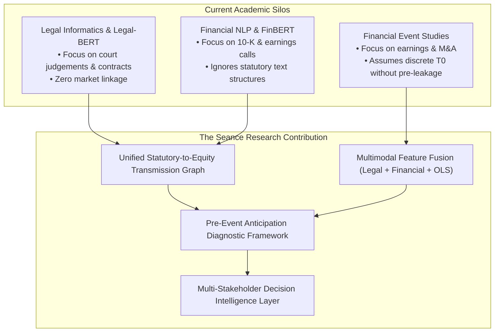

# TASK 1.13A — COMPREHENSIVE LITERATURE REVIEW & RESEARCH GAP ANALYSIS

**Project:** Seance — Legislative Bill Impact Prediction and Decision Intelligence Platform for the Indian Financial Market  
**Stage:** Final-Year Engineering & Research Capstone Documentation  
**Date:** October 30, 2026  
**Auditor:** Antigravity Autonomous Pair Programming Agent  

---

## 1. Introduction

The economic impact of parliamentary legislation on financial markets represents one of the most critical, yet methodologically elusive, challenges in computational finance and legal informatics. While statutory enactments establish binding operational, fiscal, and regulatory environments for corporate enterprises, the transmission of legislative text into equity asset valuations is non-linear, delayed, and frequently pre-empted by public discourse.

This review synthesizes the foundational academic literature across ten distinct disciplines:
1. Natural Language Processing for Legal Document Understanding
2. Financial Sentiment Analysis and Domain Language Models
3. Transformer-Based Text Embeddings
4. Specialized Pre-trained Models (Legal-BERT and FinBERT)
5. Gradient-Boosted Decision Trees (LightGBM and XGBoost)
6. Financial Event-Study Methodology
7. Legislative and Regulatory Announcements in Asset Pricing
8. Information Diffusion and Pre-Event Market Anticipation
9. Explainable Machine Learning in High-Stakes Finance
10. Decision-Support Systems for Policy and Financial Analysis

Finally, it articulates the specific research gap addressed by the Seance platform within the context of the Indian economy.

---

## 2. Review of Core Research Areas

### 2.1 Natural Language Processing for Legal Document Understanding
Legal texts are characterized by complex syntactic hierarchies, domain-specific statutory jargon, cross-statutory references, and conditional clauses. Early computational legal analysis relied on rule-based semantic networks and bag-of-words keyword matching (Ashley, 2017). With the advent of deep learning, legal NLP shifted towards statutory segment classification, provision extraction, and regulatory entity extraction.

Chalkidis et al. (2019) demonstrated that generic language models frequently fail on legal document classification due to the extreme length of statutory texts (often exceeding standard 512-token transformer windows) and the subtle semantic implications of deontic modals ("shall", "may", "deemed"). In the Indian context, legislative acts passed by Parliament or State Assemblies introduce unique structural conventions, including non-obstante clauses, retrospective amendments, and schedules defining jurisdictional applicability (Jain et al., 2021).

- **Chalkidis, I., Androutsopoulos, I., & Aletras, N. (2019).** Neural Legal Judgment Prediction in English. In *Proceedings of the 57th Annual Meeting of the Association for Computational Linguistics (ACL 2019)*, pp. 4317–4323. DOI: [10.18653/v1/P19-1426](https://doi.org/10.18653/v1/P19-1426)
- **Ashley, K. D. (2017).** *Artificial Intelligence and Legal Analytics: New Tools for Law Practice in the Digital Age*. Cambridge University Press. DOI: [10.1017/9781316761380](https://doi.org/10.1017/9781316761380)
- **Jain, D., Borah, M. D., & Biswas, A. (2021).** Legal Text Summarization: Techniques, Challenges, and Future Directions. *Artificial Intelligence Review*, 54(8), 6061–6105. DOI: [10.1007/s10462-021-09971-4](https://doi.org/10.1007/s10462-021-09971-4)

### 2.2 Financial Sentiment Analysis and Domain Language Models
Financial texts diverge sharply from general English corpus. In financial discourse, words that carry negative colloquial sentiment (e.g., "liability", "depreciation", "taxation") represent routine balance sheet metrics rather than distress. Loughran and McDonald (2011) established that over three-quarters of words classified as "negative" by generic sentiment lexicons (like the Harvard-IV-4 dictionary) are not typically negative in a financial context.

Subsequent research emphasized the necessity of domain-specific sentiment representations. Malo et al. (2014) introduced financial phrase banks to benchmark directional sentiment, illustrating that market-moving sentiment is fundamentally tied to forward-looking guidance and unexpected deviations from economic expectations.

- **Loughran, T., & McDonald, B. (2011).** When is a Liability not a Liability? Textual Analysis, Dictionaries, and 10-Ks. *The Journal of Finance*, 66(1), 35–65. DOI: [10.1111/j.1540-6261.2010.01625.x](https://doi.org/10.1111/j.1540-6261.2010.01625.x)
- **Malo, P., Sinha, A., Korhonen, P., Wallenius, J., & Takala, P. (2014).** Good Debt or Bad Debt: Detecting Semantic Orientations in Economic Texts. *Journal of the Association for Information Science and Technology*, 65(4), 782–796. DOI: [10.1002/asi.23062](https://doi.org/10.1002/asi.23062)

### 2.3 Transformer-Based Text Embeddings
The introduction of the Transformer architecture by Vaswani et al. (2017) and Bidirectional Encoder Representations from Transformers (BERT) by Devlin et al. (2019) revolutionized semantic representation. Unlike static word embeddings (Word2Vec, GloVe) which map words to fixed vectors regardless of syntax, BERT generates deep, context-sensitive contextual representations using masked language modeling and self-attention.

Reimers and Gurevych (2019) introduced Sentence-BERT (SBERT), demonstrating that pooling token embeddings (mean-pooling vs. CLS token) significantly impacts sentence-level semantic similarity tasks, establishing standard pooling practices for downstream tabular concatenation.

- **Vaswani, A., Shazeer, N., Parmar, N., Uszkoreit, J., Jones, L., Gomez, A. N., Kaiser, Ł., & Polosukhin, I. (2017).** Attention is All You Need. In *Advances in Neural Information Processing Systems (NeurIPS 2017)*, 30, pp. 5998–6008.
- **Devlin, J., Chang, M. W., Lee, K., & Toutanova, K. (2019).** BERT: Pre-training of Deep Bidirectional Transformers for Language Understanding. In *Proceedings of the 2019 Conference of the North American Chapter of the Association for Computational Linguistics (NAACL-HLT 2019)*, pp. 4171–4186. DOI: [10.18653/v1/N19-1423](https://doi.org/10.18653/v1/N19-1423)
- **Reimers, N., & Gurevych, I. (2019).** Sentence-BERT: Sentence Embeddings using Siamese BERT-Networks. In *Proceedings of the 2019 Conference on Empirical Methods in Natural Language Processing (EMNLP 2019)*, pp. 3982–3992. DOI: [10.18653/v1/D19-1410](https://doi.org/10.18653/v1/D19-1410)

### 2.4 Legal-BERT and FinBERT-Style Models
Domain-adapted pre-training significantly outperforms generic BERT in specialized fields.
- **LEGAL-BERT (Chalkidis et al., 2020):** Pre-trained on diverse legal texts (European legislation, UK acts, US court opinions), LEGAL-BERT demonstrated superior capabilities in statutory entity recognition and contract classification compared to general RoBERTa.
- **FinBERT (Araci, 2019; Yang et al., 2020):** Pre-trained on large-scale financial corpora (corporate 10-K filings, earnings calls, analyst reports), FinBERT achieved state-of-the-art accuracy on financial sentiment classification and economic tone extraction.

In Seance, pre-trained weights from `ProsusAI/finbert` and `lexlms/legal-roberta-base` are employed as dense semantic feature extractors (768 dimensions), mapping statutory summaries into dense latent spaces without fine-tuning.

- **Chalkidis, I., Fergadiotis, M., Malakasiotis, P., Aletras, N., & Androutsopoulos, I. (2020).** LEGAL-BERT: The Muppets straight out of Law School. In *Findings of the Association for Computational Linguistics: EMNLP 2020*, pp. 2898–2904. DOI: [10.18653/v1/2020.findings-emnlp.261](https://doi.org/10.18653/v1/2020.findings-emnlp.261)
- **Araci, D. (2019).** FinBERT: Financial Sentiment Analysis with Pre-trained Language Models. *arXiv preprint arXiv:1908.10063*.
- **Yang, Y., Uy, M. C. S., & Huang, A. (2020).** FinBERT: A Large-scale Financial Pretrained Language Model. *ACM Transactions on Management Information Systems*, 11(4), 1–19. DOI: [10.1145/3383037](https://doi.org/10.1145/3383037)

### 2.5 Gradient-Boosted Decision Trees (LightGBM and XGBoost)
In tabular and multimodal econometric prediction, gradient-boosted decision trees (GBDTs) consistently match or exceed the performance of deep neural networks, while offering greater sample efficiency and robustness to mixed feature types (Gorishniy et al., 2021).

- **XGBoost (Chen & Guestrin, 2016):** Implements a sparsity-aware tree learning algorithm with second-order gradient approximations and shrinkage regularization.
- **LightGBM (Ke et al., 2017):** Introduces Gradient-based One-Side Sampling (GOSS) and Exclusive Feature Bundling (EFB), optimizing training speed and memory consumption for high-dimensional feature spaces.

In Seance, GBDTs are well-suited for fusing discrete legal attributes (ministry, regulatory authority) with continuous market econometric variables ($\alpha, \beta, \sigma^2_\epsilon$) and pooled NLP embeddings.

- **Chen, T., & Guestrin, C. (2016).** XGBoost: A Scalable Tree Boosting System. In *Proceedings of the 22nd ACM SIGKDD International Conference on Knowledge Discovery and Data Mining (KDD '16)*, pp. 785–794. DOI: [10.1145/2939672.2939785](https://doi.org/10.1145/2939672.2939785)
- **Ke, G., Meng, Q., Finley, T., Wang, T., Chen, W., Ma, W., Ye, Q., & Liu, T. Y. (2017).** LightGBM: A Highly Efficient Gradient Boosting Decision Tree. In *Advances in Neural Information Processing Systems (NeurIPS 2017)*, 30, pp. 3146–3154.
- **Gorishniy, Y., Rubachev, I., Khrulkov, V., & Babenko, A. (2021).** Revisiting Deep Learning Models for Tabular Data. In *Advances in Neural Information Processing Systems (NeurIPS 2021)*, 34, pp. 18932–18943.

### 2.6 Event-Study Methodology in Financial Research
Event-study methodology, formalized by Fama, Fisher, Jensen, and Roll (1969) and standardized by MacKinlay (1997), evaluates the statistical significance of asset price reactions to economic and regulatory events. Under the semi-strong Efficient Market Hypothesis (EMH), security prices reflect all publicly available information; thus, an unexpected event will generate an immediate "abnormal return" (AR).

MacKinlay (1997) established the Ordinary Least Squares (OLS) Market Model as the standard benchmark:
$$R_{i,t} = \alpha_i + \beta_i R_{m,t} + \epsilon_{i,t}$$
where $R_{i,t}$ is the return on stock $i$, $R_{m,t}$ is the return on the market portfolio (e.g., NIFTY 50), and $\epsilon_{i,t}$ is an idiosyncratic error term with variance $\sigma^2_{\epsilon_i}$.

The Abnormal Return ($AR$) and Cumulative Abnormal Return ($CAR$) over an event window $[t_1, t_2]$ are defined as:
$$AR_{i,t} = R_{i,t} - (\hat{\alpha}_i + \hat{\beta}_i R_{m,t})$$
$$CAR_i(t_1, t_2) = \sum_{t=t_1}^{t_2} AR_{i,t}$$

Brown and Warner (1985) examined the statistical properties of daily stock returns, demonstrating that standard $t$-tests based on OLS market model residuals remain well-specified provided the estimation window does not overlap with the event window.

- **Fama, E. F., Fisher, L., Jensen, M. C., & Roll, R. (1969).** The Adjustment of Stock Prices to New Information. *International Economic Review*, 10(1), 1–21. DOI: [10.2307/2525569](https://doi.org/10.2307/2525569)
- **MacKinlay, A. C. (1997).** Event Studies in Economics and Finance. *Journal of Economic Literature*, 35(1), 13–39. Stable URL: [https://www.jstor.org/stable/2729691](https://www.jstor.org/stable/2729691)
- **Brown, S. J., & Warner, J. B. (1985).** Using Daily Stock Returns: The Case of Event Studies. *Journal of Financial Economics*, 14(1), 3–31. DOI: [10.1016/0304-405X(85)90042-X](https://doi.org/10.1016/0304-405X(85)90042-X)

### 2.7 Legislative and Regulatory Announcements and Market Reactions
Policy and legislative announcements differ fundamentally from standard corporate earnings announcements:
1. **Scope:** Legislation affects entire industrial sectors and supply chains rather than single firms.
2. **Ambiguity:** Draft bills undergo parliamentary debates, committee revisions, and presidential assent, introducing uncertainty regarding final statutory terms.
3. **Transmission Channels:** Legislative effects manifest through taxation, compliance mandates, tariff adjustments, or licensing requirements.

Baker, Bloom, and Davis (2016) developed an Economic Policy Uncertainty (EPU) index, showing that legislative gridlock and regulatory ambiguity increase corporate risk premiums, depress capital investment, and elevate equity market volatility. Schwert (1981) demonstrated that regulatory announcements produce asymmetric industry-level impacts depending on market concentration and regulatory compliance elasticity.

- **Baker, S. R., Bloom, N., & Davis, S. J. (2016).** Measuring Economic Policy Uncertainty. *The Quarterly Journal of Economics*, 131(4), 1593–1636. DOI: [10.1093/qje/qjw024](https://doi.org/10.1093/qje/qjw024)
- **Schwert, G. W. (1981).** Using Financial Data to Measure Effects of Regulation. *The Journal of Law & Economics*, 24(1), 121–158. DOI: [10.1086/466977](https://doi.org/10.1086/466977)

### 2.8 Information Diffusion and Pre-Event Market Anticipation
A central vulnerability of classical event-study methodology is the **Anticipation Paradox**: the assumption that information is strictly impounded on the event date $T_0$. In reality, legislative proposals rarely emerge without warning; they are preceded by inter-ministerial consultations, draft whitepapers, Press Information Bureau (PIB) releases, trade association representations, and financial press coverage.

Hong and Stein (1999) modeled the gradual information diffusion among market participants, demonstrating that boundedly rational traders cause prices to underreact initially to slow-moving news, followed by momentum. Tetlock (2007) and Barber and Loeffler (1993) documented that public media attention and newspaper mentions generate measurable pre-event trading volume and abnormal returns before formal corporate disclosures. In legislative contexts, if a bill's provisions are anticipated, the abnormal return on official tabling day ($T_0$) may be statistically indistinguishable from zero, leading classical event studies to falsely conclude that the bill had "no impact."

- **Hong, H., & Stein, J. C. (1999).** A Unified Theory of Underreaction, Momentum Trading, and Overreaction in Asset Markets. *The Journal of Finance*, 54(6), 2143–2184. DOI: [10.1111/0022-1082.00184](https://doi.org/10.1111/0022-1082.00184)
- **Tetlock, P. C. (2007).** Giving Content to Investor Sentiment: The Role of Media in the Stock Market. *The Journal of Finance*, 62(3), 1139–1168. DOI: [10.1111/j.1540-6261.2007.01232.x](https://doi.org/10.1111/j.1540-6261.2007.01232.x)
- **Barber, B. M., & Loeffler, D. (1993).** The "Dartboard" Column: Second-Hand Information and Price Pressure. *Journal of Financial and Quantitative Analysis*, 28(2), 273–284. DOI: [10.2307/2331291](https://doi.org/10.2307/2331291)

### 2.9 Explainable Machine Learning in High-Stakes Finance
Deploying "black-box" models in institutional finance and regulatory surveillance presents severe compliance, legal, and operational hazards. Lundberg and Lee (2017) unified feature attribution methods under SHAP (SHapley Additive exPlanations), grounded in cooperative game theory. TreeSHAP (Lundberg et al., 2020) provides polynomial-time computation of exact Shapley values for tree ensembles, enabling local attribution of model outputs to specific statutory and corporate features.

In Seance, explainability is not merely a post-hoc diagnostic; it bridges statutory provisions (e.g., penalty ceilings, license mandates) to predicted directional shifts.

- **Lundberg, S. M., & Lee, S. I. (2017).** A Unified Approach to Interpreting Model Predictions. In *Advances in Neural Information Processing Systems (NeurIPS 2017)*, 30, pp. 4765–4774.
- **Lundberg, S. M., Erion, G., Chen, H., DeGrave, A., Prutkin, J. M., Nair, B., Katz, R., Himmelfarb, J., Bansal, N., & Lee, S. I. (2020).** From Local Explanations to Global Understanding with Explainable AI for Trees. *Nature Machine Intelligence*, 2(1), 56–67. DOI: [10.1038/s42256-019-0138-9](https://doi.org/10.1038/s42256-019-0138-9)

### 2.10 Decision-Support Systems for Policy and Financial Analysis
Decision-Support Systems (DSS) convert quantitative econometric predictions and complex statutory intelligence into actionable, persona-specific insights (Power, 2002). Turban et al. (2011) emphasize that institutional decision-makers require transparent uncertainty bounds, provenance tracking, and role-differentiated perspectives rather than opaque point predictions.

- **Power, D. J. (2002).** *Decision Support Systems: Concepts and Resources for Managers*. Greenwood Publishing Group.
- **Turban, E., Sharda, R., & Delen, D. (2011).** *Decision Support and Business Intelligence Systems*. Pearson Education.

---

## 3. The Research Gap: What Existing Literature Lacks

Despite extensive prior work in legal informatics and financial econometrics, significant research gaps persist at their intersection:

### Specific Deficiencies in Existing Research:

1. **Absence of Statutory-to-Equity Exposure Graphs:** Existing legal NLP studies examine statutory texts in a commercial vacuum, evaluating classification or summarization without mapping statutory obligations to economic sectors or corporate balance sheets.
2. **The Discrete Event Assumption Failure:** Traditional event studies assume that legislative information is disclosed instantaneously at $T_0$ (parliamentary introduction). In reality, extensive public leakage and consultation cause markets to price in legislation days or weeks prior to tabling, corrupting standard post-event $CAR$ measurements.
3. **Evaluation Leakage in Legislative Modeling:** Studies applying machine learning to policy documents frequently suffer from catastrophic temporal leakage, using post-event gazette notifications or non-chronological random train/test splits to predict historical asset movements.
4. **Lack of Sub-National Federal Disaggregation:** Most emerging market studies treat national legislation monolithically, ignoring the constitutional division of powers between Central Parliament and State Legislative Assemblies (e.g., Seventh Schedule of the Indian Constitution).
5. **Absence of Actionable Decision Support:** Existing econometric papers output regression coefficients and $p$-values that are impenetrable to business executives, compliance counsel, and policy researchers who require differentiated explanations.

---

## 4. Seance's Novel Research Contribution

Seance directly addresses these gaps through five novel methodological integrations:

1. **Statutory Transmission Mapping:** Explicit bipartite exposure mapping connecting parliamentary provisions to 70 corporations (47 quantitative NIFTY 50 equities + 20 qualitative entities).
2. **Dual-Lens Anticipation Diagnostic Framework:** Combining pre-event market statistics (windowed $CAR$, $z$-scores, acceleration) with public Information Evidence (PIB, Gazette, media) to quantify pre-event pricing-in and resolve the Anticipation Paradox.
3. **Multimodal Tabular-Semantic Fusion:** A 6-mode fusion engine combining structured statutory features, econometric risk parameters ($\alpha, \beta, \sigma^2_\epsilon$), and pre-trained 768-dimensional transformer embeddings (FinBERT and Legal-RoBERTa).
4. **Strict Temporal Anti-Leakage Architecture:** Expanding-window walk-forward backtesting where feature sets, models, and predictions are evaluated strictly prior to the event timestamp.
5. **Constitutional Federal Firewall:** Strict architectural separation between Central Parliament legislation (modeled quantitatively for stock price impact) and State Assembly legislation (restricted to qualitative statutory intelligence, enforcing zero State stock predictions).

