# TASK 1.13A — RIGOROUS MODEL EVALUATION, BACKTESTING & LEAKAGE AUDIT

**Project:** Seance — Legislative Bill Impact Prediction and Decision Intelligence Platform for the Indian Financial Market  
**Stage:** Final-Year Engineering & Research Capstone Documentation  
**Date:** October 30, 2026  
**Auditor:** Antigravity Autonomous Pair Programming Agent  
**Authoritative Baseline Manifest:** `docs/production_baseline.json`  

---

## 1. Evaluation Integrity Mandate & Honesty Protocol

In quantitative finance and machine learning, empirical integrity requires distinguishing genuine out-of-sample predictive power from artifacts caused by look-ahead bias, label leakage, or class imbalance illusions.

In strict adherence to academic honesty guidelines:
1. **No accuracy score or performance metric has been manufactured.** All figures reported herein are extracted directly from verified, reproducible JSON training artifacts and backtest reports persisted in the repository.
2. **We explicitly document the severe class imbalance** that dominates legislative event prediction: over 91% to 97% of bill-company event horizons result in `NEUTRAL` price movements (abnormal return within $\pm 2.0\%$).
3. **High raw accuracy (94.9% to 97.6%) is shown to be an illusion of majority-class domination.** A naive model predicting `NEUTRAL` 100% of the time achieves 97.83% accuracy. The true model discrimination is reflected in Macro-F1 (0.33 to 0.50) and per-class recall.

---

## 2. Experimental Setup & Temporal Anti-Leakage Protocol

### 2.1 Chronological Split (No Random Splitting)
Standard $k$-fold cross-validation randomly shuffles observations, which causes catastrophic temporal leakage in financial time series (training on future market data to predict past events). Seance enforces strict chronological expanding-window splits via `TimeSeriesSplit` ($k=5$ folds):

```mermaid
flowchart TD
    subgraph Fold_0["Fold 0: 785 Train | 783 Val"]
        T0["Train: Feb 05, 2024"] --> V0["Val: Feb 05, 2024 – Jul 22, 2024"]
    end
    subgraph Fold_1["Fold 1: 1568 Train | 783 Val"]
        T1["Train: Feb 05, 2024 – Jul 22, 2024"] --> V1["Val: Jul 22, 2024 – Aug 01, 2024"]
    end
    subgraph Fold_2["Fold 2: 2351 Train | 783 Val"]
        T2["Train: Feb 05, 2024 – Aug 01, 2024"] --> V2["Val: Aug 01, 2024 – Aug 08, 2024"]
    end
    subgraph Fold_3["Fold 3: 3134 Train | 783 Val"]
        T3["Train: Feb 05, 2024 – Aug 08, 2024"] --> V3["Val: Aug 08, 2024 – Aug 09, 2024"]
    end
    subgraph Fold_4["Fold 4: 3917 Train | 783 Val"]
        T4["Train: Feb 05, 2024 – Aug 09, 2024"] --> V4["Val: Aug 09, 2024 – Aug 09, 2024"]
    end
```

### 2.2 Leakage Prevention Checklist
The `BacktestValidator` (`validation/backtest_validator.py`) enforces five mandatory anti-leakage invariants:
- **Prediction Cutoff Boundary:** No feature derived from timestamps $t \ge T_0$ is accessible during inference.
- **Market Parameter Separation:** Market model estimation ($\alpha, \beta, \sigma^2_\epsilon$) terminates at $T_{-10}$, strictly isolated from the event window.
- **Information Evidence Boundary:** All media and PIB records must possess verified publication timestamps $t_{\text{pub}} < T_0$. Post-event news articles are purged.
- **Pair Splitting Boundary:** All 5 horizons for a given bill-company pair reside in the same split fold to prevent cross-horizon target contamination.
- **Preprocessing Hygiene:** Imputers and scalers are fit exclusively on training folds and transformed onto validation folds.

---

## 3. Empirical Model Training Results Across Targets

The repository contains 12 verified model bundles across 4 target tasks and 3 model families trained on 4,700 samples. The empirical results from `models/**/training_report.json` are summarized below:

| Target Task | Model Architecture | Feature Count | Mean Training Accuracy | Mean Validation Accuracy | Mean Validation Macro-F1 | Primary Hyperparameters |
| :--- | :--- | :---: | :---: | :---: | :---: | :--- |
| **`direction`** | **LightGBM** | 17 | **0.9141** | **0.9492** | **0.5008** | `lr=0.05, max_depth=4, num_leaves=31, n_est=300` |
| `direction` | Random Forest | 17 | 0.9141 | 0.9441 | 0.4937 | `max_depth=10, min_samples_split=2, n_est=100` |
| `direction` | XGBoost | 17 | 0.9141 | 0.9492 | 0.4967 | `lr=0.05, max_depth=6, subsample=0.8, n_est=100` |
| **`market_moving`** | **LightGBM** | 17 | **0.9141** | **0.9484** | **0.5999** | `lr=0.05, max_depth=4, num_leaves=31, n_est=300` |
| `market_moving` | Random Forest | 17 | 0.9141 | 0.9446 | 0.5932 | `max_depth=10, min_samples_split=2, n_est=100` |
| `market_moving` | XGBoost | 17 | 0.9141 | 0.9441 | 0.5961 | `lr=0.05, max_depth=6, subsample=0.8, n_est=100` |
| **`impact_strength`**| **Random Forest** | 17 | **0.6022** | **0.4194** | **0.3954** | `max_depth=10, min_samples_split=2, n_est=100` |
| `impact_strength`| LightGBM | 17 | 0.6021 | 0.4115 | 0.3836 | `lr=0.05, max_depth=4, num_leaves=31, n_est=300` |
| `impact_strength`| XGBoost | 17 | 0.6012 | 0.3987 | 0.3695 | `lr=0.05, max_depth=6, subsample=0.8, n_est=100` |
| **`confidence`** | **Random Forest** | 17 | **0.7406** | **0.6345** | **0.4897** | `max_depth=10, min_samples_split=2, n_est=100` |
| `confidence` | XGBoost | 17 | 0.7399 | 0.6327 | 0.4888 | `lr=0.05, max_depth=6, subsample=0.8, n_est=100` |
| `confidence` | LightGBM | 17 | 0.7405 | 0.6179 | 0.4808 | `lr=0.05, max_depth=4, num_leaves=31, n_est=300` |

### Critical Analytical Insights:
1. **The Class Imbalance Dilemma in Direction:** In the training dataset (4,700 samples), the distribution is:
   - `NEGATIVE`: 189 samples (4.02%)
   - `NEUTRAL`: 4,284 samples (91.15%)
   - `POSITIVE`: 227 samples (4.83%)
   Consequently, while validation accuracy appears high ($\sim 94.9\%$), Macro-F1 remains bounded at $\sim 0.50$, indicating that the model struggles to discriminate rare extreme market moves from the dominant non-reactive regime.
2. **Impact Strength Complexity:** For 4-class impact strength (`LOW`, `MEDIUM`, `HIGH`, `VERY_HIGH`), validation accuracy drops to $\sim 41.9\%$, demonstrating that predicting the exact magnitude of return deviation is considerably harder than directional tendency.

---

## 4. Rigorous Historical Backtesting Audit

The repository contains historical walk-forward backtest runs. The authoritative run `backtest_direction_random_forest_20260904_142844` provides verified empirical evidence across 2,350 out-of-sample event predictions:

### 4.1 Summary Counts & Coverage
- **Total Backtested Observations:** 2,350
- **Unique Central Bills:** 10
- **Unique Tracked Companies:** 47
- **Event Horizons Tested:** 5 (`[-1,+1]`, `[-3,+3]`, `[-5,+5]`, `[-5,+10]`, `[-10,+10]`)
- **Period Covered:** August 1, 2024 to December 10, 2024 (131 calendar days)

### 4.2 Classification Performance vs. Naive Baseline
- **Observed Accuracy:** **0.9762** (97.62%)
- **Majority-Class Baseline Accuracy:** **0.9783** (97.83%)  
  *(Note: A zero-intelligence classifier predicting `NEUTRAL` on every sample achieves higher accuracy than the ML model!)*
- **Macro Precision:** 0.3261
- **Macro Recall:** 0.3326
- **Macro F1:** 0.3293
- **Balanced Accuracy:** 0.3326
- **Matthews Correlation Coefficient (MCC):** **-0.0052** (statistically indistinguishable from random noise on minority classes)
- **ROC-AUC (One-vs-Rest):** 0.5817
- **Brier Score:** 0.0584

#### Detailed Confusion Matrix:
$$\begin{pmatrix} \text{Actual \ Predicted} & \text{NEGATIVE} & \text{NEUTRAL} & \text{POSITIVE} \\ \text{NEGATIVE (24)} & 0 & 24 & 0 \\ \text{NEUTRAL (2299)} & 0 & 2294 & 5 \\ \text{POSITIVE (27)} & 0 & 27 & 0 \end{pmatrix}$$

#### Per-Class Diagnostics:
- **`NEGATIVE` (24 true cases):** Precision = 0.00, Recall = 0.00, F1 = 0.00
- **`NEUTRAL` (2,299 true cases):** Precision = 0.9783, Recall = 0.9978, F1 = 0.9879
- **`POSITIVE` (27 true cases):** Precision = 0.00, Recall = 0.00, F1 = 0.00 (5 false-positive predictions)

### 4.3 Financial Portfolio Simulation Performance
In accordance with Task 6.4.1 updates (`backtesting/strategy.py`):
- **Compounded Return Convention:** Portfolio wealth evolves as $W_t = W_{t-1} \cdot (1 + R_{\text{portfolio},t})$ with $W_0 = 1.0$.
- **Simultaneous Event Aggregation:** Multiple bill-company events on the same trading date are equal-weighted into a single daily return.
- **Transaction Cost Model:** 10 basis points (0.0010) per active position; neutral positions incur zero transaction cost.

| Metric | Seance ML Strategy | Buy-and-Hold Benchmark | NIFTY 50 Benchmark (`^NSEI`) |
| :--- | :---: | :---: | :---: |
| **Initial Capital** | 1.000000 | 1.000000 | 1.000000 |
| **Final Wealth** | **1.021081** | **0.984917** | **0.976454** |
| **Cumulative Return** | **+2.1081%** | **-1.5083%** | **-2.3546%** |
| **Excess Return vs. NIFTY 50**| **+4.4627%** | — | Baseline |
| **Hit Ratio (Win Rate)** | **80.0%** (4 of 5 trades) | N/A | N/A |
| **Hit Ratio 95% CI** | [0.3755, 0.9638] | N/A | N/A |
| **Sharpe Ratio** | **0.4082** | -1.6701 | -0.2160 |
| **Annualized Sharpe** | 6.4807* | N/A | N/A |
| **Maximum Drawdown** | **0.0000%** | -1.5083% | -4.9791% |
| **Total Event Observations** | 2,350 | 2,350 | 2,350 |
| **Actual Trades Executed** | **5** (0.21%) | Continuous | Continuous |
| **Neutral (Cash) Signals** | **2,345** (99.79%) | 0 | 0 |

*\* Critical Disclaimer: Annualized Sharpe uses $\sqrt{252}$ scaling. Because the strategy executed only 5 trades across 131 calendar days, annualizing this metric dramatically overstates statistical confidence due to small sample size.*

### 4.4 Verified Leakage & Validation Reports
From `leakage_report.json` and `financial_validation_report.json`:
- **`has_leakage`:** `false`
- **Training Cutoff Violations:** 0
- **Post-Event Feature Violations:** 0
- **Future-Dated Prediction Violations:** 0
- **Duplicate Prediction Violations:** 0
- **Financial Integrity Checks:** 10/10 Passed (No negative wealth, no NaN returns, no infinite returns, drawdowns strictly $\le 0$).

---

## 5. Synthesis & Academic Interpretation

1. **Why the Model Achieves +2.11% Return Despite Low Macro-F1:** The tree ensemble acted extremely conservatively. Faced with severe class imbalance, it issued `NEUTRAL` (hold cash) on 2,345 out of 2,350 opportunities. During the backtest window (August–December 2024), both the Buy-and-Hold benchmark (-1.51%) and NIFTY 50 (-2.35%) experienced downward corrections. By staying in cash 99.8% of the time and executing only 5 high-conviction trades (of which 4 were profitable), the model preserved capital and generated positive alpha (+4.46% vs NIFTY 50).
2. **The Anticipation Effect in Backtesting:** The near-absence of post-event directional movement in 97.8% of cases strongly corroborates the Anticipation Paradox: market prices had already adjusted to the legislation prior to $T_0$, leaving little exploitable alpha in the post-introduction window.
3. **Reproducible Evaluation Protocol for Future Work:** To evaluate future model iterations without bias, researchers must:
   - Ingest at least 50+ additional historical Central bills spanning 2018–2023.
   - Enforce the 5-fold `TimeSeriesSplit` without random shuffling.
   - Report Balanced Accuracy and PR-AUC alongside raw accuracy.
   - Never evaluate state legislation against national stock benchmarks.

