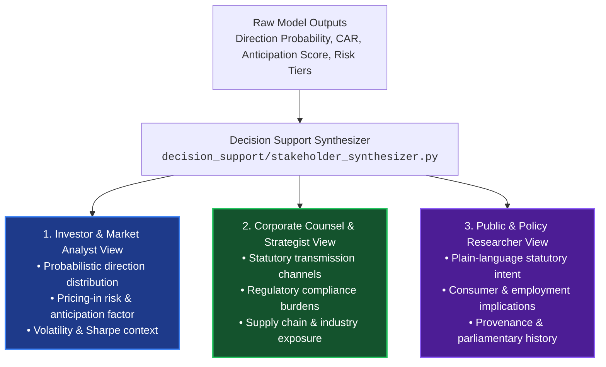

# TASK 1.13A — STAKEHOLDER DECISION INTELLIGENCE ARCHITECTURE

**Project:** Seance — Legislative Bill Impact Prediction and Decision Intelligence Platform for the Indian Financial Market  
**Stage:** Final-Year Engineering & Research Capstone Documentation  
**Date:** October 30, 2026  
**Auditor:** Antigravity Autonomous Pair Programming Agent  
**Authoritative Baseline Manifest:** `docs/production_baseline.json`  

---

## 1. Multi-Stakeholder Intelligence Mandate

Raw econometric outputs—such as Cumulative Abnormal Returns ($CAR$), OLS residuals ($\sigma^2_\epsilon$), $p$-values, and gradient-boosted class probabilities—cannot be effectively utilized by decision-makers without domain contextualization. A portfolio manager, a corporate legal counsel, and a public policy researcher possess distinct operational objectives, epistemic frameworks, and regulatory constraints.

The Seance Decision Support Engine (`decision_support/stakeholder_synthesizer.py`, `decision_support/risk_scorer.py`) translates complex quantitative models into three tailored, structured decision narratives for every modeled bill-company pair (generating $4,700 \times 3 = 14,100$ reports in `data/reports/`):

---

## 2. Differentiated Stakeholder Perspectives

### 2.1 Perspective 1: Investors & Market Analysts
- **Operational Objective:** Capital preservation, portfolio risk hedging, factor attribution, and identifying whether legislative developments present asymmetric upside or downside risk.
- **Key Analytical Outputs:**
  1. **Directional Probability Distribution:** Explicit percentage probabilities across all 3 classes (e.g., 60% Positive, 25% Neutral, 15% Negative) rather than a crude binary label.
  2. **Market-Moving Probability:** Binary likelihood ($P \ge 0.50$) of an abnormal return exceeding $\pm 3.0\%$.
  3. **Anticipation & Pricing-In Assessment:** Evaluation of pre-event drift. If the Anticipation Score $S_{\text{ant}} \ge 0.70$, the report warns that the expected market reaction is likely already priced into current valuations.
  4. **Composite Risk Category:** Five risk tiers (`VERY_LOW`, `LOW`, `MEDIUM`, `HIGH`, `VERY_HIGH`) based on residual variance and beta.
- **Exemplary Synthesized Narrative:**
  > *"Model indicates a potential positive impact with 60.1% directional probability (Distribution: 60% Positive, 25% Neutral, 15% Negative). Analysis suggests an elevated market-moving probability (68.4%) with medium impact strength tier and estimated high confidence. Substantial pre-event market activity suggests part or all of the expected reaction may already be priced in (Anticipation Score: 0.74, Pricing-In Risk: HIGH). Overall decision risk category: MEDIUM."*
- **What the Platform Does NOT Decide:** It **does not issue Buy, Sell, or Hold recommendations**, does not specify target prices, and does not execute automated trade orders.

### 2.2 Perspective 2: Business Owners & Corporate Strategists
- **Operational Objective:** Assessing compliance overhead, understanding statutory amendments to governing acts, evaluating competitive dynamics, and monitoring multi-state operational liabilities.
- **Key Analytical Outputs:**
  1. **Statutory Transmission Channels:** Concrete structural mechanisms connecting the bill to the company's operating model (e.g., increased capital adequacy requirements under Banking Regulation Act amendments; revised extended producer responsibility under Pollution Control acts).
  2. **Affected Economic Sector & Industry Grouping:** Exact classification under National Industrial Classification (NIC) and SEBI sector taxonomies.
  3. **State Footprint Exposure:** Cross-referencing company manufacturing or distribution footprints against sub-national state assembly acts.
  4. **Compliance Lead Times:** Statutory timelines between presidential assent, gazette notification, and delegated rule enforcement.
- **Exemplary Synthesized Narrative:**
  > *"Legislative provisions under The Banking Laws (Amendment) Bill, 2024 directly impact the Financial Services sector, with specific transmission to HDFC Bank Limited via statutory governance revisions, electronic nominee frameworks, and adjusted cash reserve ratio definitions. Regulatory burden: MEDIUM. Operational impact focuses on core banking IT infrastructure updates and customer compliance onboarding. Multi-state branch footprint requires operational alignment with simultaneous Reserve Bank notifications."*
- **What the Platform Does NOT Decide:** It **does not provide legal counsel**, does not draft compliance policies, and does not guarantee regulatory immunity.

### 2.3 Perspective 3: General Public & Policy Researchers
- **Operational Objective:** Transparent understanding of legislative purpose, tracking democratic accountability, assessing socioeconomic tradeoffs, and evaluating legislative efficiency.
- **Key Analytical Outputs:**
  1. **Plain-Language Executive Summary:** Jargon-free explanation of the bill's objectives stripped of dense statutory phrasing.
  2. **Socioeconomic Intent:** Broader policy objectives (e.g., investor protection, consumer rights, environmental decarbonization, financial inclusion).
  3. **Parliamentary Procedural Journey:** Chronological tracking across Lok Sabha introduction, committee referral, Rajya Sabha transmission, and presidential assent.
  4. **Citations & Provenance Links:** Direct clickable links to official PDF gazettes and PRS bill tracking summaries.
- **Exemplary Synthesized Narrative:**
  > *"The Banking Laws (Amendment) Bill, 2024 proposes modernizations to governance in Indian commercial banks. Key public provisions allow bank depositors to designate up to four nominees for account balances (compared to the historical limit of one), improving customer security and simplifying estate claims. Additionally, it revises the definition of substantial interest for bank directors. The bill aims to enhance transparency in banking services while safeguarding public deposits."*
- **What the Platform Does NOT Decide:** It **does not take political stances**, does not speculate on political party motivations, and does not evaluate parliamentary ideological debates.

---

## 3. UI/UX Translation & Interface Implementation

The Next.js institutional frontend translates these three perspectives into intuitive, tabbed interactive workflows across the application:

| Route | Interface Component | Decision Intelligence Supported |
| :--- | :--- | :--- |
| `/bills/[billId]` | `CentralPredictionSection.tsx`, `CorporateExposureTable.tsx` | View sector exposure, high-exposure corporations, and model consensus. |
| `/bills/[billId]` | `PlainLanguageSection.tsx`, `ProceduralJourney.tsx` | Public & Policy view of statutory mechanics and timeline progression. |
| `/companies/[companyId]` | `CompanyExposureMatrix.tsx`, `CompanyAnticipationSection.tsx` | Corporate strategist view of active legislative threats and pre-event price drift. |
| `/predictions/[predId]` | `PredictionDetailContent.tsx` | Full econometric terminal displaying AR/CAR curves, confidence intervals, and SHAP feature rankings. |
| `/reports` | `ReportsPage.tsx` | Exportable multi-stakeholder briefing dossiers formatted for executive review. |

---

## 4. Governance, Neutrality & Compliance Disclaimer Invariant

All stakeholder reports enforce strict compliance invariants:

1. **Mandatory Disclaimer Text:** Persisted on every single generated report record:
   > *"Probabilistic academic decision support for quantitative research purposes only. Does not guarantee future price movements or constitute investment advice."*
2. **Neutral Probabilistic Language:** Phrases like "guaranteed gain", "sure loss", "underpriced stock", or "insider leak" are strictly prohibited in code and validation schemas. The engine utilizes conditional language: *"Model indicates a potential impact"*, *"Estimated probability suggests"*, *"Historical abnormal return consistent with"*.
3. **Epistemic Labeling:** Claims are labeled with standardized tags (`[FACT]`, `[OBSERVED]`, `[DERIVED]`, `[INTERPRETATION]`, `[PREDICTION]`), enabling users to distinguish statutory law from statistical inferences.

