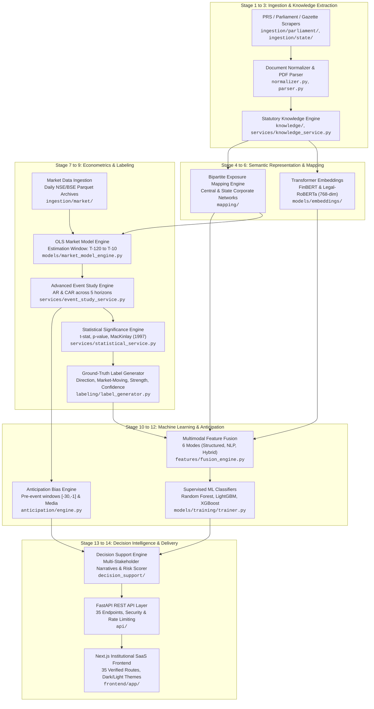

# TASK 1.13A — SYSTEM ARCHITECTURE, RESEARCH OBJECTIVES & METHODOLOGY

**Project Title:** Seance: An NLP and Machine Learning-Based Legislative Bill Impact Prediction and Decision Intelligence Platform for the Indian Financial Market  
**Stage:** Final-Year Engineering & Research Capstone Documentation  
**Date:** October 30, 2026  
**Auditor:** Antigravity Autonomous Pair Programming Agent  
**Authoritative Baseline Manifest:** `docs/production_baseline.json` (SHA-256: `50ae76039bccf2e4a671cf2ae915889e490b17404db6eb2e49e7965ecd6400b7`)

---

## 1. Problem Statement & Research Objectives

### 1.1 Background & Economic Context
In modern constitutional democracies, legislative enactments by parliament and state assemblies represent fundamental macroeconomic and microeconomic interventions. In India, a rapidly expanding $3.75+ trillion economy with over 5,000 publicly listed corporations across the National Stock Exchange (NSE) and Bombay Stock Exchange (BSE), legislative acts systematically reshape industry operating margins, tax structures, compliance obligations, licensing barriers, and foreign direct investment (FDI) ceilings.

However, the transmission of legislative text into equity asset valuations is fraught with friction, delay, and extreme information asymmetry. Market participants—ranging from institutional asset managers and risk officers to corporate counsel and retail investors—face substantial hurdles in interpreting, synthesizing, and pricing statutory proposals.

### 1.2 Core Challenges & The Information Gap
1. **Linguistic & Structural Complexity:** Legislative bills in India (drafted in formal statutory language) feature dense legal prose, cross-statutory amendments (e.g., amending the RBI Act, Banking Regulation Act, and Companies Act simultaneously), and delayed delegated legislation via central rules and notifications.
2. **The Corporate Exposure Mapping Dilemma:** Statutory text rarely names specific corporations. A bill regulating "offshore mineral rights" or "digital payment system aggregators" impacts specific listed entities based on revenue exposure, supply chain dependency, or licensing status. Manual mapping by legal and financial analysts is labor-intensive, error-prone, and slow.
3. **The Information Gap Between Law and Capital Markets:** Econometric and legal research remain in isolated silos. Legal scholars analyze statutory constitutionality, while quantitative financial analysts model time-series price movements using technical indicators or quarterly earnings. Neither possesses an integrated computational platform connecting statutory semantics to abnormal equity returns.
4. **The Anticipation Paradox:** Financial markets do not wait for the official tabling of a bill in Lok Sabha or Rajya Sabha. Through pre-legislative consultations, inter-ministerial whitepapers, trade body representations, and press leaks, market participants anticipate statutory provisions days or weeks prior to introduction ($T_0$). Traditional event studies assuming discrete $T_0$ information shocks often observe zero abnormal returns post-event, erroneously concluding that the legislation was economically irrelevant when, in reality, it was fully priced in.
5. **Stakeholder Explanation Asymmetry:** An institutional fund manager requires probabilistic directional distributions and Sharpe ratio impacts; a chief executive or corporate counsel requires compliance risk and supply chain transmission channels; a citizen or policy researcher requires plain-English explanations of societal intent. Existing financial portals output raw tickers or stock recommendations without contextualized legal provenance.

### 1.3 Research Objectives & Research Questions
The primary objective of Seance is to develop, evaluate, and deploy an end-to-end, multi-stage decision intelligence platform that parses legislative text, maps corporate exposures, quantifies pre-event anticipation, and estimates market impacts using econometric event studies and supervised machine learning.

#### Research Questions (RQs):
- **RQ1:** Can natural language processing and legal semantic representation reliably extract statutory mechanisms, ministries, and economic sectors from parliamentary and state assembly bills?
- **RQ2:** To what extent can pre-trained transformer embeddings (FinBERT, Legal-RoBERTa) and structured legal features predict the direction (`POSITIVE`, `NEGATIVE`, `NEUTRAL`) and market-moving probability of asset returns around legislative events?
- **RQ3:** How can pre-event market trading statistics and public information diffusion signals be combined to quantify the Anticipation Paradox without false accusations of illicit conduct?
- **RQ4:** How can a temporal walk-forward backtesting framework evaluate predictive models without look-ahead bias or label leakage in small-sample legislative regimes?
- **RQ5:** How can quantitative econometric predictions and qualitative legal provisions be synthesized into stakeholder-differentiated decision support?

### 1.4 Scope, Assumptions & Honesty Boundaries
- **Geographic & Jurisdictional Scope:** Focused strictly on the Republic of India. Central legislation comprises 20 modeled production bills (Lok Sabha / Rajya Sabha) and 44 enacted State bills across 4 southern assemblies (Andhra Pradesh, Karnataka, Kerala, Telangana).
- **Corporate Scope:** 70 tracked entities: 47 large-cap NSE/BSE listed equities (NIFTY 50 universe) with verified daily trading histories, 20 qualitative intelligence entities, and 3 benchmark entities.
- **Strict Honesty & Non-Causality Boundary:** The platform **does not claim to predict every market movement**, nor does it determine absolute economic causality from observational market data. Predicted outputs reflect probabilistic statistical associations conditioned on historical event-study residuals.
- **Non-Advisory Mandate:** The platform outputs probabilistic academic decision support and **does not provide investment advice**, stock tips, or portfolio management recommendations.

---

## 2. End-to-End System Architecture Pipeline

The Seance platform operates as a 14-stage end-to-end intelligence and prediction pipeline:

### Detailed Pipeline Stages:
1. **Legislative Data Collection:** Central bills scraped from PRS Legislative Research and parliamentary archives; state enactments collected from official state gazettes.
2. **Document Parsing & Normalization:** PDF layout parsing, OCR cleanup, metadata normalization, and deduplication into `UnifiedBillRecord` schemas.
3. **Legislative Entity & Provision Extraction:** Rule-based and pattern-driven extraction of statutory sections, penalty clauses, regulatory authorities, and ministries.
4. **Legal Semantic Representation:** Dense contextual vector representations extracted using pre-trained `ProsusAI/finbert` and `lexlms/legal-roberta-base`.
5. **Bill Classification & Structured Labeling:** Classification into policy domains, economic sectors, and primary legislative categories.
6. **Sector & Company Exposure Mapping:** Deterministic bipartite mapping connecting statutory provisions to 70 tracked corporate entities based on business descriptions and regulatory oversight.
7. **Financial Market Data Preparation:** Daily trading records for 47 quantitative equities and the NIFTY 50 index (`^NSEI`), normalized to trading-day calendars.
8. **Event-Study Calculations:** Daily abnormal returns ($AR$) and cumulative abnormal returns ($CAR$) calculated using historical market models.
9. **NLP & ML Feature Construction:** Extraction of 17 structured attributes (legal, company, and econometric parameters) fused with 768-dimensional embeddings.
10. **Prediction Generation:** Multi-target prediction using LightGBM, XGBoost, and Random Forest trained via expanding walk-forward cross-validation.
11. **Anticipation Diagnostics:** Pre-event trading analysis across 5 sub-windows (`[-30,-21]` to `[-2,-1]`) and cumulative window `[-30,-1]` combined with public information evidence.
12. **Evidence & Provenance Management:** Explicit provenance tracking tying every claim to source documents, gazette notifications, or market price series with epistemic tagging (`[FACT]`, `[OBSERVED]`, `[DERIVED]`, `[INTERPRETATION]`, `[PREDICTION]`).
13. **Stakeholder-Specific Interpretation:** Synthesis of qualitative narratives tailored for Investors, Business Executives, and Policy Researchers.
14. **Frontend Presentation & Monitoring:** Interactive institutional dashboards, live discovery feeds, and watchlist alert dispatches.

---

## 3. Natural Language Processing Methodology

### 3.1 Text Extraction, Normalization & Chunking
Legislative documents are ingested from raw PDF format (`data/bills/pdfs/`) using PyPDF2 / pdfplumber and normalized:
- Elimination of non-standard unicode characters, running headers, footers, and page numbers.
- Extraction of statutory structural elements: Preamble, Statement of Objects and Reasons (SOR), Financial Memoranda, and Enacting Sections.
- Chunking strategy: Standard legislative sections are tokenized using Hugging Face AutoTokenizers. Because transformer context windows are constrained to 512 tokens, statutory summaries and Statements of Objects and Reasons (which capture legislative intent) are utilized for dense representation.

### 3.2 Pre-trained Transformer Models
Seance employs two distinct pre-trained transformer backbones:
1. **ProsusAI/finbert:** A 12-layer, 768-hidden dimension BERT architecture trained on financial corporate disclosures and market text. It provides financial semantic sensitivity.
2. **lexlms/legal-roberta-base:** A 12-layer, 768-hidden dimension RoBERTa architecture pre-trained on legal corpora (court decisions, legislation, contracts). It provides statutory semantic sensitivity.

### 3.3 Embedding Pooling & Matrix Generation
- **Pooling Strategy:** Non-padded token representations from the final hidden layer are mean-pooled:
  $$\mathbf{e}_{\text{bill}} = \frac{1}{\sum_{j=1}^{L} m_j} \sum_{j=1}^{L} m_j \mathbf{h}_j$$
  where $\mathbf{h}_j \in \mathbb{R}^{768}$ is the hidden state of token $j$ and $m_j \in \{0, 1\}$ is the attention mask.
- **Storage:** Precomputed embeddings are persisted as 64-bit float arrays in `.npy` and compressed `.parquet` files under `data/embeddings/finbert/` and `data/embeddings/legal-roberta/`.
- **Honesty Rule:** **Zero fine-tuning was performed.** The models function strictly as frozen feature extractors.

---

## 4. Machine Learning Methodology

### 4.1 Target Label Definitions
Four distinct ground-truth target variables are evaluated for each bill-company pair:
1. **`direction` (Multiclass):**
   - `POSITIVE`: $CAR > +0.02$ (+2.0%) with $p < 0.10$
   - `NEGATIVE`: $CAR < -0.02$ (-2.0%) with $p < 0.10$
   - `NEUTRAL`: $-0.02 \le CAR \le +0.02$ or $p \ge 0.10$
2. **`market_moving` (Binary):**
   - `True`: $|CAR| \ge 0.03$ (+3.0%) and $p < 0.05$
   - `False`: Otherwise
3. **`impact_strength` (Multiclass):**
   - `LOW`: $|CAR| < 0.02$
   - `MEDIUM`: $0.02 \le |CAR| < 0.05$
   - `HIGH`: $0.05 \le |CAR| < 0.10$
   - `VERY_HIGH`: $|CAR| \ge 0.10$
4. **`confidence` (Multiclass):**
   - `HIGH`: $p < 0.01$ and $R^2 \ge 0.15$
   - `MEDIUM`: $0.01 \le p < 0.05$
   - `LOW`: $p \ge 0.05$ or $R^2 < 0.05$

### 4.2 Feature Construction (17 Structured Features)
The baseline structured feature vector $\mathbf{x}_{\text{struct}} \in \mathbb{R}^{17}$ comprises:
- **Statutory Attributes (9):** `bill_type`, `ministry`, `department`, `policy_domain`, `economic_domain`, `primary_sector`, `secondary_sectors`, `regulatory_authority`, `geographic_scope`.
- **Corporate Attributes (4):** `company_sector`, `industry`, `sub_industry`, `hq_state`.
- **Market Econometric Attributes (4):** $\alpha$ (excess return), $\beta$ (systematic risk), $R^2$ (market model explanatory power), $\sigma^2_\epsilon$ (residual idiosyncratic variance).

### 4.3 Feature Fusion Modes
The Feature Fusion Engine (`features/fusion_engine.py`) supports 6 multimodal configurations:
1. `structured`: 17 tabular features.
2. `finbert`: 768-dimensional FinBERT text embedding.
3. `legal`: 768-dimensional Legal-RoBERTa text embedding.
4. `structured-finbert`: Concatenation of 17 structured features + 768 FinBERT dimensions (785 total features).
5. `structured-legal`: Concatenation of 17 structured features + 768 Legal-RoBERTa dimensions (785 total features).
6. `hybrid`: Full multimodal concatenation (17 structured + 768 FinBERT + 768 Legal-RoBERTa = 1,553 features).

### 4.4 Model Training & Cross-Validation Strategy
- **Algorithms:** Random Forest, LightGBM, and XGBoost.
- **Validation Design:** Expanding-window chronological cross-validation (`TimeSeriesSplit`, $k=5$ folds). Records are sorted strictly by bill introduction date, ensuring that training folds always precede validation folds.
- **Class Imbalance Handling:** Under extreme class imbalance (91.15% Neutral in `direction`), balanced class weighting (`class_weight="balanced"`) and tree scale-pos-weight configurations are applied. Hyperparameter tuning utilizes grid and randomized search across tree depth (4–10), learning rate (0.01–0.10), and leaf constraints (20–31).
- **Explainability:** Feature attribution is computed via TreeSHAP and gain-based feature importances, identifying the relative contribution of statutory domains vs. market betas.

