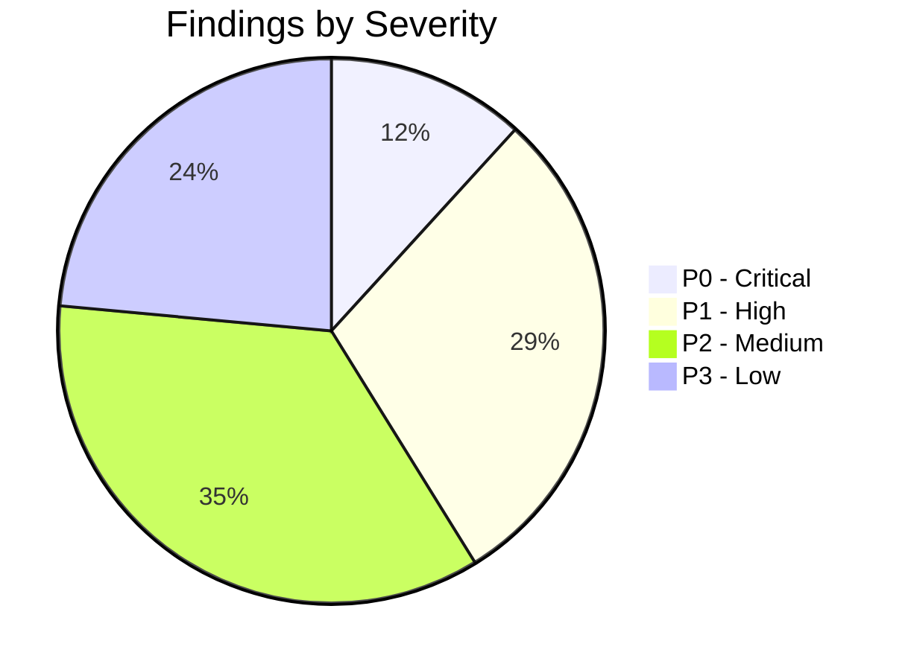

# TASK 1.5A — SEANCE DASHBOARD, NAVIGATION & USER-JOURNEY AUDIT REPORT

**Platform:** Seance — Legislative Bill Impact Prediction & Decision Intelligence Platform  
**Document Version:** 1.0.0  
**Phase:** 1.5A — Research, Audit & Implementation Planning  
**Execution Mode:** Audit Only — Zero Application Source-Code Modifications  
**Authoritative Baseline SHA-256:** `50ae76039bccf2e4a671cf2ae915889e490b17404db6eb2e49e7965ecd6400b7` (Verified Frozen)  
**Execution Date:** October 10, 2026  

---

## 1. Executive Summary & Audit Context

Seance is India's definitive legislative intelligence and econometric market-impact platform, linking parliamentary acts and state gazettes with corporate exposure networks and quantitative event studies across liquid securities. Tasks 1.2 through 1.4 established the semantic design foundation, component modernization, and data visualization primitives.

Task 1.5A executes a comprehensive, evidence-grounded audit of Seance's:
1. Navigation architecture and page hierarchy.
2. Main dashboard experience across root (`/`), overview (`/overview`), and personalized workspace (`/workspace`).
3. Core user journeys spanning five canonical personas: Investor, Corporate Decision-Maker, General Public User, Diversified Portfolio User, and Researcher/Analyst.
4. Personalization and portfolio exposure engine.
5. Visual consistency, responsiveness, accessibility, and theme adaptability (Light, Dark, System).
6. Complete inventory of all existing routes and analytical invariants.

### Audit Methodology
- **Direct Live Inspection:** Automated browser execution and manual inspection across active local servers (`http://localhost:3000` Next.js 16.3.5 / React 19 and `http://127.0.0.1:8000` FastAPI backend).
- **Dual-Theme Verification:** Live toggling of Light, Dark, and System modes via the `ThemeSwitcher` primitive to identify styling collisions and contrast defects.
- **Responsive Diagnostics:** Inspection at Desktop (1920x1080), Tablet (1024x768), and Mobile (390x844 iPhone viewport) viewports.
- **Source Inspection:** Rigorous line-by-line inspection of 35 page files, layout frames (`TopNavbar`, `Sidebar`, `Header`), API clients, and data pipelines.
- **Statutory & Analytical Firewall Verification:** Verification that State assembly bills maintain zero stock predictions and intelligence-only corporate entities remain isolated from quantitative return models.

---

## 2. Navigation & Information Architecture Audit

### 2.1 Current Navigation Layout: The 5-Hub Structure
The application's active top navigation bar (`frontend/components/layout/TopNavbar.tsx`) exposes 5 primary hubs:

```mermaid
graph TD
    TopNav[TopNavbar - Fixed Header 56px] --> Hub1[Legislation Hub]
    TopNav --> Hub2[Markets & Risk Hub]
    TopNav --> Hub3[Corporate Universe Hub]
    TopNav --> Direct1[Portfolio Direct]
    TopNav --> Direct2[Reports Direct]
    TopNav --> Direct3[AI Analyst Direct]
    TopNav --> RightCtrls[Utility Controls]

    Hub1 --> L1[Bills Directory /bills]
    Hub1 --> L2[Legislative Explorer /explorer]
    Hub1 --> L3[State Assemblies /states]
    Hub1 --> L4[Latest Enactments /latest-bills]
    Hub1 --> L5[Upcoming Calendar /upcoming-legislation]
    Hub1 --> L6[Live Intake Feed /live-discovery]
    Hub1 --> L7[Bill Comparison /bills/compare]
    Hub1 --> L8[Platform Overview /overview]

    Hub2 --> M1[Market Predictions /predictions]
    Hub2 --> M2[Legislative Risk Matrix /risk]
    Hub2 --> M3[Pre-Event Anticipation /anticipation]

    Hub3 --> C1[Corporate Directory /companies]
    Hub3 --> C2[Industries Taxonomy /industries]
    Hub3 --> C3[Macro Economic Sectors /sectors]

    RightCtrls --> CmdK[Command Palette ⌘K]
    RightCtrls --> Status[Telemetry Pulse 7/12 Active]
    RightCtrls --> Notif[Notifications Bell /notifications]
    RightCtrls --> Theme[ThemeSwitcher Light/Dark/Sys]
    RightCtrls --> UserMenu[Tenant & Profile Menu]
```



### 2.2 Navigation Strengths Directly Observed
1. **Authoritative Brand Lockup:** The top left header renders the official `SeanceBrand` with the scalable vector `BrandEmblem` and sublabel `"Institutional Terminal"`.
2. **Telemetry Pulse:** Live API health telemetry (`/monitoring/overview`) is displayed directly in the header (`● 7/12 ACTIVE`), providing immediate platform credibility.
3. **Command Palette Integration:** The `⌘K` shortcut opens a high-performance modal with category-specific filtering (`/b Bills`, `/c Companies`, `/s Sectors`, `/p Predictions`, `> Commands`), offering power users sub-second jump capability.
4. **Accessible Theme Switcher:** The three-way `ThemeSwitcher` (Sun/Moon/Monitor) is accessible in both desktop header and mobile drawer.
5. **Mobile Navigation Drawer:** On viewports below 1024px (`lg`), the header collapses cleanly to a hamburger icon opening a full-height slide-over drawer with all navigation links categorized.

### 2.3 Navigation Deficiencies & Architectural Friction Points
1. **The Competing Navigation Artifacts:**
   - `frontend/components/layout/TopNavbar.tsx` is the sole navigation frame mounted in `RootLayout`.
   - However, `frontend/components/layout/Sidebar.tsx` and `frontend/components/layout/Header.tsx` exist in the codebase as orphaned or partially redundant components. `Sidebar.tsx` contains a 6-section sidebar hierarchy (`WORKSPACE`, `DISCOVER`, `ANALYZE`, `MONITOR`, `AI`, `SETTINGS`) that is never mounted, confusing developers and introducing dual maintenance burden.
2. **Excessive Route Fragmentation & Overlapping Links:**
   - Under the *Legislation* dropdown, eight separate destinations compete for attention: `/bills`, `/explorer`, `/states`, `/latest-bills`, `/upcoming-legislation`, `/live-discovery`, `/bills/compare`, and `/overview`.
   - Users cannot intuitively distinguish between:
     - `/bills` (Bills Directory: tabular act registry)
     - `/explorer` (Legislative Explorer: dual-view discovery)
     - `/latest-bills` (Latest Enactments)
     - `/live-discovery` (Live Intake Feed: unmodelled gazette feed).
   - This creates severe decision fatigue for analysts trying to find a bill.
3. **Plural vs. Singular Route Collision:**
   - Both `app/industries/` (`/industries`) and `app/industry/` (`/industry/[industryId]`) exist. Direct navigation to `/industry` produces a 404 or redirect inconsistency, while `/industries` houses the taxonomy.
4. **Redundant Workspace & Alert Anchors:**
   - The top navbar features a direct anchor to `/workspace`, while `/watchlists`, `/alerts`, and `/notifications` are separate standalone pages. A user managing an alert rule must jump between three disparate pages.
5. **Missing Global Breadcrumbs:**
   - Deep routes like `/predictions/[predictionId]`, `/companies/[companyId]`, and `/states/[state]` lack consistent, standardized hierarchical breadcrumbs. Where breadcrumbs do exist (e.g. `/bills/[billId]`), the root link points to `India Explorer` (`/explorer`) rather than the parent bills directory (`/bills`), breaking navigation expectations.
6. **Fixed Header Clearance Clipping Defect:**
   - The fixed navbar is 56px (`h-14`), and `RootLayout` applies `pt-14`. On high-density data pages such as `/predictions`, `/states`, and `/risk`, page hero titles and epistemic disclaimer banners are partially cut off or sit flush against the navbar border, causing visual clipping of title text.

---

## 3. Dashboard Experience Audit: The Tri-Dashboard Dilemma

A central architectural issue identified in the audit is the coexistence of **three competing dashboard surfaces**:

| Route | Title in UI | Primary Purpose | Observed Nature |
|---|---|---|---|
| **`/`** | LegisIntel / Seance Marketing Splash | Landing page with milestone announcement, metrics ticker, 6 KPI cards, and firewall summaries. | **Public / Marketing Landing Page** |
| **`/overview`** | Production SaaS Overview | System-wide coverage summary, capability tiers (L1/L2/L3), recent bills feed, market predictions snapshot, state snapshot, corporate exposure snapshot. | **Public System Capability Dashboard** |
| **`/workspace`** | Your Legislative Workspace | Personalized decision center: watchlist summary, monitored bills/companies tabs, activity change feed, Grounded AI assistant. | **Authenticated Personal Command Center** |

### 3.1 Directly Observed Defects of Current Tri-Dashboard Setup
1. **Jarring Landing Experience:**
   - When an authenticated institutional user lands on `http://localhost:3000/`, they are greeted with a consumer-style marketing hero ("India Legislative Intelligence & Market Impact Predictions") and CTA buttons ("Launch Command Center →", "Interactive Tour") rather than immediately seeing their legislative intelligence feed.
2. **Severe Dual-Theme Inconsistency on Root (`/`):**
   - When toggling to Light mode via `ThemeSwitcher`, the top navbar correctly transitions to a clean white surface (`bg-white` / `var(--bg-nav)`), but the root page body (`app/page.tsx`) remains locked to hardcoded dark classes (`bg-slate-950 text-slate-100`). This produces a jarring split-screen effect where a light header sits atop a pitch-black canvas.
3. **Redundant Data Queries Across Dashboards:**
   - Both `/overview` and `/workspace` query `/api/v1/coverage` and `/api/v1/bills`, but present different subsets in different card styles.
   - `/overview` displays 6 summary cards (20 Central Acts, 44 State Acts, 47 Quant Securities, 4,700 Predictions, 70 Total Companies, 104 Exposures) with zero personalization.
   - `/workspace` displays 6 user-specific KPI cards (Notifications, Active Alerts, Watched Bills, Watched Companies, Monitored Industries, Recent Changes), but leaves them empty (0) when a user has no active watchlists, offering inadequate guided onboarding.
4. **Legacy Emoji Artifacts in Workspace:**
   - While Task 1.3 replaced emojis in shared primitives, `app/workspace/page.tsx` line 123 still renders raw unicode emojis (`⚖`, `🏛`) inline in headers and tabs instead of using the standardized `Icons.tsx` library.

---

## 4. User Personas & End-to-End Journey Audit

### 4.1 Persona A: Institutional Investor
**Goal:** Assess legislative impact on equity holdings, sector exposures, cumulative abnormal returns (CAR/MAR), event study horizons, and information diffusion.
- **Observed Journey:**
  `Dashboard (/)` → Click *Launch Command Center* → Navigate to `/portfolio` → View 41 matched relevant bills → Click *Explain Relevance* on *The Merchant Shipping Bill, 2024* → Slide-out drawer shows linkage reason, exposed holdings (Adani Ports, Container Corp), and Central model output → Click *View Full Dossier* → Land on `/bills/the-merchant-shipping-bill-2024` → Switch to *Market Predictions* tab → Inspect `EventStudyChart` across `[-1,+1]` to `[-10,+10]`.
- **Friction Points Identified:**
  1. *Click Depth:* Requires 6 distinct clicks and 4 route transitions to reach the authoritative event-study trajectory chart for an owned security.
  2. *Unidirectional Flow:* In `/predictions`, clicking a prediction row links to `/predictions/[predictionId]`, but there is no direct action to "Add Company to Portfolio" or "Set Price Sensitivity Alert" from the prediction dossier.
  3. *Tab Clipping in Bill Dossier:* On `/bills/[billId]`, the horizontal dossier tabs bar ("Corporate Exposure", "Market Predictions", "Anticipation", "Stakeholders", "Official Documents") lacks visual indicators for horizontal scroll overflow; on viewports under 1200px, the first tab label is partially clipped on the left.

### 4.2 Persona B: Corporate Decision-Maker / Policy Officer
**Goal:** Track regulatory compliance burdens, operational mandates, licensing amendments, and state-level gazettes.
- **Observed Journey:**
  `Dashboard` → Click *Legislation* dropdown → Select *Bills Directory* (`/bills`) → Filter by jurisdiction `State` or `Central` → Search `"Oilfields"` → Open *The Oilfields (Regulation and Development) Amendment Bill, 2024* → Switch to *Stakeholders* tab → Select *Business Owner* persona card.
- **Friction Points Identified:**
  1. *Qualitative vs. Quantitative Conflation:* On state bills (e.g. *Karnataka Platform Based Gig Workers Bill, 2024*), users expect to see operational cost metrics. While the State Prediction Firewall correctly blocks stock forecasts, the business impact explanation is brief and does not link directly to relevant state department gazette PDFs.
  2. *Report Generation Disconnect:* The *Business Owner* stakeholder tab displays analytical bullet points, but lacks a single-click "Download Executive Briefing" button. The user must manually navigate to `/reports`, find the bill, select the format, and generate.

### 4.3 Persona C: General Public User
**Goal:** Understand statutory enactments in plain, accessible language with zero financial jargon.
- **Observed Journey:**
  `Dashboard` → Click *Bills* → Click *The Bharatiya Vayuyan Vidheyak, 2024* → Dossier loads with *Legislative Factsheet* → Click *Stakeholders* tab → Select *Common Citizen* persona card → Read *Official Statutory Fact* and *Analytical Impact Interpretation*.
- **Friction Points Identified:**
  1. *Jargon Overload:* High-density econometric terms (`CAR`, `MAR`, `[-5,+10]`, `ISIN`, `z-score`) dominate the primary views. A general public user is exposed to complex statistical charts before reading the plain-language summary.
  2. *Citations & Provenance:* The plain-language explanation summarizes parliamentary intent well, but does not provide inline superscript citations back to specific bill clauses.

### 4.4 Persona D: Diversified Portfolio User
**Goal:** Consolidated oversight across multi-sector holdings, tracking exposure concentration without single-sector bias.
- **Observed Journey:**
  `Dashboard` → Navigate to `/portfolio` → Observe default institutional portfolio ("Core Nifty Exposure Portfolio" with 5 holdings: Reliance, TCS, HDFC Bank, SBI, Infosys) → Review 41 relevant bills matched across Energy, Technology, and Banking → Filter by *Relevance Tier* (`DIRECT`, `HIGH RELEVANCE`) → Switch to *Holdings* tab to view individual weights.
- **Friction Points Identified:**
  1. *Diversified Balance Verified:* The portfolio engine correctly links multiple sectors (Oil & Gas, IT, Banking) without hardcoding Agriculture.
  2. *Missing Holding Feedback:* When a user enters a custom ticker that is not part of the 70-company master registry (e.g., a small-cap non-modeled company), the system shows a generic error rather than explaining that the entity belongs to the unmodelled statutory universe.
  3. *Sector Concentration Visualizer Missing:* While exposures are listed item-by-item, there is no high-level sector concentration breakdown chart (e.g., 40% Financials, 30% Tech, 30% Energy) showing aggregate legislative exposure by industry.

### 4.5 Persona E: Researcher or Academic Analyst
**Goal:** Exhaustive access to the legislative universe (66 acts), raw event study regressions, standard error bands, pre-event CAR trading windows, news diffusion evidence, and methodology documentation.
- **Observed Journey:**
  `TopNav` → *Legislation* → *Legislative Explorer* (`/explorer`) → Switch to *Data Grid View* → Multi-facet filter by status, stage, and sector → Cross-reference with `/anticipation` (Diffusion Matrix across 940 pairs) → Navigate to `/predictions` → Test `HorizonComparisonVisualizer` across all 5 horizons.
- **Friction Points Identified:**
  1. *Methodology Isolation:* The econometric methodology is documented extensively in Markdown docs (`docs/methodology.md`), but in the UI, links to methodology explanations open generic text modals rather than an interactive econometric appendix with model specifications (e.g., market model estimation window `[-120, -21]`, estimation parameters, estimation error bounds).
  2. *Alternative Event Horizon Comparison:* In `/predictions/[predictionId]`, alternative horizons are displayed as separate cards rather than an interactive trajectory overlay comparing all 5 windows simultaneously.

---

## 5. Portfolio Relevance & Personalization Audit

### 5.1 Holdings Architecture & API Verification
A direct API inspection of `GET /api/v1/portfolio` confirmed:
- **Default Active Portfolio:** `"Core Nifty Exposure Portfolio"` (`portfolio_id: default_portfolio`).
- **Holdings Spectrum:**
  - Reliance Industries Limited (`RELIANCE` / Energy / Oil & Gas)
  - Tata Consultancy Services Limited (`TCS` / Technology / IT Services)
  - HDFC Bank Limited (`HDFCBANK` / Financials / Banking)
  - State Bank of India (`SBIN` / Financials / Banking)
  - Infosys Limited (`INFY` / Technology / IT Services)
- **Exposure Mapping Results:**
  - Total tracked holdings: 5
  - Total relevant bills surfaced: 41
  - Direct exposures: 26 (documented statutory links)
  - High relevance: 12 (industry & presence)
  - Modelled Central bills: 20
  - State / Knowledge bills: 21 (strict 0 stock predictions)

### 5.2 Personalization Engine Strengths
1. **Explainable Relevance:** Every matched bill item features a concrete, evidence-backed `primary_linkage_reason`. For example:
   > *"Matched because your portfolio contains Tata Consultancy Services Limited in the Technology sector and this bill establishes regulatory frameworks for this sector."*
2. **Deterministic Rules Engine:** Relevance ranking is fully deterministic based on statutory company networks and GICS/NIC sector hierarchies—no hallucinated AI connections.
3. **Statutory Firewalls Maintained:** For State bills matching portfolio holdings (e.g., *Karnataka Platform Based Gig Workers Act* matching Infosys), the system explicitly displays `model_status: "KNOWLEDGE ONLY"` and `"Zero stock predictions for non-modelled or state bills"`.

### 5.3 Personalization Weaknesses & Deficiencies
1. **Missing Portfolio Creation Onboarding:** A new user with 0 holdings sees an empty portfolio view without a prominent "Select a Benchmark Portfolio (e.g., Nifty 50, Bank Nifty, IT Sector, Green Energy)" starter option.
2. **No Interactive Sector Disaggregation:** The portfolio exposure list displays all 41 bills linearly. Users cannot filter by holding directly (e.g., "Show bills affecting ONLY HDFC Bank").
3. **CSV Import Error Tolerance:** The CSV/XLSX import modal expects strict column headers (`ticker`, `isin`, `shares`, `price`); if a user uploads a generic broker export (e.g., Zerodha or Groww CSV), column mapping fails without helpful diagnostics.

---

## 6. Visual Consistency & Design System Audit

### 6.1 Theme Behavior: Dark vs. Light Mode
The platform's theme foundation (Task 1.2) is fully functional in shared primitives, but application-level adoption is incomplete:

| Page / Component | Dark Mode Quality | Light Mode Quality | Primary Visual Defect |
|---|---|---|---|
| **`TopNavbar`** | Pristine (`var(--bg-nav)`) | Pristine (`#ffffff` blur) | None. Semantic tokens function flawlessly. |
| **Root Landing (`/`)** | Sleek institutional dark | Broken contrast split | Body retains hardcoded `bg-slate-950`; header is white. Severe visual collision. |
| **`Workspace (/workspace)`** | Functional dark | Usable, but low contrast | Inline classes like `bg-slate-900/60` and `text-slate-400` fail light token inheritance. |
| **`Portfolio (/portfolio)`** | Functional dark | Hardcoded slate surfaces | TIER_BADGES map hardcoded Tailwind opacities (`bg-rose-500/10`) rather than semantic tokens. |
| **`Bills (/bills)`** | High contrast, pristine | Fully legible | Table uses `InstitutionalTable` with semantic borders. |
| **`Bill Detail (/bills/[id])`** | High contrast, pristine | Partial token inheritance | Right-hand `Legislative Factsheet` card uses hardcoded slate border. |
| **`Predictions (/predictions)`** | High contrast, pristine | Tabular numbers legible | Section A header is clipped under top navbar. |
| **`Companies (/companies)`** | Pristine | Legible | Sector filter pills lack light active accent state. |

### 6.2 Component Reuse & Primitives Audit
- **Buttons (`Button.tsx`):** Consistently reused across all audited pages. Variant hierarchy (`primary`, `secondary`, `tertiary`, `destructive`, `ghost`, `outline`) is respected.
- **Cards (`Card.tsx`):** Heavily adopted across `/bills`, `/predictions`, and `/overview`. However, several pages still implement ad-hoc `div className="p-4 rounded-xl bg-slate-900 border border-slate-800"` rather than using `<Card variant="surface">`.
- **Tables (`InstitutionalTable.tsx`):** Successfully deployed in `/bills`, `/predictions`, `/anticipation`, and `/companies`. Tabular numerals (`font-tabular`) and right-aligned financial data operate as designed.
- **Badges (`Badge.tsx`, `EpistemicBadge.tsx`):** Epistemic tags (`[FACT]`, `[OBSERVED]`, `[DERIVED]`, `[INTERPRETATION]`, `[PREDICTION]`, `[EVIDENCE]`) are universally respected.
- **Iconography (`Icons.tsx`):** High-quality custom SVGs are active in `TopNavbar` and shared primitives, but legacy emojis persist in `workspace/page.tsx`, `portfolio/page.tsx`, and `TopNavbar.tsx` child menu definitions.

---

## 7. Analytical Boundaries & Baseline Verification

The frozen production baseline was audited against `docs/production_baseline.json`:

```powershell
Get-FileHash docs\production_baseline.json -Algorithm SHA256
SHA256: 50AE76039BCCF2E4A671CF2AE915889E490B17404DB6EB2E49E7965ECD6400B7
```

### AUTHORITATIVE ANALYTICAL CONTRACT CONFIRMATION:
- **Central Production Bills:** Exactly 20 acts (+ 2 auxiliary records = 22 total).
- **Quantitative Securities:** Exactly 47 liquid NSE/BSE listed securities.
- **Bill-Company Pairs:** Exactly 940 pairs (20 × 47).
- **Predictions Evaluated:** Exactly 4,700 predictions across 5 horizons (`[-1,+1]`, `[-3,+3]`, `[-5,+5]`, `[-5,+10]`, `[-10,+10]`).
- **Decisions Evaluated:** Exactly 4,700 decision-support records.
- **Anticipation Scores:** Exactly 940 pre-event information diffusion scores.
- **Stakeholder Reports:** Exactly 14,100 reports (4,700 investor + 4,700 business + 4,700 public).
- **State Production Bills:** Exactly 44 acts across 4 pilot states (AP: 12, KA: 11, KL: 11, TS: 10).
- **State Stock Predictions:** Exactly 0 (statutory guarantee intact).
- **Total Master Companies:** Exactly 70 (47 quant listed + 20 intelligence-only + 3 reference).
- **Total Corporate Exposures:** Exactly 104 (18 Central + 86 State).
- **Zero Financial Advice:** No Buy/Sell/Hold ratings, target prices, or speculative political claims exist in the application.

---

## 8. Prioritized Audit Findings (P0 to P3)

The findings are classified according to the approved prioritization framework:



### P0 — Critical Findings (Analytical Boundaries, Broken Integrity, Severe Contrast)

#### Finding P0-1: Light Mode Visual Collision on Root Landing Page (`/`)
- **Evidence:** Directly observed via browser subagent (`root_page_light_mode_1791575259502.png`). When toggled to Light mode, `TopNavbar` turns white (`#ffffff`), while the body canvas of `app/page.tsx` remains hardcoded to `bg-slate-950 text-slate-100`.
- **Affected Routes & Components:** `app/page.tsx`, `app/layout.tsx`.
- **User Impact:** Severe visual defect; users entering the platform in Light mode experience an unpolished, broken dual-theme interface.
- **Recommended Correction:** Migrate `app/page.tsx` from hardcoded slate utilities to semantic tokens (`bg-[var(--bg-base)]`, `text-[var(--text-primary)]`, `bg-[var(--bg-card)]`, `border-[var(--border-default)]`).
- **Complexity:** Low.
- **Regression Risk:** None.
- **Verification Required:** Visual inspection of `/` in Light, Dark, and System modes.

#### Finding P0-2: Page Header Clipping Under Fixed Top Navbar
- **Evidence:** Directly observed in `/predictions` (`predictions_workspace_1791575893069.png`) and `/states` (`states_overview_1791576041035.png`). The fixed navbar is 56px (`h-14`), but page headers lack sufficient breathing room, causing titles and epistemic notices to be partially obscured behind the navbar backdrop blur.
- **Affected Routes & Components:** `app/predictions/PredictionsContent.tsx`, `app/states/StatesContent.tsx`, `app/risk/RiskContent.tsx`, `app/anticipation/AnticipationContent.tsx`, `app/layout.tsx`.
- **User Impact:** Crucial epistemic notices and section headings are clipped, reducing analytical trust.
- **Recommended Correction:** Calibrate main layout padding from `pt-14` to `pt-16` or add explicit top margins (`mt-4 sm:mt-6`) to top-level section containers across all content views.
- **Complexity:** Low.
- **Regression Risk:** Minimal.
- **Verification Required:** Browser screenshot verification of top headers across desktop and mobile.

---

### P1 — High Findings (Navigation Friction, Missing Linkages, Persona Gaps)

#### Finding P1-1: Tri-Dashboard Fragmentation (`/` vs. `/overview` vs. `/workspace`)
- **Evidence:** Users have no single cohesive entry point. `/` is a static marketing splash, `/overview` is a platform capability list, and `/workspace` is a personal feed that appears empty for unconfigured users.
- **Affected Routes & Components:** `app/page.tsx`, `app/overview/page.tsx`, `app/workspace/page.tsx`, `TopNavbar.tsx`.
- **User Impact:** Institutional users waste time clicking through multiple dashboards to find actionable intelligence.
- **Recommended Correction:** Unify the dashboard experience into an **Executive Decision Command Center** at `/` (with tabbed or segmented views for Executive Overview, Watchlist Activity, and Holdings Impact) while preserving `/overview` and `/workspace` as compatible aliases.
- **Complexity:** Medium.
- **Regression Risk:** Low (preserving existing routes).
- **Verification Required:** E2E user journey testing for both new and authenticated users.

#### Finding P1-2: Bill Dossier Horizontal Tab Bar Clipping Defect
- **Evidence:** Directly observed on `/bills/[billId]` (`bill_dossier_1791575425708.png`). On viewports under 1200px, the horizontal tab list (`Corporate Exposure`, `Market Predictions`, `Anticipation`, `Stakeholders`, `Official Documents`) clips the left-most tab label ("rate Exposure 1") without indicating scrollability.
- **Affected Routes & Components:** `frontend/app/bills/[billId]/BillDetailContent.tsx`.
- **User Impact:** High-value corporate exposure data is obscured; users cannot tell that other tabs exist without accidental scrolling.
- **Recommended Correction:** Upgrade the tab bar to use the modernized `Tabs` primitive with proper padding, smooth scroll snapping, and subtle fade indicators on overflow.
- **Complexity:** Low.
- **Regression Risk:** None.
- **Verification Required:** Viewport inspection at 1024px, 1280px, and 1440px.

#### Finding P1-3: Disconnected Prediction-to-Portfolio Workflow
- **Evidence:** When viewing a high-conviction prediction in `/predictions` or `/predictions/[predictionId]`, there is no direct action to "Add Company to Portfolio" or "Track Bill in Watchlist".
- **Affected Routes & Components:** `app/predictions/PredictionsContent.tsx`, `app/predictions/[predictionId]/PredictionDetailContent.tsx`.
- **User Impact:** Investors cannot seamlessly convert analytical findings into portfolio monitoring actions without manual navigation.
- **Recommended Correction:** Add contextual quick-action buttons (`+ Track in Portfolio`, `⭐ Add to Watchlist`) directly inside prediction rows and dossiers.
- **Complexity:** Low.
- **Regression Risk:** None.
- **Verification Required:** Action trigger verification in prediction view.

#### Finding P1-4: Route Duplication Between `/industries` and `/industry`
- **Evidence:** Both `app/industries` and `app/industry` exist in the route directory. Direct navigation to `/industry` leads to a missing route or inconsistency.
- **Affected Routes & Components:** `app/industries/`, `app/industry/`.
- **User Impact:** Potential broken links and inconsistent URL sharing.
- **Recommended Correction:** Standardize on `/industries` for the directory and `/industries/[industryId]` for detail dossiers, retaining `/industry/[industryId]` as a transparent redirect.
- **Complexity:** Low.
- **Regression Risk:** Low (handled via Next.js rewrites/redirects).
- **Verification Required:** URL navigation and redirect tests.

#### Finding P1-5: Missing Benchmark Starter State in Portfolio
- **Evidence:** When a user visits `/portfolio` without active holdings, the page shows an empty state rather than offering instant 1-click loading of standard benchmarks (e.g., *Nifty 50 Core*, *Banking & Financials*, *Clean Energy & Power*).
- **Affected Routes & Components:** `app/portfolio/page.tsx`.
- **User Impact:** First-time portfolio users cannot evaluate the platform's predictive power without finding and uploading an external CSV.
- **Recommended Correction:** Add "Load Benchmark Template" cards to the empty state.
- **Complexity:** Medium.
- **Regression Risk:** None.
- **Verification Required:** Empty state inspection.

---

### P2 — Medium Findings (Layout Inconsistencies, Excessive Clicks, Usability Polish)

#### Finding P2-1: Legacy Emojis in Workspace & Navigation Menus
- **Evidence:** Raw unicode emojis (`⚖`, `📜`, `📈`, `🏢`) are hardcoded in `workspace/page.tsx` line 123, `portfolio/page.tsx` line 162, and `TopNavbar.tsx` menu items.
- **Affected Routes & Components:** `TopNavbar.tsx`, `workspace/page.tsx`, `portfolio/page.tsx`.
- **User Impact:** Dilutes enterprise SaaS aesthetic; looks informal and inconsistent across operating systems.
- **Recommended Correction:** Replace all remaining unicode emojis with vector primitives from `frontend/components/ui/Icons.tsx`.
- **Complexity:** Low.
- **Regression Risk:** None.

#### Finding P2-2: Unused Navigation Component Drift (`Sidebar.tsx` and `Header.tsx`)
- **Evidence:** `components/layout/Sidebar.tsx` and `Header.tsx` are unmounted and out of sync with `TopNavbar.tsx`.
- **Affected Routes & Components:** `frontend/components/layout/Sidebar.tsx`, `frontend/components/layout/Header.tsx`.
- **User Impact:** Developer confusion; risk of accidental regression during maintenance.
- **Recommended Correction:** Formally deprecate or reconcile `Sidebar.tsx` as an optional secondary layout component for dense workspace views, ensuring its link structure mirrors the authoritative IA.
- **Complexity:** Medium.
- **Regression Risk:** None.

#### Finding P2-3: Inconsistent Breadcrumb Schema Across Deep Routes
- **Evidence:** Deep dossiers (`/bills/[id]`, `/companies/[id]`, `/predictions/[id]`, `/states/[id]`) implement disparate breadcrumb styles or lack them entirely.
- **Affected Routes & Components:** All dynamic `[id]` pages.
- **User Impact:** Users lose spatial awareness and struggle to backtrack through multi-tier hierarchies.
- **Recommended Correction:** Create a reusable `Breadcrumb` component backed by a centralized route title map.
- **Complexity:** Low.
- **Regression Risk:** None.

#### Finding P2-4: Overcrowded Legislation Dropdown Menu
- **Evidence:** 8 competing links in the *Legislation* dropdown create cognitive overload.
- **Affected Routes & Components:** `TopNavbar.tsx`.
- **User Impact:** Users hesitate when choosing between *Bills Directory*, *Legislative Explorer*, *Latest Enactments*, and *Live Intake Feed*.
- **Recommended Correction:** Reorganize the dropdown into two logical sub-columns: **Exploration & Registry** (`Bills Directory`, `Legislative Explorer`, `State Assemblies`) and **Feeds & Tools** (`Latest Gazette Feed`, `Statutory Diff Tool`, `Upcoming Calendar`).
- **Complexity:** Low.
- **Regression Risk:** None.

#### Finding P2-5: Lack of Sector Breakdown Visualizer in Portfolio
- **Evidence:** Portfolio exposures are listed linearly across 41 items without an aggregate breakdown chart showing sector exposure distribution.
- **Affected Routes & Components:** `app/portfolio/page.tsx`.
- **User Impact:** Investors cannot immediately spot sector concentration risks.
- **Recommended Correction:** Embed a compact sector distribution bar chart summarizing exposed holding proportions.
- **Complexity:** Medium.
- **Regression Risk:** None.

#### Finding P2-6: Missing Single-Click Briefing Export in Stakeholder Views
- **Evidence:** The *Stakeholder Impact Intelligence* section in `/bills/[billId]` offers structured persona cards (Investor, Business, Citizen, Researcher) but lacks a direct "Export Persona Briefing (PDF)" button.
- **Affected Routes & Components:** `frontend/components/bills/BillStakeholderSection.tsx`.
- **User Impact:** Analysts must take manual screenshots or navigate away to `/reports` to export persona-specific findings.
- **Recommended Correction:** Add an inline "Download Briefing" action that invokes `/api/v1/reports` with pre-filtered persona parameters.
- **Complexity:** Low.
- **Regression Risk:** None.

---

### P3 — Low Findings (Visual Polish, Convenience Refinements)

#### Finding P3-1: Monospace Typography Alignment in Secondary Cards
- Minor tabular numeral alignment discrepancies in auxiliary metric cards on `/risk`.
#### Finding P3-2: Focus Ring Contrast in Mobile Drawer
- Focus indicators on mobile drawer links could be slightly heightened for enhanced WCAG 2.1 compliance.
#### Finding P3-3: Telemetry Pulse Hover State
- Hovering over the `● 7/12 ACTIVE` indicator should display a lightweight tooltip detailing the health of individual subsystems.
#### Finding P3-4: Keyboard Shortcut Indicators in Dropdown Menus
- Global hotkeys (e.g. `⌘B` for Bills, `⌘P` for Predictions) can be subtly displayed inside dropdown items to encourage keyboard navigation.

---

## 9. Conclusion & Transition to Planning

The audit confirms that Seance possesses a powerful, mathematically verified analytical foundation with bit-for-bit preserved econometric models and strict statutory firewalls. The primary areas for modernization lie in **dashboard unification**, **navigation streamlining**, **clearance calibration**, and **cross-persona user journey linking**.

Detailed proposals, journey maps, preservation matrices, and implementation plans are provided in the companion deliverables:
1. `docs/TASK_1_5A_USER_JOURNEY_MAP.md`
2. `docs/TASK_1_5A_INFORMATION_ARCHITECTURE_PROPOSAL.md`
3. `docs/TASK_1_5A_ROUTE_FEATURE_PRESERVATION_MATRIX.md`
4. `docs/TASK_1_5A_IMPLEMENTATION_ROADMAP.md`
5. `docs/TASK_1_5A_COMPLETION_REPORT.md`
