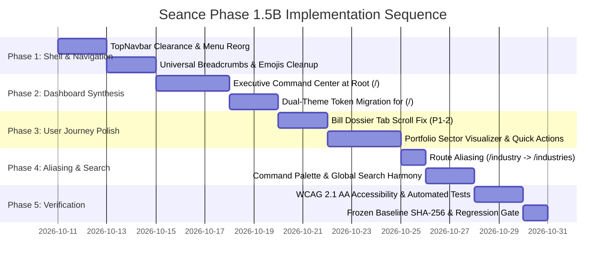

# TASK 1.5A — SEANCE DASHBOARD & NAVIGATION IMPLEMENTATION ROADMAP (PHASE 1.5B)

**Platform:** Seance — Legislative Bill Impact Prediction & Decision Intelligence Platform  
**Document Version:** 1.0.0  
**Phase:** 1.5A — Research, Audit & Implementation Planning  
**Execution Mode:** Roadmap & Specifications Only — Zero Code Modifications  
**Authoritative Baseline SHA-256:** `50ae76039bccf2e4a671cf2ae915889e490b17404db6eb2e49e7965ecd6400b7` (Verified Frozen)  
**Execution Date:** October 10, 2026  

---

## 1. Executive Implementation Strategy

The findings of the Task 1.5A audit establish a clear mandate: modernize Seance's layout, navigation, and dashboard into a cohesive enterprise SaaS experience while preserving 100% of existing routes and strictly maintaining all analytical firewalls and frozen econometric baselines.

The implementation is structured into **5 disciplined sequential phases** for execution in Phase 1.5B:

---

## 2. Phase-by-Phase Technical Specifications

### Phase 1: Layout, Shell & Navigation Modernization
**Objective:** Eliminate layout clipping, organize navigation hubs, clean legacy emojis, and introduce universal breadcrumbs.

#### Tasks:
1. **Header Clearance Calibration (P0-2):**
   - Calibrate `RootLayout` (`frontend/app/layout.tsx`) top padding or adjust section containers from `pt-14` to provide clean `64px` clearance.
   - Eliminate visual clipping across `/predictions`, `/states`, `/risk`, and `/anticipation`.
2. **TopNavbar Hub Restructuring (P2-4):**
   - Reorganize the *Legislation* dropdown menu in `TopNavbar.tsx` into two structured sub-columns:
     - *Exploration & Registry:* Bills Directory, Legislative Explorer, State Assemblies.
     - *Gazettes & Tools:* Live Intake Feed, Latest Enactments, Statutory Diff, Parliamentary Calendar.
   - Streamline *Portfolio & Decision Center* into a unified fourth hub.
3. **Universal Breadcrumb Primitive Integration (P2-3):**
   - Create `frontend/components/layout/Breadcrumb.tsx` using semantic tokens and vector chevrons.
   - Mount standardized breadcrumb trails on all dynamic routes (`/bills/[id]`, `/predictions/[id]`, `/companies/[id]`, `/states/[id]`, `/industries/[id]`).
4. **Iconography Standardization (P2-1):**
   - Replace remaining unicode emojis (`⚖`, `📜`, `📈`, `🏢`, `🏛`) in `workspace/page.tsx`, `portfolio/page.tsx`, and `TopNavbar.tsx` with vector glyphs from `frontend/components/ui/Icons.tsx`.

- **Dependencies:** None.
- **Estimated Complexity:** Low to Medium.
- **Regression Risk:** Zero (pure layout and styling calibration).
- **Verification Gate:** Visual inspection across 1920x1080, 1024x768, and 390x844 viewports.

---

### Phase 2: Executive Dashboard Synthesis & Personalization
**Objective:** Transform the fragmented root page (`/`) into an Executive Decision Command Center with complete dual-theme adaptability.

#### Tasks:
1. **Dual-Theme Token Migration for Root Page (P0-1):**
   - Refactor `frontend/app/page.tsx` from hardcoded slate utilities (`bg-slate-950`, `bg-slate-900/60`, `text-slate-100`) to semantic design tokens (`var(--bg-base)`, `var(--bg-card)`, `var(--border-default)`, `var(--text-primary)`).
   - Guarantee flawless contrast and typography in both Light and Dark modes.
2. **Executive Command Center Layout (P1-1):**
   - Re-architect `frontend/app/page.tsx` with a segmented perspective switcher:
     - **Tab 1: Executive Overview (Default):** Real-time baseline telemetry (20 Central, 44 State, 47 Quant, 104 Exposures), high-conviction market transmission snapshot, key state shifts, and statutory firewall indicators.
     - **Tab 2: My Holdings Exposure:** Personalized holdings table, exposed holdings counts, direct linkage reasons, and 1-click explain drawer.
     - **Tab 3: Intelligence Feed & Changes:** Chronological activity feed, gazette notices, and watchlist triggers.
3. **Empty-State Starter Templates (P1-5):**
   - When a user has 0 holdings or 0 watchlists, present 1-click benchmark starters (*Nifty 50 Core*, *Banking & Financials*, *Clean Energy & Power*) to demonstrate analytical capabilities instantly.

- **Dependencies:** Phase 1 complete.
- **Estimated Complexity:** Medium.
- **Regression Risk:** Low (existing `/overview` and `/workspace` remain fully functional).
- **Verification Gate:** Theme switching in browser; test all 3 perspective tabs for both new and authenticated users.

---

### Phase 3: Deep User Journey Optimization & Component Polish
**Objective:** Streamline the 5 core user journeys, fix component clipping defects, and add high-value contextual actions.

#### Tasks:
1. **Bill Dossier Tab Overflow Fix (P1-2):**
   - Refactor tab navigation in `frontend/app/bills/[billId]/BillDetailContent.tsx` using the modernized `Tabs` primitive with proper padding, smooth horizontal scrolling, and overflow fade indicators.
   - Eliminate the "rate Exposure 1" clipping bug on screen widths below 1200px.
2. **Prediction-to-Portfolio Quick Actions (P1-3):**
   - In `app/predictions/PredictionsContent.tsx` and `PredictionDetailContent.tsx`, add contextual quick actions:
     - `+ Track in Portfolio`
     - `⭐ Add to Watchlist`
   - Connect these actions directly to `portfolioApi` and `watchlistApi`.
3. **Portfolio Sector Exposure Concentration Visualizer (P2-5):**
   - In `app/portfolio/page.tsx`, embed an interactive horizontal stacked bar or sector breakdown card summarizing exposure percentages across Energy, Technology, Financials, and other sectors.
   - Ensure strictly neutral treatment across all 13 sectors (zero hardcoded bias toward Agriculture).
4. **1-Click Stakeholder Briefing Export (P2-6):**
   - In `frontend/components/bills/BillStakeholderSection.tsx`, add an inline "Download Persona Briefing" button on Investor, Business, and Citizen cards that pre-populates `/reports`.

- **Dependencies:** Phases 1 & 2 complete.
- **Estimated Complexity:** Medium.
- **Regression Risk:** Minimal.
- **Verification Gate:** End-to-end journey execution for Investor, Business Owner, Public, Diversified, and Researcher personas.

---

### Phase 4: Route Preservation, Aliasing & Search Harmony
**Objective:** Guarantee 100% backward compatibility, eliminate plural/singular route collisions, and harmonize global search.

#### Tasks:
1. **Route Canonicalization & Redirects (P1-4):**
   - Configure Next.js redirects/rewrites in `frontend/next.config.ts`:
     - Redirect `/industry` → `/industries`
     - Redirect `/industry/:id` → `/industries/:id`
   - Update all internal links across components to point to the canonical `/industries` structure.
2. **Command Palette & Search Bar Harmony:**
   - Harmonize desktop top search bar (`#global-search-btn`) with `CommandPalette.tsx` (⌘K).
   - Ensure typing in the header search opens the precision modal with active query transfer.
   - Add "Deep Search in Explorer" shortcut to hand off complex queries to `/explorer`.

- **Dependencies:** Phases 1–3 complete.
- **Estimated Complexity:** Low.
- **Regression Risk:** Zero (pure redirect configuration and event listener binding).
- **Verification Gate:** Test all 35 URLs directly in browser; verify zero 404 responses.

---

### Phase 5: Verification, Accessibility & Analytical Boundary Gate
**Objective:** Execute rigorous automated regression tests, WCAG 2.1 AA accessibility verification, and authoritative baseline SHA-256 validation.

#### Tasks:
1. **WCAG 2.1 AA Accessibility Audit:**
   - Validate color contrast ratios (≥ 4.5:1 for normal text, ≥ 3:1 for large text and UI borders) across both Light and Dark themes.
   - Verify complete keyboard navigation (`Tab`, `Enter`, `Escape`, `Arrow` keys) across top navbar, dropdowns, modal dialogs, and tables.
   - Confirm screen-reader ARIA landmarks (`role="banner"`, `role="navigation"`, `role="main"`).
2. **Automated Test Suite Execution:**
   - Run full frontend test suite: `npm test` (Vitest across all 29+ test files).
   - Run TypeScript typecheck: `npm run typecheck` (`tsc --noEmit`).
   - Run Next.js production build: `npm run build` to verify clean SSR compilation across all 31 routes.
3. **Bit-for-Bit Analytical Baseline Verification:**
   - Execute SHA-256 hash check on `docs/production_baseline.json`:
     `SHA-256: 50ae76039bccf2e4a671cf2ae915889e490b17404db6eb2e49e7965ecd6400b7`
   - Re-verify all analytical counts:
     - 20 Central bills
     - 47 quantitative securities
     - 940 pairs
     - 4,700 predictions
     - 4,700 decisions
     - 940 anticipation scores
     - 14,100 stakeholder reports
     - 44 State bills with 0 stock predictions
     - 70 master companies (47 quant + 23 non-quant)
     - 104 corporate exposures

- **Dependencies:** All previous phases complete.
- **Estimated Complexity:** Low.
- **Regression Risk:** Zero.
- **Verification Gate:** 100% test pass rate, clean build, matching SHA-256 hash.

---

## 3. Risk Mitigation & Regression Safeguards

| Potential Risk | Severity | Preventive Safeguard |
|---|:---:|---|
| Breaking existing bookmarks or URLs | HIGH | Strictly preserve all 35 routes. Use Next.js redirects for aliases; never delete route files. |
| Contrast failure in Light theme | HIGH | Enforce semantic tokens (`var(--bg-base)`, etc.); prohibit hardcoded Tailwind slate utilities. |
| Inadvertent state stock predictions | CRITICAL | Enforce statutory firewall invariants in UI; verify 0 predictions on all 44 state bills. |
| Hardcoding specific sectors (e.g. Agriculture) | MEDIUM | Treat all 13 sectors with equal weight; verify dynamic sector mapping. |
| Performance degradation in Command Palette | LOW | Debounce search queries; maintain lightweight client-side index for top entities. |

---

## 4. Phase 1.5B Definition of Done (DoD)

Task 1.5B will be deemed COMPLETE when:
1. All P0 and P1 findings identified in Task 1.5A are remediated.
2. The root URL (`/`) functions as an Executive Decision Command Center with flawless Light and Dark theme support.
3. Header padding clearance (`pt-16` / `mt-6`) eliminates title clipping across all analytical views.
4. The 5 canonical user journeys operate within 2 clicks from the dashboard.
5. All 35 route paths resolve successfully with zero 404 errors.
6. 100% of automated frontend tests pass with zero TypeScript errors.
7. Next.js production build succeeds with all routes compiled.
8. Baseline SHA-256 hash remains bit-for-bit exact: `50ae76039bccf2e4a671cf2ae915889e490b17404db6eb2e49e7965ecd6400b7`.
