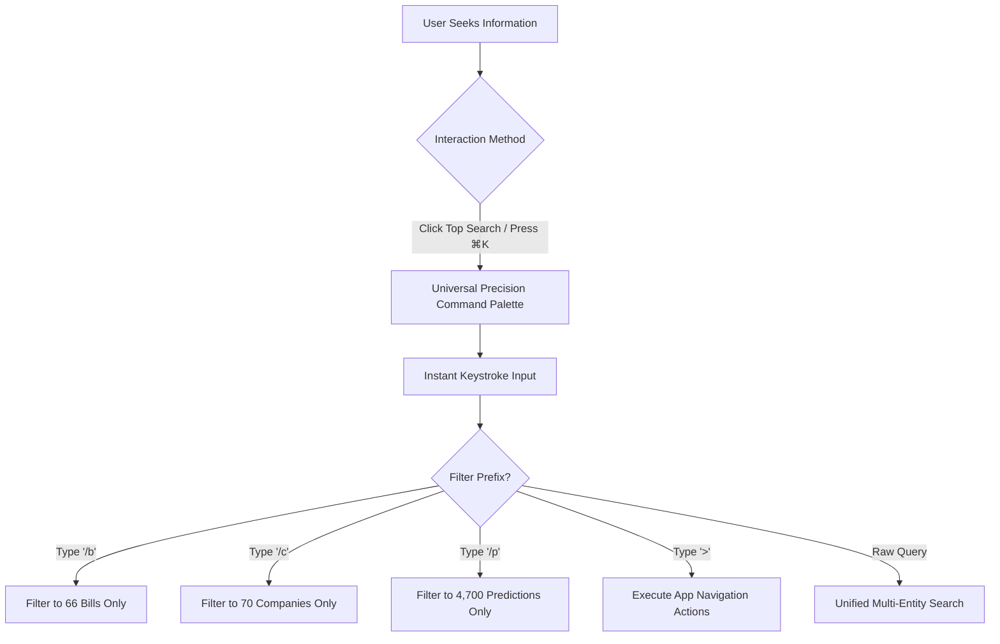

# TASK 1.5A — SEANCE INFORMATION ARCHITECTURE & DASHBOARD MODERNIZATION PROPOSAL

**Platform:** Seance — Legislative Bill Impact Prediction & Decision Intelligence Platform  
**Document Version:** 1.0.0  
**Phase:** 1.5A — Research, Audit & Implementation Planning  
**Execution Mode:** Proposal Only — Zero Application Source-Code Modifications  
**Authoritative Baseline SHA-256:** `50ae76039bccf2e4a671cf2ae915889e490b17404db6eb2e49e7965ecd6400b7` (Verified Frozen)  
**Execution Date:** October 10, 2026  

---

## 1. Executive Vision: Modern Enterprise Decision Intelligence

Seance must transition from a disjointed collection of research pages into a unified, high-density **Enterprise Decision Intelligence Platform**. The current application suffers from:
1. **Tri-Dashboard Fragmentation:** A public marketing splash (`/`), a static capability overview (`/overview`), and a personal workspace (`/workspace`) compete for identity.
2. **Navigation Proliferation:** 8 overlapping choices under *Legislation*, plus separate links for *Portfolio*, *Reports*, and *AI Analyst*.
3. **Plural/Singular Route Drift:** `/industries` vs. `/industry`.
4. **Orphaned Layouts:** Unused `Sidebar.tsx` and `Header.tsx` drifting from `TopNavbar.tsx`.

The proposed Information Architecture (IA) establishes **4 primary thematic hubs**, consolidates the dashboard experience into an **Executive Command Center**, introduces a **universal breadcrumb hierarchy**, and **preserves 100% of existing routes** through transparent aliasing and non-breaking redirects.

---

## 2. Proposed Information Architecture Hierarchy

```mermaid
graph TD
    Root[Seance Institutional Terminal] --> GlobalNav[Primary Navigation Frame]
    GlobalNav --> Hub1[1. Legislation]
    GlobalNav --> Hub2[2. Markets & Risk]
    GlobalNav --> Hub3[3. Corporate Universe]
    GlobalNav --> Hub4[4. Portfolio & Decision Center]

    GlobalNav --> UtilityNav[Utility & Observability Bar]
    UtilityNav --> CmdK[Command Palette ⌘K]
    UtilityNav --> Telemetry[System Health Pulse]
    UtilityNav --> Notifs[Notifications Center]
    UtilityNav --> ThemeToggle[ThemeSwitcher]
    UtilityNav --> UserProfile[Tenant / Role Switcher]

    Hub1 --> H1_1[Bills Directory /bills]
    Hub1 --> H1_2[Legislative Explorer /explorer]
    Hub1 --> H1_3[State Assemblies /states]
    Hub1 --> H1_4[Live Gazette Feed /live-discovery]
    Hub1 --> H1_5[Statutory Diff /bills/compare]
    Hub1 --> H1_6[Parliament Calendar /upcoming-legislation]

    Hub2 --> H2_1[Market Predictions /predictions]
    Hub2 --> H2_2[Legislative Risk Matrix /risk]
    Hub2 --> H2_3[Pre-Event Anticipation /anticipation]

    Hub3 --> H3_1[Corporate Directory /companies]
    Hub3 --> H3_2[Industries Taxonomy /industries]
    Hub3 --> H3_3[Macro Economic Sectors /sectors]

    Hub4 --> H4_1[Portfolio Command Center /portfolio]
    Hub4 --> H4_2[Decision Workspace /workspace]
    Hub4 --> H4_3[Impact Reports /reports]
    Hub4 --> H4_4[Watchlists & Alerts /watchlists]
    Hub4 --> H4_5[Grounded AI Analyst /ai-analyst]
```



---

## 3. Resolving the Tri-Dashboard Dilemma

### 3.1 The Problem
Today, users entering `http://localhost:3000/` see a marketing splash page. Authenticated institutional analysts must click *Launch Command Center* to reach `/workspace`, which is empty if they have not yet configured watchlists. Meanwhile, `/overview` contains system-level capability metrics that are disconnected from portfolio intelligence.

### 3.2 The Proposed Solution: Unified Executive Decision Command Center
Convert the root URL (`/`) into an **Adaptive Executive Command Center**:

```
+----------------------------------------------------------------------------------------------------+
|  [Seance Brand]   Legislation ▾   Markets & Risk ▾   Corporate Universe ▾   Portfolio & Decisions ▾   [⌘K] [● Active] [🔔] [Theme] [Profile] |
+----------------------------------------------------------------------------------------------------+
|  SYSTEM TICKER: Central Event Studies: 20 Acts · 4,700 Predictions | State Coverage: 44 Acts | Firewalls Locked           |
+----------------------------------------------------------------------------------------------------+
|  === EXECUTIVE DECISION COMMAND CENTER ===                                                         |
|  [Tab: Executive Overview]    [Tab: My Holdings Exposure]    [Tab: Intelligence Feed & Changes]   |
+----------------------------------------------------------------------------------------------------+
|  [Section 1: Legislative Velocity & Milestone Cards (20 Central | 44 State | 47 Quant | 104 Exposures)]|
+----------------------------------------------------------------------------------------------------+
|  [Section 2: High-Conviction Market Transmission]      |  [Section 3: Key State Regulatory Shifts]  |
|  - Top 3 Modelled Enactments & Predicted Impact        |  - AP, KA, KL, TS Enacted Acts             |
|  - Authoritative Horizons [-1,+1] to [-10,+10]         |  - Zero Stock Predictions Banner           |
+----------------------------------------------------------------------------------------------------+
|  [Section 4: Portfolio Relevance Snapshot]             |  [Section 5: Live Gazette Intake Feed]     |
|  - Core Nifty Holdings Exposure (Reliance, TCS, HDFC)  |  - Latest unmodelled gazette alerts        |
|  - 41 Matched Bills (26 Direct, 12 High Relevance)     |  - Verification status tags                |
+----------------------------------------------------------------------------------------------------+
```

### 3.3 Persona-Adaptive Dashboards
The Executive Command Center provides 3 distinct perspective modes via tabbed switching:
1. **Executive Overview (Default for new users & public):** High-level legislative velocity, verified system baseline, statutory firewalls, recent enactments.
2. **My Holdings Exposure (Default for investors & portfolio users):** Personalized exposure table, direct linkages to holdings, risk concentration.
3. **Intelligence Feed & Changes (Default for policy officers & compliance):** Real-time activity logs, amendments, gazette notifications, watchlist triggers.

### 3.4 Backward Compatibility & Route Preservation
- `/overview` remains a functional URL, rendering the *Executive Overview* perspective.
- `/workspace` remains a functional URL, rendering the *Intelligence Feed & Changes* perspective.
- `/` serves as the consolidated command center, eliminating the consumer marketing detour.

---

## 4. Restructuring Primary Navigation Hubs

### Hub 1: Legislation
Currently, the *Legislation* dropdown displays 8 competing items. We propose organizing them into two structured columns inside the dropdown:

```
+-------------------------------------------------------------+
| LEGISLATION HUB                                             |
+------------------------------+------------------------------+
| EXPLORATION & REGISTRY       | GAZETTES & TOOLS             |
| 📜 Bills Directory           | 📡 Live Intake Feed          |
|    Canonical act registry    |    Unmodelled gazette feed   |
| 🔍 Legislative Explorer      | ⚡ Latest Enactments         |
|    Multi-facet discovery     |    Recent bill introductions |
| 🗺 State Assemblies          | ⚖ Statutory Bill Diff       |
|    AP, KA, KL, TS acts       |    Side-by-side provisions   |
|                              | 📅 Parliamentary Calendar    |
|                              |    Committee agendas         |
+------------------------------+------------------------------+
```
*Zero routes removed; cognitive clarity enhanced.*

### Hub 2: Markets & Risk
Maintains the focused 3-item structure:
1. **Market Predictions (`/predictions`):** 4,700 event-study records across 5 authoritative event windows.
2. **Legislative Risk Matrix (`/risk`):** 5-tier deterministic risk model, pricing-in status, and ISIN calculator.
3. **Pre-Event Anticipation (`/anticipation`):** 940 diffusion scores, news frequency evidence, and pre-event CAR analysis.

### Hub 3: Corporate Universe
Streamlines enterprise entities and macro classifications:
1. **Corporate Directory (`/companies`):** Master registry of 70 corporations (47 quant listed, 20 intelligence-only, 3 reference).
2. **Industries Taxonomy (`/industries`):** Granular industry sectors mapped to statutory policy.
3. **Macro Economic Sectors (`/sectors`):** 13 macro sectors ensuring neutral coverage across all industries.

### Hub 4: Portfolio & Decision Center
Consolidates previously scattered user-specific tools into a cohesive executive hub:
1. **Portfolio Exposure (`/portfolio`):** Holdings management, CSV/XLSX import, multi-sector exposure analysis.
2. **Personalized Workspace (`/workspace`):** Monitored entities, activity feeds, change tracking.
3. **Impact Reports (`/reports`):** Multi-stakeholder report generation engine (Investor, Corporate, Public).
4. **Watchlists & Alerts (`/watchlists` & `/alerts`):** Entity monitoring and threshold alert rules.
5. **Grounded AI Analyst (`/ai-analyst`):** Verifiable LLM explanations with strict statutory grounding.

---

## 5. Universal Breadcrumb Architecture

Deep analytical routes suffer from disorientation. We propose a standardized Breadcrumb pattern mounted directly below the top navigation bar on all dynamic routes:

| Route Pattern | Standardized Breadcrumb Trail | Clickable Links |
|---|---|---|
| `/bills/[billId]` | `Home > Legislation > Bills Directory > [Bill Title]` | `Home` (`/`), `Legislation` (`/bills`), `Bills Directory` (`/bills`) |
| `/bills/compare` | `Home > Legislation > Statutory Comparison Workbench` | `Home` (`/`), `Legislation` (`/bills`) |
| `/predictions/[predictionId]` | `Home > Markets & Risk > Predictions > [ISIN] · [Bill Title]` | `Home` (`/`), `Predictions` (`/predictions`) |
| `/companies/[companyId]` | `Home > Corporate Universe > Companies > [Ticker]` | `Home` (`/`), `Companies` (`/companies`) |
| `/industries/[industryId]` | `Home > Corporate Universe > Industries > [Industry Name]` | `Home` (`/`), `Industries` (`/industries`) |
| `/states/[state]` | `Home > Legislation > State Assemblies > [State Name]` | `Home` (`/`), `State Assemblies` (`/states`) |
| `/watchlists/[watchlistId]` | `Home > Portfolio & Decisions > Watchlists > [Watchlist Name]` | `Home` (`/`), `Watchlists` (`/watchlists`) |

---

## 6. Global Search vs. Command Palette (⌘K) Harmony

Currently, users have both a top navbar search bar and a `⌘K` modal that perform similar lookups. We propose harmonizing them:


- **Desktop Header:** Clicking the header search input immediately triggers the `CommandPalette` modal with focus retained.
- **Mobile Header:** A compact magnifying glass icon opens the same accessible modal.
- **Deep Search:** A "Press Enter for Advanced Explorer" prompt seamlessly transfers complex queries to `/explorer`.

---

## 7. Dual-Theme Architectural Specifications

All proposed layouts will strictly adhere to the semantic design tokens established in Task 1.2:

```css
/* Surface Mapping */
Canvas Background:        var(--bg-base)          /* Light: #f8fafc | Dark: #05090f */
Card Surface:             var(--bg-surface)       /* Light: #ffffff | Dark: #0c1322 */
Card Border:              var(--border-default)   /* Light: #e2e8f0 | Dark: #1e293b */
Header Surface:           var(--bg-nav)           /* Light: rgba(255,255,255,0.85) | Dark: rgba(5,9,15,0.85) */

/* Typography Mapping */
Primary Headings:         var(--text-primary)     /* Light: #0f172a | Dark: #f8fafc */
Secondary Copy:           var(--text-secondary)   /* Light: #475569 | Dark: #cbd5e1 */
Muted Captions:           var(--text-muted)       /* Light: #64748b | Dark: #94a3b8 */
```
No hardcoded slate hexes or Tailwind utilities (`bg-slate-950`, `text-slate-100`) will be permitted in layout containers.

---

## 8. Epistemic & Firewall Boundary Architecture

The UI will clearly display epistemic tags and statutory boundaries at every touchpoint:

```
+---------------------------------------------------------------------------------------------+
| [FACT] Official Statutory Fact: Passed in Parliament on 10 Dec 2024                         |
| [OBSERVED] Pre-Event Trading Diffusion: -42.8 bps Cumulative Abnormal Return detected       |
| [DERIVED] Corporate Exposure: 8 Entities identified via statutory supply-chain mapping      |
| [PREDICTION] Econometric Model Output: 60.1% confidence across [-1,+1] horizon              |
| [INTERPRETATION] Regulatory Intelligence: Compliance burden shifts to terminal operators    |
| [EVIDENCE] PRS Legislative Research official source citation verified                      |
+---------------------------------------------------------------------------------------------+
```

### Firewall UI Rules:
1. **State Bills:** Every state bill header and table row must display `[STATE QUALITATIVE]` and `"Statutory Firewall: Zero stock predictions"`.
2. **Intelligence-Only Companies:** Company dossiers for private entities must display `[INTELLIGENCE ONLY]` and `"Firewalled from quantitative econometric models"`.
3. **No Financial Advice:** Universal footer and header disclaimers: `"Decision support intelligence only. No Buy/Sell/Hold recommendations."`
