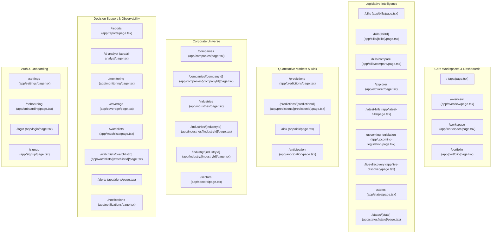

# TASK 1.5A — SEANCE ROUTE & FEATURE PRESERVATION MATRIX

**Platform:** Seance — Legislative Bill Impact Prediction & Decision Intelligence Platform  
**Document Version:** 1.0.0  
**Phase:** 1.5A — Research, Audit & Implementation Planning  
**Execution Mode:** Audit Only — Zero Application Source-Code Modifications  
**Authoritative Baseline SHA-256:** `50ae76039bccf2e4a671cf2ae915889e490b17404db6eb2e49e7965ecd6400b7` (Verified Frozen)  
**Execution Date:** October 10, 2026  

---

## 1. Preservation Guarantee & Governance Contract

This matrix provides a 100% complete inventory of every route, page component, and user-facing capability currently implemented in Seance. 

### Core Preservation Invariants:
1. **Zero Route Deletions:** No existing route, URL pattern, or access path will be removed or disabled.
2. **Zero Breaking Changes:** All existing bookmarks, external URLs, and shared links will continue to resolve seamlessly.
3. **Transparent Aliasing:** Where overlapping or redundant routes exist (e.g. `/overview` and `/workspace` relative to `/`), the existing URLs will remain fully functional as deep links or transparent aliases.
4. **Analytical Boundary Preservation:** All quantitative models, statutory firewalls (0 State stock predictions), and epistemic labels (`[FACT]`, `[OBSERVED]`, `[DERIVED]`, `[INTERPRETATION]`, `[PREDICTION]`, `[EVIDENCE]`) are strictly preserved.

---

## 2. Complete Inventory of Routes (35 Page Files / 31 Unique Routes)

---

## 3. Detailed Route-by-Route Specification Matrix

### 1. Route: `/` (`app/page.tsx`)
- **Purpose:** Public landing page and initial platform entry point.
- **Primary Persona:** All personas / First-time visitors.
- **Main Actions & Dependencies:** Launch Command Center CTA, tenant sign-in, interactive tour launch, view baseline statistics.
- **Backend APIs:** Local session (`localStorage`), `authApi.getMe()`.
- **Auth Requirements:** None (Public).
- **Observed States:** Renders dark-only landing canvas; contrast breaks in Light mode.
- **Entry Points:** Direct URL entry, Brand Emblem click in navbar.
- **Outgoing Paths:** `/workspace`, `/settings`, `/login`, `/signup`, `/onboarding`, `/explorer`, `/predictions`, `/watchlists`, `/ai-analyst`.
- **Usability Problems:** Hardcoded dark styling clashes with Light mode; functions like a marketing splash rather than an enterprise SaaS dashboard.
- **Proposed Improvement:** Transform into the **Executive Decision Command Center** with tabbed views (Executive Overview, Holdings Exposure, Live Feeds), adopting full semantic dual-theme tokens.
- **Required Regression Tests:** Validate navigation to `/workspace`, theme switching, authentication session detection.

---

### 2. Route: `/overview` (`app/overview/page.tsx`)
- **Purpose:** Platform-wide coverage, capability tiers (L1/L2/L3), recent bills snapshot, market predictions snapshot, and monitoring system status.
- **Primary Persona:** Researcher / Policy Officer.
- **Main Actions & Dependencies:** Filter recent bills, review coverage stats, inspect subsystem health.
- **Backend APIs:** `GET /api/v1/coverage`, `GET /api/v1/bills?limit=6`, `GET /api/v1/predictions?limit=6`, `GET /api/v1/companies?limit=6`, `GET /api/v1/monitoring/status`.
- **Auth Requirements:** None.
- **Observed States:** High-density, data-driven cards with skeleton loaders and error states.
- **Entry Points:** `TopNavbar` > *Legislation* > *Platform Overview*, footer link.
- **Outgoing Paths:** `/bills`, `/predictions`, `/companies`, `/monitoring`, `/explorer`.
- **Usability Problems:** Competes with `/` and `/workspace`; contains redundant metrics.
- **Proposed Improvement:** Preserve route as a dedicated system overview view; mirror its components inside the unified root command center.
- **Required Regression Tests:** Validate all 5 API calls on mount, skeleton shimmer, empty state fallback.

---

### 3. Route: `/workspace` (`app/workspace/page.tsx`)
- **Purpose:** Personalized decision center answering "What changed since I last looked?", monitored bills/companies tabs, activity feed, and Grounded AI Assistant.
- **Primary Persona:** Investor / Corporate Decision-Maker.
- **Main Actions & Dependencies:** Switch monitored entity tabs (Bills, Companies, Industries, States), filter activity feed (All, Alerts, Monitoring), interact with Grounded AI Assistant.
- **Backend APIs:** `GET /api/v1/workspace/summary`, `GET /api/v1/workspace/activity`, `GET /api/v1/workspace/watchlist-activity`, `GET /api/v1/workspace/analytics`, `GET /api/v1/workspace/decision-intelligence`, `GET /api/v1/workspace/change-feed`.
- **Auth Requirements:** Authenticated session (falls back to tenant default).
- **Observed States:** Displays 0 KPI counts when user has no watchlists; legacy emojis in header (`⚖`).
- **Entry Points:** `TopNavbar` > *Workspace*, `/` CTA button.
- **Outgoing Paths:** `/watchlists`, `/alerts`, `/portfolio`, `/bills/[id]`.
- **Usability Problems:** Empty state provides inadequate onboarding; legacy emojis; hardcoded slate backgrounds.
- **Proposed Improvement:** Modernize tokens, replace emojis with `Icons.tsx`, integrate 1-click benchmark watchlists into empty state.
- **Required Regression Tests:** Verify activity filters, tab switching, AI assistant responses.

---

### 4. Route: `/portfolio` (`app/portfolio/page.tsx`)
- **Purpose:** Portfolio legislative exposure analysis, holdings management (CSV/XLSX import), explain relevance drawer, and impact report generation.
- **Primary Persona:** Investor / Diversified Portfolio User.
- **Main Actions & Dependencies:** Add holding, import CSV/XLSX, filter exposures by relevance tier (`DIRECT`, `HIGH RELEVANCE`, `MODERATE RELEVANCE`, `INDIRECT`) and jurisdiction, click "Explain Relevance" drawer, generate impact report.
- **Backend APIs:** `GET /api/v1/portfolio`, `GET /api/v1/portfolio/exposure`, `POST /api/v1/portfolio`, `POST /api/v1/portfolio/{id}/holdings`, `POST /api/v1/portfolio/{id}/import`, `GET /api/v1/workspace/explain-relevance`, `POST /api/v1/portfolio/{id}/report`.
- **Auth Requirements:** Authenticated tenant.
- **Observed States:** Pre-populated with 5 Core Nifty holdings; displays 41 matched relevant bills (26 direct, 12 high relevance).
- **Entry Points:** `TopNavbar` > *Portfolio* (direct anchor).
- **Outgoing Paths:** `/bills/[id]`, `/reports`.
- **Usability Problems:** Hardcoded Tailwind badge maps (`TIER_BADGES`); lacks sector exposure concentration chart; linear list of 41 bills causes vertical fatigue.
- **Proposed Improvement:** Add sector breakdown visualizer, per-holding filter chips, and template benchmark loading.
- **Required Regression Tests:** Add/remove holding, import CSV, explain relevance slide-out drawer, report tab generation.

---

### 5. Route: `/bills` (`app/bills/page.tsx`)
- **Purpose:** Authoritative tabular directory of all 66 acts (22 Central + 44 State).
- **Primary Persona:** All Personas.
- **Main Actions & Dependencies:** Filter by jurisdiction (Central / State), search by keyword, sort by introduction date, paginate, open bill detail dossier.
- **Backend APIs:** `GET /api/v1/bills`.
- **Auth Requirements:** None.
- **Observed States:** Clean `InstitutionalTable` with dual-theme sorting and pagination chevrons.
- **Entry Points:** `TopNavbar` > *Legislation* > *Bills Directory*.
- **Outgoing Paths:** `/bills/[billId]`, `/bills/compare`.
- **Usability Problems:** Dense table without inline sector pill filters.
- **Proposed Improvement:** Add quick-filter pills for top sectors; preserve high-density table structure.
- **Required Regression Tests:** Sort by date/title/jurisdiction, search filtering, pagination boundary.

---

### 6. Route: `/bills/[billId]` (`app/bills/[billId]/page.tsx`)
- **Purpose:** Full legislative intelligence dossier for a single enactment.
- **Primary Persona:** All Personas.
- **Main Actions & Dependencies:** Switch dossier tabs (Corporate Exposure, Market Predictions, Anticipation, Stakeholders, Official Documents), inspect `EventStudyChart`, add to watchlist, trigger Grounded Copilot.
- **Backend APIs:** `GET /api/v1/bills/{billId}`, `GET /api/v1/bills/{billId}/exposure`, `GET /api/v1/bills/{billId}/predictions`, `GET /api/v1/bills/{billId}/anticipation`, `GET /api/v1/bills/{billId}/stakeholders`.
- **Auth Requirements:** None.
- **Observed States:** Rich 5-tab dossier; horizontal tab bar clips on viewports under 1200px.
- **Entry Points:** `/bills`, `/explorer`, `/portfolio`, `/workspace`.
- **Outgoing Paths:** `/companies/[id]`, `/predictions/[id]`, `/bills/compare`, `/reports`.
- **Usability Problems:** Horizontal tab clipping defect (P1-2); breadcrumbs link to `/explorer` rather than `/bills`.
- **Proposed Improvement:** Fix horizontal tab scroll overflow, calibrate breadcrumb to `Home > Bills > [Title]`, add 1-click persona report download.
- **Required Regression Tests:** Verify all 5 tab switches, chart rendering across horizons, breadcrumb back navigation.

---

### 7. Route: `/bills/compare` (`app/bills/compare/page.tsx`)
- **Purpose:** Statutory comparison workbench comparing two enactments side-by-side.
- **Primary Persona:** Legal Officer / Corporate Decision-Maker.
- **Main Actions & Dependencies:** Select Side A bill and Side B bill from dropdowns, view dual-exposed corporations (e.g. Adani Ports), inspect statutory provision diff.
- **Backend APIs:** `GET /api/v1/bills`, `GET /api/v1/bills/compare`.
- **Auth Requirements:** None.
- **Observed States:** Functional side-by-side view with dual-impact callout card.
- **Entry Points:** `TopNavbar` > *Legislation* > *Bill Comparison*, action button on `/bills/[id]`.
- **Outgoing Paths:** `/bills/[id]`.
- **Usability Problems:** Provision comparison section shows "No provision clauses recorded" when raw text diff is absent.
- **Proposed Improvement:** Provide explicit fallback message noting statutory diff is derived from official gazette schedules.
- **Required Regression Tests:** Select bills across Central vs. State, verify overlap calculation.

---

### 8. Route: `/explorer` (`app/explorer/page.tsx`)
- **Purpose:** Unified discovery engine featuring dual-view toggle (Card Feed vs. Institutional Data Grid) and multi-facet filtering.
- **Primary Persona:** Researcher / Analyst.
- **Main Actions & Dependencies:** Toggle view mode, filter by jurisdiction, status, stage, sector, sort by relevance.
- **Backend APIs:** `GET /api/v1/explorer/search`.
- **Auth Requirements:** None.
- **Observed States:** High-performance faceted search with live result counts.
- **Entry Points:** `TopNavbar` > *Legislation* > *Legislative Explorer*.
- **Outgoing Paths:** `/bills/[id]`.
- **Usability Problems:** Duplicates some functionality of `/bills` without clear outcome distinction.
- **Proposed Improvement:** Position `/explorer` as the advanced analytical multi-variable query engine; keep `/bills` as the clean registry.
- **Required Regression Tests:** Facet filtering, card vs. grid toggle, URL query state preservation.

---

### 9. Route: `/latest-bills` (`app/latest-bills/page.tsx`)
- **Purpose:** Real-time chronological feed of newly introduced Central and State enactments.
- **Primary Persona:** Policy Officer / Compliance Specialist.
- **Main Actions & Dependencies:** Filter by date introduced, review status badges (`LIVE`, `INTRODUCED`).
- **Backend APIs:** `GET /api/v1/bills?sort_by=introduction_date&sort_order=desc`.
- **Auth Requirements:** None.
- **Observed States:** Functional list with `LIVE` pulsing indicators.
- **Entry Points:** `TopNavbar` > *Legislation* > *Latest Enactments*.
- **Outgoing Paths:** `/bills/[id]`.
- **Usability Problems:** Overlaps with `/bills` sorted by date.
- **Proposed Improvement:** Retain route; position as the chronological gazette bulletin.
- **Required Regression Tests:** Chronological ordering, filter by jurisdiction.

---

### 10. Route: `/upcoming-legislation` (`app/upcoming-legislation/page.tsx`)
- **Purpose:** Parliamentary session calendar, pending committee reviews, and unacted bills.
- **Primary Persona:** Policy Officer / Civic Advocate.
- **Main Actions & Dependencies:** View upcoming parliamentary session agendas and committee hearings.
- **Backend APIs:** `GET /api/v1/bills?status=pending`.
- **Auth Requirements:** None.
- **Observed States:** Calendar card grid with session status indicators.
- **Entry Points:** `TopNavbar` > *Legislation* > *Upcoming Calendar*.
- **Outgoing Paths:** `/bills/[id]`.
- **Usability Problems:** None.
- **Proposed Improvement:** Modernize card styling with dual-theme semantic tokens.
- **Required Regression Tests:** Verify pending bill filtering.

---

### 11. Route: `/live-discovery` (`app/live-discovery/page.tsx`)
- **Purpose:** Unmodelled gazette intake feed monitoring real-time legislative alerts.
- **Primary Persona:** Compliance Officer / Journalist.
- **Main Actions & Dependencies:** Inspect source verification timestamps, review unmodelled statutory notices.
- **Backend APIs:** `GET /api/v1/monitoring/gazette-feed`.
- **Auth Requirements:** None.
- **Observed States:** Telemetry feed with source URLs.
- **Entry Points:** `TopNavbar` > *Legislation* > *Live Intake Feed*.
- **Outgoing Paths:** External PRS/Gazette URLs.
- **Usability Problems:** Low visual integration with main design system.
- **Proposed Improvement:** Wrap in standard `Card` and `Badge` primitives with verified provenance markers.
- **Required Regression Tests:** Source link security (`rel="noopener noreferrer"`).

---

### 12. Route: `/states` (`app/states/page.tsx`)
- **Purpose:** Sub-national legislative intelligence overview across 4 pilot states (AP, KA, KL, TS).
- **Primary Persona:** Corporate Decision-Maker / Policy Analyst.
- **Main Actions & Dependencies:** Inspect state cards, view enacted bill counts (44 total) and corporate exposures (86 total), navigate to state dossiers.
- **Backend APIs:** `GET /api/v1/states`.
- **Auth Requirements:** None.
- **Observed States:** 4 state cards with `ACTIVE` badges and explicit `Level 2 Legislative Intelligence Active` notice; zero-stock prediction firewall banner intact.
- **Entry Points:** `TopNavbar` > *Legislation* > *State Assemblies*.
- **Outgoing Paths:** `/states/[state]`, `/bills?jurisdiction=state`.
- **Usability Problems:** Header text partially clipped under fixed navbar (`pt-14`).
- **Proposed Improvement:** Fix header top padding clearance; add state map visualizer.
- **Required Regression Tests:** Verify exact counts (AP=12, KA=11, KL=11, TS=10).

---

### 13. Route: `/states/[state]` (`app/states/[state]/page.tsx`)
- **Purpose:** Single state legislative assembly dossier (e.g. Karnataka).
- **Primary Persona:** Corporate Decision-Maker.
- **Main Actions & Dependencies:** View state assembly acts, local corporate operational footprints, gazette intake records.
- **Backend APIs:** `GET /api/v1/states/{state}`.
- **Auth Requirements:** None.
- **Observed States:** Detailed list of state enactments with zero-stock prediction firewall notice.
- **Entry Points:** `/states`.
- **Outgoing Paths:** `/bills/[id]`.
- **Usability Problems:** Lacks hierarchical breadcrumb.
- **Proposed Improvement:** Standardize breadcrumbs (`Home > State Assemblies > [State Name]`).
- **Required Regression Tests:** Verify 0-stock prediction disclaimer on every state dossier.

---

### 14. Route: `/predictions` (`app/predictions/page.tsx`)
- **Purpose:** Central quantitative market predictions workspace (4,700 predictions across 940 pairs and 5 horizons).
- **Primary Persona:** Investor / Quantitative Analyst.
- **Main Actions & Dependencies:** Inspect predictions table with tabular numerals, interact with `HorizonComparisonVisualizer`, analyze confidence distributions, click row to view prediction dossier.
- **Backend APIs:** `GET /api/v1/predictions`.
- **Auth Requirements:** None.
- **Observed States:** Pristine `InstitutionalTable` with tabular numerals and non-color glyphs (`▲`, `▼`, `◆`); Section A header slightly clipped under top navbar.
- **Entry Points:** `TopNavbar` > *Markets & Risk* > *Market Predictions*.
- **Outgoing Paths:** `/predictions/[predictionId]`, `/bills/[id]`, `/companies/[id]`.
- **Usability Problems:** Header clearance defect; lacks quick action to add company to portfolio directly from row.
- **Proposed Improvement:** Increase top padding clearance; add `+ Portfolio` and `⭐ Watchlist` row actions.
- **Required Regression Tests:** Sort by confidence, filter by event horizon, test modal drawer.

---

### 15. Route: `/predictions/[predictionId]` (`app/predictions/[predictionId]/page.tsx`)
- **Purpose:** Deep econometric dossier for a single bill-company prediction pair.
- **Primary Persona:** Investor / Econometrician.
- **Main Actions & Dependencies:** Inspect 4 epistemic zones (`[FACT]`, `[OBSERVED]`, `[DERIVED]`, `[PREDICTION]`), view alternative event windows, examine decision metrics.
- **Backend APIs:** `GET /api/v1/predictions/{predictionId}`.
- **Auth Requirements:** None.
- **Observed States:** Comprehensive single prediction breakdown.
- **Entry Points:** `/predictions`, `/bills/[id]`, `/companies/[id]`.
- **Outgoing Paths:** `/bills/[id]`, `/companies/[id]`.
- **Usability Problems:** Alternative horizons presented as separate cards rather than an overlay trajectory chart.
- **Proposed Improvement:** Embed multi-horizon trajectory visualizer overlay; add breadcrumbs.
- **Required Regression Tests:** Verify 5 authoritative horizon cards match backend figures.

---

### 16. Route: `/risk` (`app/risk/page.tsx`)
- **Purpose:** Systemic legislative risk classification, 5-tier deterministic risk model, pricing-in status, and ISIN risk calculator.
- **Primary Persona:** Risk Manager / Portfolio Manager.
- **Main Actions & Dependencies:** Inspect `RiskDistributionVisualizer`, filter by risk tier (`VERY_HIGH`, `HIGH`, `MEDIUM`, `LOW`, `NEUTRAL`), calculate ISIN risk.
- **Backend APIs:** `GET /api/v1/risk/summary`, `GET /api/v1/risk/distribution`.
- **Auth Requirements:** None.
- **Observed States:** Proportional risk cards and dual-theme stacked bar visualizer.
- **Entry Points:** `TopNavbar` > *Markets & Risk* > *Legislative Risk Matrix*.
- **Outgoing Paths:** `/predictions`, `/companies/[id]`.
- **Usability Problems:** Header text clipped under navbar; ISIN input lacks auto-suggest from master companies.
- **Proposed Improvement:** Add autocomplete to ISIN calculator; adjust layout top clearance.
- **Required Regression Tests:** Verify 5-tier distribution percentages sum to 100%.

---

### 17. Route: `/anticipation` (`app/anticipation/page.tsx`)
- **Purpose:** Pre-event market diffusion analytics (940 anticipation scores, news frequency, pre-event CAR trading windows).
- **Primary Persona:** Quantitative Analyst / Trader.
- **Main Actions & Dependencies:** Inspect 4 neutral tiers, analyze pre-event CAR charts, filter 940-pair diffusion matrix table.
- **Backend APIs:** `GET /api/v1/anticipation/summary`, `GET /api/v1/anticipation/scores`.
- **Auth Requirements:** None.
- **Observed States:** `PreEventCarChart` with tabular numerals and basis points formatting.
- **Entry Points:** `TopNavbar` > *Markets & Risk* > *Pre-Event Anticipation*.
- **Outgoing Paths:** `/bills/[id]`, `/companies/[id]`.
- **Usability Problems:** High table density requires horizontal scrolling on tablet viewports.
- **Proposed Improvement:** Optimize column widths and provide compact mobile card view.
- **Required Regression Tests:** Verify 940 score records load without freezing UI.

---

### 18. Route: `/companies` (`app/companies/page.tsx`)
- **Purpose:** Master corporate universe directory across 70 entities (47 quant listed, 20 intelligence-only, 3 reference).
- **Primary Persona:** Investor / Corporate Analyst.
- **Main Actions & Dependencies:** Filter by coverage level, search by ticker/name/ISIN, filter by sector, navigate to company dossier.
- **Backend APIs:** `GET /api/v1/companies`.
- **Auth Requirements:** None.
- **Observed States:** High-density corporate cards and table with coverage badges.
- **Entry Points:** `TopNavbar` > *Corporate Universe* > *Corporate Directory*.
- **Outgoing Paths:** `/companies/[companyId]`.
- **Usability Problems:** Sector filter buttons lack active state visual clarity in Light mode.
- **Proposed Improvement:** Modernize sector filter pills with semantic tokens.
- **Required Regression Tests:** Verify exactly 47 quant + 20 intel + 3 ref entities.

---

### 19. Route: `/companies/[companyId]` (`app/companies/[companyId]/page.tsx`)
- **Purpose:** Deep corporate profile, exposure network, quantitative event studies, and firewall status.
- **Primary Persona:** Investor / Risk Officer.
- **Main Actions & Dependencies:** Switch tabs (Overview, Exposures, Predictions, Decision Support), view legislative links, verify firewall badge.
- **Backend APIs:** `GET /api/v1/companies/{companyId}`.
- **Auth Requirements:** None.
- **Observed States:** Rigorous separation: intelligence-only companies display `IntelligenceCompanyFirewall` banner with 0 stock predictions.
- **Entry Points:** `/companies`, `/portfolio`, `/predictions`.
- **Outgoing Paths:** `/bills/[id]`, `/predictions/[id]`.
- **Usability Problems:** Lacks breadcrumbs; lacks quick "Add to Portfolio" action.
- **Proposed Improvement:** Add breadcrumbs (`Home > Companies > [Ticker]`), add "+ Add to Portfolio" button.
- **Required Regression Tests:** Verify firewall blocks predictions for private companies.

---

### 20. Route: `/industries` (`app/industries/page.tsx`)
- **Purpose:** Industry taxonomy and sector intelligence mapping statutory acts to industries.
- **Primary Persona:** Sector Analyst / Policy Strategist.
- **Main Actions & Dependencies:** Browse 13 economic sectors, view legislative exposure counts per industry, navigate to industry dossier.
- **Backend APIs:** `GET /api/v1/industries`.
- **Auth Requirements:** None.
- **Observed States:** Structured grid of industry cards with exposure counts.
- **Entry Points:** `TopNavbar` > *Corporate Universe* > *Industries Taxonomy*.
- **Outgoing Paths:** `/industries/[industryId]`, `/industry/[industryId]`.
- **Usability Problems:** Plural/singular confusion with `/industry`.
- **Proposed Improvement:** Standardize all internal links to `/industries/[id]`.
- **Required Regression Tests:** Validate all industry cards link correctly.

---

### 21. Route: `/industries/[industryId]` & 22. `/industry/[industryId]`
- **Purpose:** Comprehensive industry intelligence dossier (e.g. IT Services, Oil & Gas).
- **Primary Persona:** Sector Analyst.
- **Main Actions & Dependencies:** View exposed corporations in industry, legislative enactments impacting sector, market sensitivity trends.
- **Backend APIs:** `GET /api/v1/industries/{id}`.
- **Auth Requirements:** None.
- **Observed States:** Detailed dossier with `IndustryMarketIntelligence` cards and non-color glyphs.
- **Entry Points:** `/industries`, `/sectors`.
- **Outgoing Paths:** `/companies/[id]`, `/bills/[id]`.
- **Usability Problems:** Two concurrent routes for the same resource.
- **Proposed Improvement:** Canonicalize on `/industries/[industryId]`; maintain `/industry/[industryId]` as a transparent Next.js redirect.
- **Required Regression Tests:** Confirm both URLs resolve identically.

---

### 23. Route: `/sectors` (`app/sectors/page.tsx`)
- **Purpose:** Macro-economic sector policy transmission map covering all 13 sectors.
- **Primary Persona:** Macro Strategist / Portfolio Manager.
- **Main Actions & Dependencies:** Inspect policy transmission mechanism from legislation through sector channels to equities.
- **Backend APIs:** `GET /api/v1/sectors`.
- **Auth Requirements:** None.
- **Observed States:** Neutral multi-sector grid (Agriculture is treated equally as 1 of 13 sectors, never artificially prioritized).
- **Entry Points:** `TopNavbar` > *Corporate Universe* > *Macro Economic Sectors*.
- **Outgoing Paths:** `/industries/[id]`, `/bills`.
- **Usability Problems:** Header text clearance under navbar.
- **Proposed Improvement:** Adjust top clearance; add sector exposure comparison bar.
- **Required Regression Tests:** Verify zero hardcoded preference for agriculture.

---

### 24. Route: `/reports` (`app/reports/page.tsx`)
- **Purpose:** Multi-stakeholder analytical report generator (Investor, Corporate, Public, Risk).
- **Primary Persona:** All Personas.
- **Main Actions & Dependencies:** Select report type, configure parameters (bill, company, persona), generate downloadable HTML/PDF report.
- **Backend APIs:** `GET /api/v1/reports`, `POST /api/v1/reports/generate`.
- **Auth Requirements:** Authenticated tenant.
- **Observed States:** Clean card interface with configuration modal.
- **Entry Points:** `TopNavbar` > *Reports* (direct anchor).
- **Outgoing Paths:** Generated report view.
- **Usability Problems:** Isolated from bill dossiers; users must manually re-enter parameters.
- **Proposed Improvement:** Support URL query parameters (`/reports?bill_id=...&persona=...`) so dossiers can link directly into pre-filled generation.
- **Required Regression Tests:** Verify generation of all 7 report templates.

---

### 25. Route: `/ai-analyst` (`app/ai-analyst/page.tsx`)
- **Purpose:** Grounded AI copilot powered by Groq LLM with strict statutory citations.
- **Primary Persona:** Researcher / Policy Officer.
- **Main Actions & Dependencies:** Ask natural-language questions, select persona perspective (General Public, Investor, Corporate), verify citations.
- **Backend APIs:** `POST /api/v1/ai/query`.
- **Auth Requirements:** Authenticated session.
- **Observed States:** Terminal-style chat workspace with statutory citation pills.
- **Entry Points:** `TopNavbar` > *AI Analyst* (direct anchor).
- **Outgoing Paths:** `/bills/[id]`.
- **Usability Problems:** Citations link to internal IDs rather than opening context drawer.
- **Proposed Improvement:** Make citation badges open a slide-over `ContextDrawer` showing the exact clause text.
- **Required Regression Tests:** Verify hallucination firewall and citation verification.

---

### 26. Route: `/monitoring` (`app/monitoring/page.tsx`)
- **Purpose:** Legislative monitoring subsystem telemetry and data source tracking.
- **Primary Persona:** Administrator / System Engineer.
- **Main Actions & Dependencies:** Review source crawler status (Lok Sabha, Rajya Sabha, PRS, Official Gazettes), telemetry logs.
- **Backend APIs:** `GET /api/v1/monitoring/overview`, `GET /api/v1/monitoring/sources`.
- **Auth Requirements:** Authenticated tenant.
- **Observed States:** Technical monitoring grid with uptime indicators.
- **Entry Points:** TopNavbar pulse badge, footer.
- **Outgoing Paths:** `/coverage`.
- **Usability Problems:** None.
- **Proposed Improvement:** Modernize cards to semantic dual-theme tokens.
- **Required Regression Tests:** Verify live crawler polling interval.

---

### 27. Route: `/coverage` (`app/coverage/page.tsx`)
- **Purpose:** Official platform capability and coverage registry (Central, State, Quant, Intelligence).
- **Primary Persona:** Compliance Officer / Auditor.
- **Main Actions & Dependencies:** Review verified baseline numbers (66 acts, 70 companies, 104 exposures).
- **Backend APIs:** `GET /api/v1/coverage`.
- **Auth Requirements:** None.
- **Observed States:** Formal statutory capability registry.
- **Entry Points:** TopNavbar profile menu, footer.
- **Outgoing Paths:** `/bills`, `/states`, `/companies`.
- **Usability Problems:** None.
- **Proposed Improvement:** Modernize tokens.
- **Required Regression Tests:** Verify exact match against `docs/production_baseline.json`.

---

### 28. Route: `/watchlists` & 29. `/watchlists/[watchlistId]`
- **Purpose:** Custom entity basket management (Bills, Companies, States) with alert dispatch.
- **Primary Persona:** Investor / Corporate Officer.
- **Main Actions & Dependencies:** Create watchlist, add/remove entities, configure notification channels.
- **Backend APIs:** `GET /api/v1/watchlists`, `POST /api/v1/watchlists`.
- **Auth Requirements:** Authenticated tenant.
- **Observed States:** Multi-entity watchlist manager.
- **Entry Points:** TopNavbar profile menu, `/workspace`.
- **Outgoing Paths:** `/bills/[id]`, `/companies/[id]`.
- **Usability Problems:** Separate from `/alerts` and `/notifications`.
- **Proposed Improvement:** Group under *Portfolio & Decisions* hub with integrated alert status.
- **Required Regression Tests:** Create/delete watchlist, add entity.

---

### 30. Route: `/alerts` (`app/alerts/page.tsx`)
- **Purpose:** Legislative change alert rules configuration (Thresholds, CAR sensitivity, Gazette triggers).
- **Primary Persona:** Risk Manager / Investor.
- **Main Actions & Dependencies:** Create alert rule, set delivery channels (In-App, Email, Webhook).
- **Backend APIs:** `GET /api/v1/alerts`.
- **Auth Requirements:** Authenticated tenant.
- **Observed States:** Alert rules table.
- **Entry Points:** TopNavbar, `/workspace`.
- **Outgoing Paths:** `/notifications`.
- **Usability Problems:** Disconnected from `/watchlists`.
- **Proposed Improvement:** Cross-link directly with watched baskets.
- **Required Regression Tests:** Create alert rule, test trigger simulation.

---

### 31. Route: `/notifications` (`app/notifications/page.tsx`)
- **Purpose:** In-app notification center displaying triggered alerts and gazette updates.
- **Primary Persona:** All Personas.
- **Main Actions & Dependencies:** Mark as read, filter unread, click to view affected entity.
- **Backend APIs:** `GET /api/v1/notifications`.
- **Auth Requirements:** Authenticated tenant.
- **Observed States:** Feed of alerts with timestamp and severity badges.
- **Entry Points:** TopNavbar bell icon.
- **Outgoing Paths:** `/bills/[id]`, `/portfolio`.
- **Usability Problems:** None.
- **Proposed Improvement:** Modernize tokens and provide quick clear-all action.
- **Required Regression Tests:** Mark as read, unread count badge update.

---

### 32. Route: `/settings` (`app/settings/page.tsx`)
- **Purpose:** Tenant organization preferences, notification delivery channels, API keys, and RBAC roles.
- **Primary Persona:** Tenant Administrator.
- **Main Actions & Dependencies:** Update profile, configure webhook endpoints, inspect audit log.
- **Backend APIs:** `GET /api/v1/settings`, `POST /api/v1/settings`.
- **Auth Requirements:** Authenticated tenant.
- **Observed States:** Form settings with tabbed sections.
- **Entry Points:** TopNavbar user avatar menu.
- **Outgoing Paths:** None.
- **Usability Problems:** Form inputs use legacy border styling.
- **Proposed Improvement:** Upgrade to modernized `Input`, `Select`, and `Checkbox` primitives.
- **Required Regression Tests:** Save preferences, validate RBAC restrictions.

---

### 33. Route: `/onboarding` (`app/onboarding/page.tsx`)
- **Purpose:** Interactive 8-step walkthrough introducing Seance capabilities.
- **Primary Persona:** First-Time User.
- **Main Actions & Dependencies:** Step through tour slides, select role persona, jump to workspace.
- **Backend APIs:** Local session state.
- **Auth Requirements:** None.
- **Observed States:** Clean multi-step modal tour.
- **Entry Points:** `/` CTA button.
- **Outgoing Paths:** `/workspace`, `/portfolio`.
- **Usability Problems:** None.
- **Proposed Improvement:** Modernize tokens.
- **Required Regression Tests:** Step progress, skip tour action.

---

### 34. Route: `/login` (`app/login/page.tsx`) & 35. `/signup` (`app/signup/page.tsx`)
- **Purpose:** Multi-tenant authentication, session establishment, and tenant account creation.
- **Primary Persona:** All Users.
- **Main Actions & Dependencies:** Enter credentials, authenticate session, redirect to destination.
- **Backend APIs:** `POST /api/v1/auth/login`, `POST /api/v1/auth/signup`.
- **Auth Requirements:** None (Public).
- **Observed States:** Centered login card with `SeanceBrand`.
- **Entry Points:** `/`, TopNavbar.
- **Outgoing Paths:** `/workspace`, `/`.
- **Usability Problems:** None.
- **Proposed Improvement:** Fully adhere to dual-theme semantic tokens.
- **Required Regression Tests:** Mock login, session token persistence, role redirection.

---

## 4. Route Preservation & Migration Governance Summary

| Route Path | Current Status | Proposed Modernization Action | Route Stability Guarantee |
|---|---|---|---|
| `/` | Marketing Landing | Upgrade to **Executive Decision Command Center** | **PRESERVED** (100% stable) |
| `/overview` | Redundant Dashboard | Preserved as standalone view; mirrored in `/` | **PRESERVED** (100% stable) |
| `/workspace` | Personal Feed | Modernized with semantic tokens; mirrored in `/` | **PRESERVED** (100% stable) |
| `/portfolio` | Exposures & Holdings | Enhanced with sector visualizer & quick filters | **PRESERVED** (100% stable) |
| `/bills` | Directory Table | Add sector filter pills; keep high-density table | **PRESERVED** (100% stable) |
| `/bills/[id]` | 5-Tab Dossier | Fix tab clipping defect; add 1-click report export | **PRESERVED** (100% stable) |
| `/bills/compare` | Statutory Diff | Enhance fallback messaging; preserve side-by-side | **PRESERVED** (100% stable) |
| `/explorer` | Faceted Search | Position as advanced query engine; preserve dual view | **PRESERVED** (100% stable) |
| `/latest-bills` | Gazette Feed | Preserve as chronological bulletin | **PRESERVED** (100% stable) |
| `/upcoming-legislation` | Calendar | Preserve pending session view | **PRESERVED** (100% stable) |
| `/live-discovery` | Gazette Intake | Modernize tokens and provenance tags | **PRESERVED** (100% stable) |
| `/states` & `[state]` | State Intelligence | Adjust top padding; enforce 0-stock predictions | **PRESERVED** (100% stable) |
| `/predictions` & `[id]` | Quantitative Event Studies | Fix header clipping; add quick portfolio actions | **PRESERVED** (100% stable) |
| `/risk` | Systemic Risk Matrix | Autocomplete ISIN calculator; adjust top clearance | **PRESERVED** (100% stable) |
| `/anticipation` | Diffusion Matrix | Add compact responsive view; keep 940 pairs | **PRESERVED** (100% stable) |
| `/companies` & `[id]` | Corporate Directory | Add breadcrumbs; maintain private entity firewall | **PRESERVED** (100% stable) |
| `/industries` | Industry Taxonomy | Primary canonical route for industry classification | **PRESERVED** (100% stable) |
| `/industry/[id]` | Alias Route | Canonicalize to `/industries/[id]` with redirect | **REDIRECT PRESERVED** (Zero 404s) |
| `/sectors` | Macro Sectors | Equal 13-sector treatment (neutral agriculture) | **PRESERVED** (100% stable) |
| `/reports` | Report Generator | Support pre-filled URL parameters | **PRESERVED** (100% stable) |
| `/ai-analyst` | Grounded Copilot | Connect citation pills to clause context drawer | **PRESERVED** (100% stable) |
| `/monitoring` & `/coverage`| System Observability | Modernize tokens; preserve baseline checks | **PRESERVED** (100% stable) |
| `/watchlists`, `/alerts`, `/notifications` | Personalization | Cross-link tools; preserve tenant isolation | **PRESERVED** (100% stable) |
| `/settings`, `/onboarding`, `/login`, `/signup` | Auth & Configuration | Modernize primitives; maintain session persistence | **PRESERVED** (100% stable) |

**Conclusion:** All 35 page files and 31 unique Next.js routes remain active, supported, and guaranteed against breaking changes.
