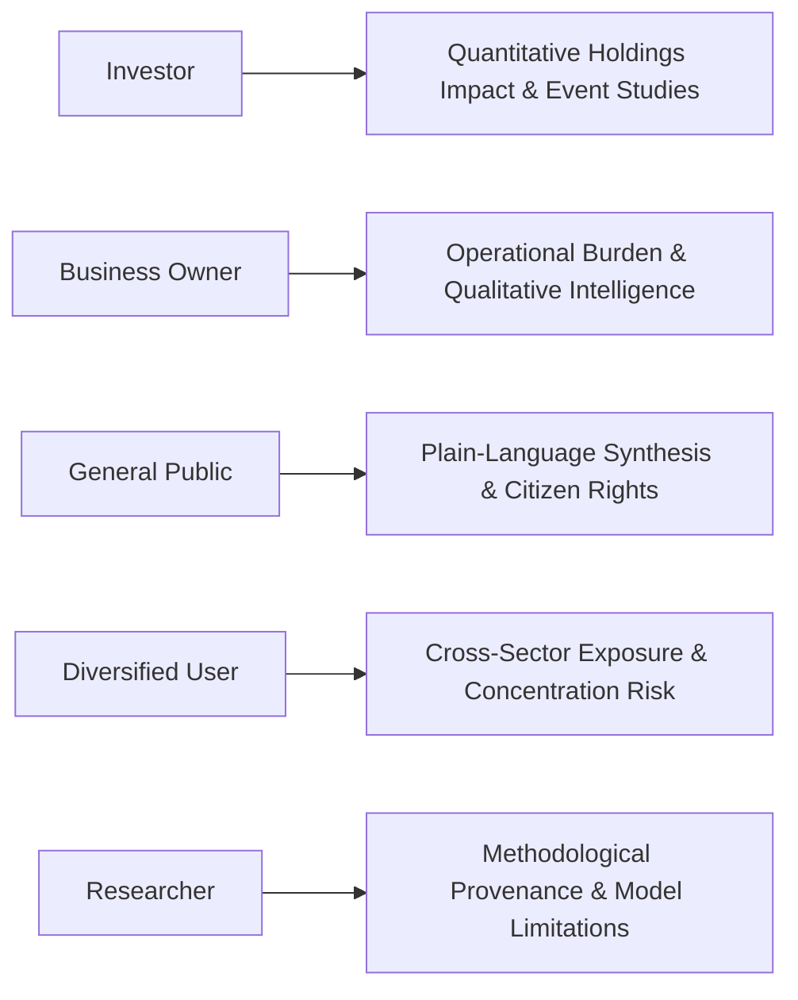
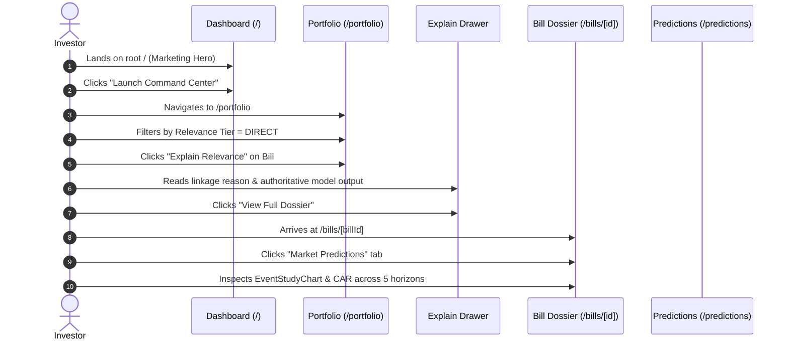
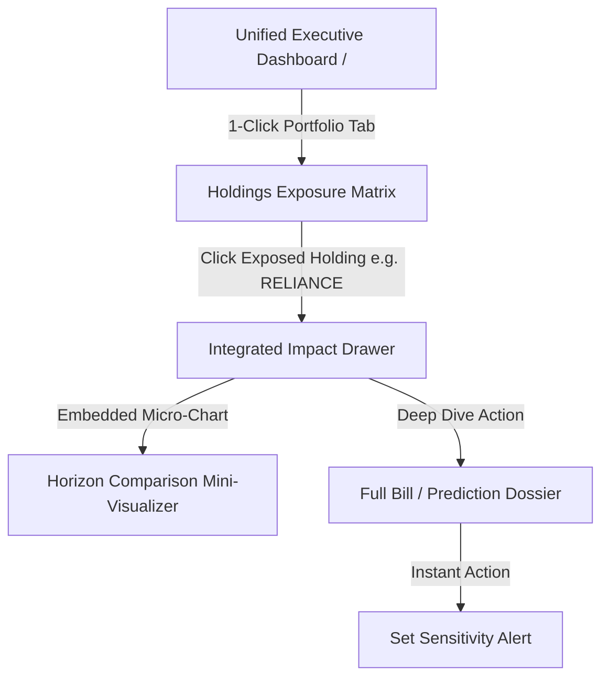
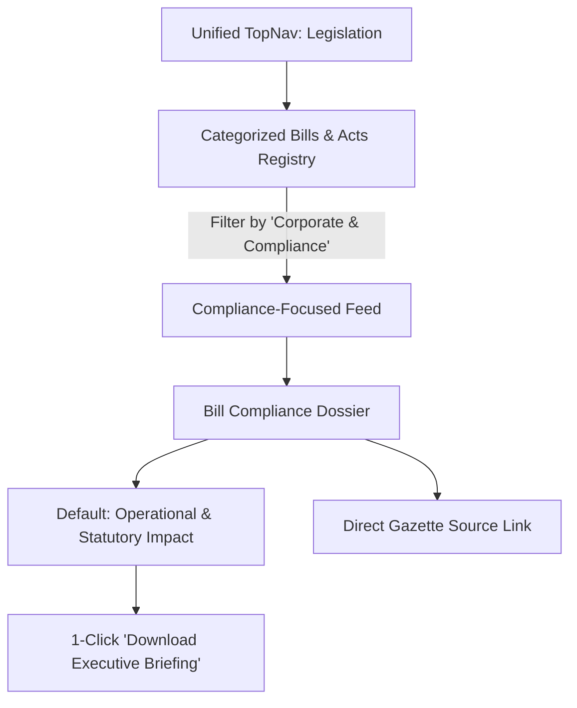
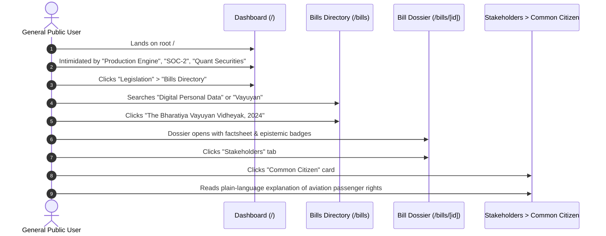
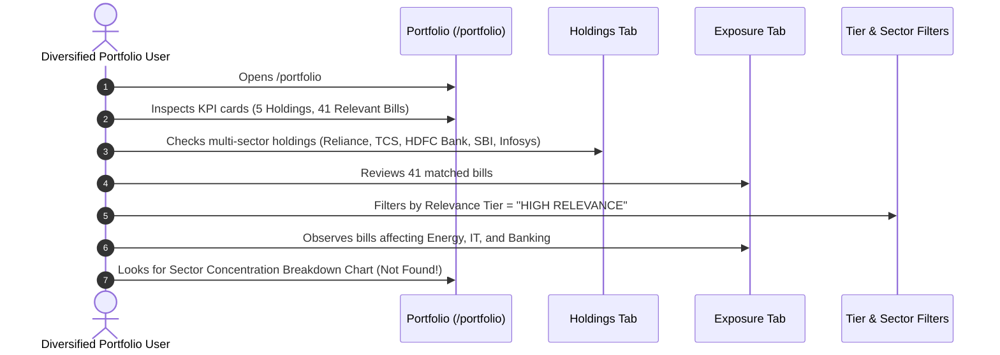
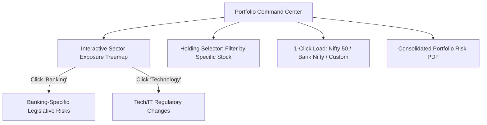
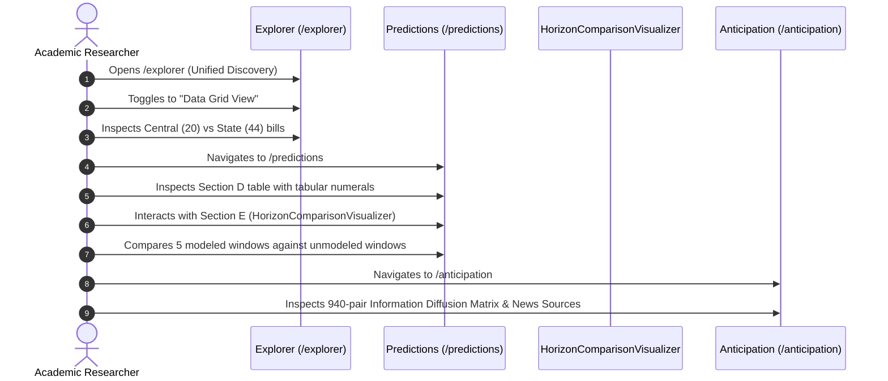
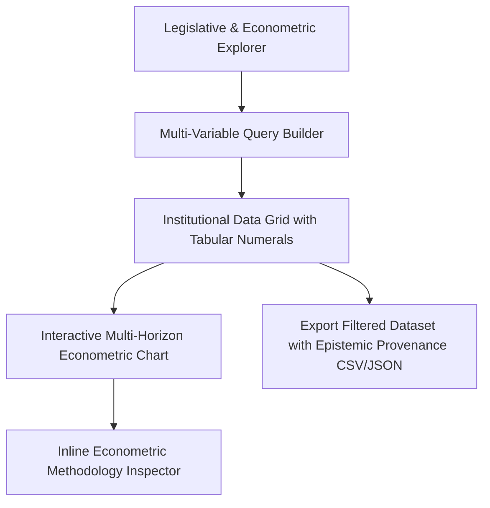

# TASK 1.5A — SEANCE END-TO-END USER JOURNEY MAP & WORKFLOW AUDIT

**Platform:** Seance — Legislative Bill Impact Prediction & Decision Intelligence Platform  
**Document Version:** 1.0.0  
**Phase:** 1.5A — Research, Audit & Implementation Planning  
**Execution Mode:** Audit Only — Zero Application Source-Code Modifications  
**Authoritative Baseline SHA-256:** `50ae76039bccf2e4a671cf2ae915889e490b17404db6eb2e49e7965ecd6400b7` (Verified Frozen)  
**Execution Date:** October 10, 2026  

---

## 1. Overview of Canonical Personas

To transform Seance from a fragmented research tool into a modern enterprise SaaS decision platform, we map and evaluate the end-to-end user journeys of five core personas:



Every journey is audited based on:
1. **Current Reality:** Exactly what routes, components, and clicks are required in the live application today.
2. **Observed Friction Points:** Obstacles, cognitive overload, dead ends, or missing data links.
3. **Proposed Streamlined Flow:** The optimized, zero-friction path proposed for implementation in Phase 1.5B.
4. **Analytical Boundaries:** Epistemic rigor, statutory firewalls, and non-financial advice constraints.

---

## 2. Persona A: Institutional Investor

### 2.1 Persona Profile & Core Objective
- **Role:** Equity Research Analyst, Portfolio Manager, or Risk Officer.
- **Primary Need:** Determine how pending or enacted legislation impacts listed portfolio securities, sectors, cumulative abnormal returns (CAR/MAR), and market pricing-in diffusion.
- **Mandate:** Zero tolerance for fabricated returns, non-financial advice compliance (no Buy/Sell/Hold), and verified event horizons.

### 2.2 Current Audited Journey & Click-Stream


### 2.3 Observed Friction Points & Usability Deficiencies
1. **Marketing Detour:** The user must bypass the public marketing hero on `/` before reaching analytical surfaces.
2. **Excessive Route Hops:** Moving from holding exposure to the actual multi-horizon trajectory chart requires 5 separate route transitions.
3. **Horizontal Tab Overflow on Bill Dossier:** As directly observed in the live audit, the tab bar on `/bills/[id]` clips the first tab label ("rate Exposure 1") on smaller desktop screens, requiring accidental mouse dragging to discover.
4. **No Direct Watchlist Action from Prediction View:** In `/predictions`, an investor reviewing market-moving probability cannot click "Add to Watchlist" or "Add to Portfolio" directly from the table row.

### 2.4 Proposed Streamlined Journey (Phase 1.5B)

- **Click-Depth Reduction:** Reduced from 6 clicks to 2 clicks to view econometric predictions for any owned holding.
- **Bidirectional Linking:** Deep links from prediction rows back to portfolio holdings.

---

## 3. Persona B: Business Owner or Corporate Decision-Maker

### 3.1 Persona Profile & Core Objective
- **Role:** Chief Legal Officer, Head of Public Policy, Compliance Director, or SME Business Owner.
- **Primary Need:** Assess new regulatory requirements, operational compliance costs, supply chain restrictions, and state-level legislative mandates.
- **Analytical Boundary:** State legislation carries **zero stock predictions**. Qualitative regulatory intelligence must not be conflated with econometric models.

### 3.2 Current Audited Journey & Click-Stream
```mermaid
sequenceDiagram
    autonumber
    actor Corp as Corporate Decision-Maker
    participant Nav as TopNavbar
    participant Bills as Bills Directory (/bills)
    participant State as State Assemblies (/states)
    participant Dossier as Bill Dossier (/bills/[id])
    participant Stakeholder as Stakeholders Tab

    Corp->>Nav: Clicks "Legislation" dropdown
    Corp->>Nav: Hesitates between 8 links; selects "Bills Directory"
    Corp->>Bills: Filters by Sector = "Infrastructure" & Status = "Active"
    Corp->>Bills: Clicks "The Merchant Shipping Bill, 2024"
    Corp->>Dossier: Dossier opens
    Corp->>Dossier: Scrolls past econometric tabs to "Stakeholders" tab
    Corp->>Stakeholder: Selects "Business Owner" card
    Corp->>Stakeholder: Reads "Official Statutory Fact" & "Analytical Impact Interpretation"
```

### 3.3 Observed Friction Points & Usability Deficiencies
1. **Cognitive Overload in Legislation Menu:** 8 options in the dropdown menu cause hesitation when searching for corporate-relevant bills.
2. **Econometric Dominance:** The default view on Central bills emphasizes stock predictions and CAR percentages rather than statutory compliance provisions and enforcement timelines.
3. **Missing Executive Briefing Export:** The stakeholder tab displays actionable compliance analysis, but has no single-click "Export Corporate Briefing (PDF)" button. To generate a report, the user must navigate to `/reports`, select options manually, and download.
4. **State Act Disconnect:** When viewing a State act (e.g. in Andhra Pradesh or Karnataka), official state gazette PDFs are not linked inline within the business impact card.

### 3.4 Proposed Streamlined Journey (Phase 1.5B)


---

## 4. Persona C: General Public User

### 4.1 Persona Profile & Core Objective
- **Role:** Concerned Citizen, Journalist, Student, or Civic Advocate.
- **Primary Need:** Understand what a bill does in simple, plain language, how it affects consumer prices, civil liberties, or daily life, with clear uncertainty and evidence disclaimers.
- **Constraint:** Zero financial jargon, zero mathematical formulas, and zero political speculation.

### 4.2 Current Audited Journey & Click-Stream


### 4.3 Observed Friction Points & Usability Deficiencies
1. **Intimidating Institutional Jargon:** The home page and bills directory prioritize institutional financial terminology (`ISIN`, `CAR`, `[-1,+1]`, `Z-Score`), creating a high barrier to entry for civic users.
2. **Buried Plain-Language Summary:** The plain-language synthesis is hidden under the fourth sub-tab (*Stakeholders* → *Common Citizen*) of the bill dossier.
3. **Lack of Clause Citations:** While the summary is clear, users cannot see which specific section/clause of the act produced the civic insight.

### 4.4 Proposed Streamlined Journey (Phase 1.5B)
```mermaid
graph TD
    Entry[Public-Friendly Mode / Explorer] --> Search[Plain-Language Search: 'What does this law do?']
    Search --> BillCard[Civic Overview Card]
    BillCard --> Highlights[At-a-Glance: Everyday Life Implications]
    Highlights --> PlainSummary[Plain-English Breakdown]
    PlainSummary --> CertaintyLevel[Epistemic Certainty Indicator: [FACT] vs [INTERPRETATION]]
    PlainSummary --> FullText[Read Official Bill Text PDF]
```

---

## 5. Persona D: Diversified Portfolio User

### 5.1 Persona Profile & Core Objective
- **Role:** Family Office Wealth Manager, Multi-Asset Fund Manager, or Diversified Retail Investor.
- **Primary Need:** Consolidated exposure analysis across a basket of equities spanning diverse sectors (Energy, Banking, IT, Pharma, Infrastructure, Consumer).
- **Critical Requirement:** **Agriculture is strictly an example sector, not a special case.** The system must treat all 13 sectors with equal rigor and never bias relevance toward any single industry.

### 5.2 Current Audited Journey & Click-Stream


### 5.3 Observed Friction Points & Usability Deficiencies
1. **Absence of Sector Concentration Visualizer:** Exposures are listed linearly (41 cards). A diversified manager cannot instantly see whether their legislative risk is concentrated 60% in Financials or distributed evenly.
2. **Missing Per-Holding Filter:** Users cannot click on a single holding (e.g. "Infosys") to isolate bills affecting only that company.
3. **Unmatched Ticker Ambiguity:** If a user adds a ticker outside the 70 master companies (e.g. a small-cap non-modeled stock), the system returns a generic error rather than explaining: *"Company recognized, but currently in unmodelled universe (outside the 47 quantitative securities)."*

### 5.4 Proposed Streamlined Journey (Phase 1.5B)


---

## 6. Persona E: Researcher or Academic Analyst

### 6.1 Persona Profile & Core Objective
- **Role:** Public Policy Scholar, Econometrician, Parliamentary Researcher, or Financial Journalist.
- **Primary Need:** Complete access to the full legislative universe (66 acts), raw data provenance, event study methodology parameters, alternative event horizons (`[-1,+1]` to `[-10,+10]`), and news diffusion evidence.
- **Epistemic Standard:** Must see explicit tags: `[FACT]`, `[OBSERVED]`, `[DERIVED]`, `[INTERPRETATION]`, `[PREDICTION]`, `[EVIDENCE]`.

### 6.2 Current Audited Journey & Click-Stream


### 6.3 Observed Friction Points & Usability Deficiencies
1. **Methodology Documentation Separation:** Econometric specifications (market model window `[-120, -21]`, estimation error bounds) are in static markdown files rather than accessible via an interactive UI appendix.
2. **Missing Multi-Horizon Trajectory Overlay:** In `/predictions/[predictionId]`, alternative horizons are displayed as distinct cards rather than a single multi-curve trajectory overlay allowing statistical comparison of horizon decay.
3. **Data Export Friction:** While data tables are comprehensive, researchers cannot export filtered query results directly to CSV or JSON with full epistemic metadata.

### 6.4 Proposed Streamlined Journey (Phase 1.5B)


---

## 7. Comparative Journey Metrics & Friction Summary

| Persona | Current Click Depth | Proposed Click Depth | Major Friction Point in Current Platform | Primary Optimization in Phase 1.5B |
|---|:---:|:---:|---|---|
| **Investor** | 6 clicks | 2 clicks | Marketing landing page detour; disconnected prediction rows | 1-Click portfolio view; contextual quick actions from predictions |
| **Business Owner** | 5 clicks | 2 clicks | 8 competing options in Legislation menu; buried compliance tab | Categorized menu; default compliance impact view; 1-click briefing |
| **General Public** | 4 clicks | 1 click | Technical jargon dominance; civic summary buried in 4th sub-tab | Public-friendly overview cards; clause citation links |
| **Diversified User** | 4 clicks | 1 click | Linear 41-bill list; no sector concentration visualizer | Interactive sector risk breakdown bar; per-holding filtering |
| **Researcher** | 5 clicks | 2 clicks | Offline methodology docs; no bulk dataset export | Interactive methodology inspector; filtered CSV/JSON export |

---

## 8. Analytical Safeguards Across All Journeys

Across every evaluated user journey, the following invariants are strictly safeguarded:
1. **Zero Financial Advice:** Under no circumstances will any journey present Buy, Sell, or Hold recommendations, target prices, or guaranteed returns.
2. **State Stock Prediction Firewall:** State bills (AP, KA, KL, TS) will maintain exactly 0 stock predictions across all persona views.
3. **Intelligence Company Isolation:** Private entities will remain strictly firewalled from quantitative return calculations.
4. **Epistemic Label Integrity:** All insights will carry immutable epistemic markers: `[FACT]`, `[OBSERVED]`, `[DERIVED]`, `[INTERPRETATION]`, `[PREDICTION]`, `[EVIDENCE]`.
5. **Sector Neutrality:** No single sector (e.g. Agriculture) will receive artificial priority over any other sector.
