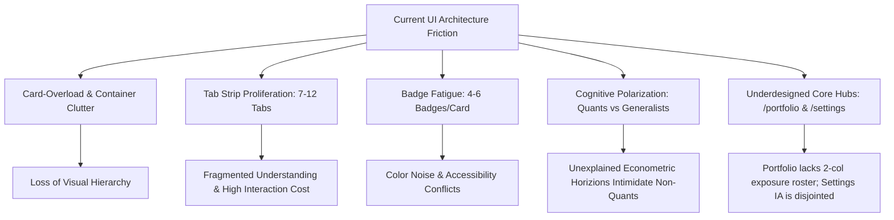
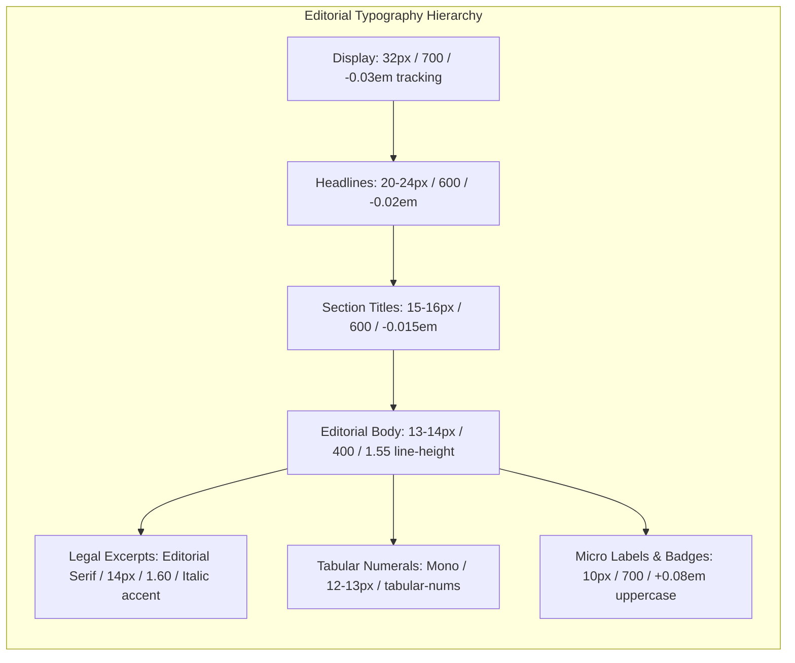
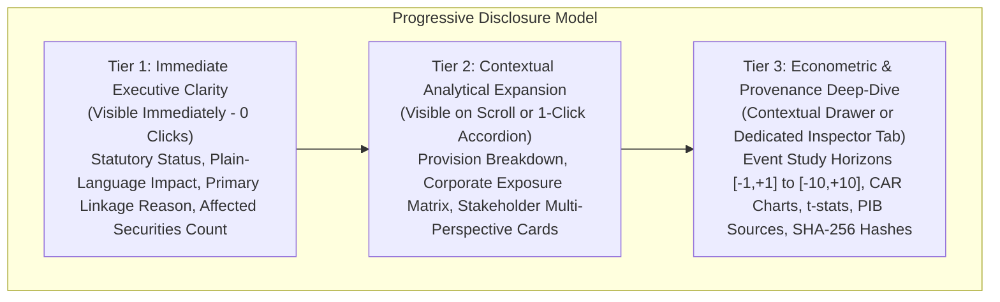
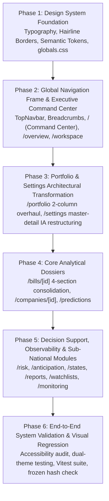

# TASK 1.6A — SEANCE EXPERIENCE REDESIGN: COMPREHENSIVE AUDIT & DESIGN SPECIFICATION

**Platform:** Seance — Legislative Bill Impact Prediction & Decision Intelligence Platform  
**Document Version:** 1.0.0  
**Phase:** 1.6A — Experience Redesign Audit & Planning  
**Execution Date:** October 29, 2026  
**Execution Mode:** Audit & Specification Only — Zero Application Source-Code Modifications  
**Authoritative Baseline SHA-256:** `50ae76039bccf2e4a671cf2ae915889e490b17404db6eb2e49e7965ecd6400b7` (**VERIFIED EXACT BIT-FOR-BIT MATCH**)  
**Status:** COMPLETE & READY FOR REVIEW  

---

## 1. Executive Summary & Authoritative Context

### 1.1 Project Context & Redesign Imperative
Seance is India's premier legislative bill impact and decision-intelligence platform. It bridges parliamentary enactments (Central Lok Sabha/Rajya Sabha and State Legislative Assemblies) with corporate exposure networks, econometric market impact predictions, information diffusion diagnostics, and stakeholder intelligence.

Recent engineering initiatives (Tasks 1.2–1.5B) established essential UI modernization, including semantic token infrastructure, dual-theme toggling, responsive navigation drawers, and cross-workflow links. However, direct evaluation reveals that the user experience remains:
- **Visually Cluttered:** High saturation of colored badges, competing sub-headings, repeated status pills, and dense metric grids creating cognitive fatigue.
- **Generic & AI-Dashboard Heavy:** Heavy reliance on floating card-within-card containers, uncalibrated border strokes, and decorative visual gimmicks reminiscent of generic SaaS templates rather than institutional finance terminals.
- **Information Architecture Bottlenecks:** Horizontal tab overload (e.g. 12 tabs on `/bills/[billId]`, 9 tabs on `/companies/[companyId]`, 7 tabs on `/monitoring`, 7 tabs on `/settings`) forces users to hunt through fragmented surfaces to synthesize a single holistic view.
- **Financial Knowledge Barriers:** Advanced econometric concepts (event study horizons `[-1,+1]` to `[-10,+10]`, cumulative abnormal returns, diffusion z-scores, p-values, t-statistics) sit alongside plain-language policy narratives without tiered progressive disclosure. General users and policy researchers are overwhelmed by raw quantitative tables, while institutional quantitative analysts lack high-density, customizable inspection views.
- **Underdesigned Anchor Pages:** The Portfolio (`/portfolio`) and Settings (`/settings`) pages specifically require complete structural overhauls rather than cosmetic patches.

### 1.2 Non-Destructive Audit Mandate & Strict Safeguards
Task 1.6A is strictly an **Audit and Design Specification Phase**. It does not modify production code, routes, behavior, APIs, data, models, or schemas.

**Authoritative Safeguard Guarantees:**
1. **Frozen Baseline Preservation:** The canonical production baseline manifest (`docs/production_baseline.json`) with SHA-256 hash `50ae76039bccf2e4a671cf2ae915889e490b17404db6eb2e49e7965ecd6400b7` remains 100% untainted and verified bit-for-bit.
2. **Statutory Firewalls Maintained:** Sub-national State legislation (44 acts across Andhra Pradesh, Karnataka, Kerala, Telangana) carries strictly **0 quantitative stock predictions**. Intelligence-only private/statutory companies (23 entities) remain strictly firewalled from quantitative market prediction models.
3. **Regulatory Non-Advice Principle:** No Buy/Sell/Hold recommendations, price targets, automated trading triggers, or personalized investment advice are permitted.
4. **Sector Invariant:** No individual sector is hardcoded as the sole supported sector.
5. **Route & Data Contract Preservation:** All 35 page files across 31 unique Next.js routes, all backend REST endpoints (`/api/v1/*`), multi-tenant boundaries (IDOR isolation), and database schemas are 100% preserved.

---

## 2. Verified Codebase Route & Component Inventory

### 2.1 Complete Route Inventory (35 Page Files / 31 Unique Routes)
Every route was inspected against the live Next.js App Router tree in `frontend/app`. No routes are deleted, aliased routes remain accessible, and the discovered settings route is formally cataloged.

| # | Route URL | Page File Path | Primary Persona | Core Data APIs | Implementation Status |
|---|---|---|---|---|---|
| 1 | `/` | `frontend/app/page.tsx` | All / Executive / First-Time | `authApi.getMe()`, `useCoverage()` | Active Entrypoint (Needs Command Center Redesign) |
| 2 | `/overview` | `frontend/app/overview/page.tsx` | Policy Researcher / System Auditor | `billsApi`, `predictionsApi`, `companiesApi`, `monitoringApi`, `useCoverage()` | Active (Observatory & Baseline Telemetry) |
| 3 | `/workspace` | `frontend/app/workspace/page.tsx` | Daily Analyst / Decision-Maker | `workspaceApi.getSummary()`, `getActivity()`, `getWatchlistActivity()` | Active (Personal Decision Workbench) |
| 4 | `/portfolio` | `frontend/app/portfolio/page.tsx` | Institutional Investor / Asset Manager | `portfolioApi.listPortfolios()`, `getExposure()`, `explainRelevance()`, `generateReport()` | Active (Major Redesign Anchor) |
| 5 | `/bills` | `frontend/app/bills/page.tsx` | Policy Researcher / Legal Counsel | `billsApi.listBills()` (page, limit, search, jurisdiction) | Active (Parliamentary & State Act Registry) |
| 6 | `/bills/[billId]` | `frontend/app/bills/[billId]/page.tsx` | All Personas (Drill-down) | `billsApi.getBillDetail()`, `getPredictionStatus()`, `getAnticipation()` | Active (12-tab dossier needs progressive disclosure) |
| 7 | `/bills/compare` | `frontend/app/bills/compare/page.tsx` | Regulatory Analyst / Policy Officer | `billsApi.getBillDetail(billA, billB)` | Active (Statutory Diff & Overlap Workbench) |
| 8 | `/explorer` | `frontend/app/explorer/page.tsx` | Research Desk / Legal Investigator | `billsApi.listBills()`, `searchApi.unifiedSearch()` | Active (Faceted Discovery Matrix) |
| 9 | `/latest-bills` | `frontend/app/latest-bills/page.tsx` | Compliance Officer / News Desk | Live Ingestion Feed Metadata (Central & State) | Active (Live Discovery Feed) |
| 10 | `/upcoming-legislation` | `frontend/app/upcoming-legislation/page.tsx` | Government Affairs / Strategist | Authoritative Parliamentary Calendar Feeds | Active (Scheduled Sessions & Readings) |
| 11 | `/live-discovery` | `frontend/app/live-discovery/page.tsx` | Ingestion Engineer / Monitor | Live Source Ingestion Pipelines (Unmodelled) | Active (Raw Gazette Discovery Stream) |
| 12 | `/states` | `frontend/app/states/page.tsx` | Regional Policy Analyst / State Officer | Static & API State Registry (AP, KA, KL, TS) | Active (Sub-National Legislative Hub) |
| 13 | `/states/[state]` | `frontend/app/states/[state]/page.tsx` | Regional Legal Analyst | `statesApi.getStateDetail()`, `billsApi.listBills()` | Active (State Assembly Dossier) |
| 14 | `/predictions` | `frontend/app/predictions/page.tsx` | Quant Analyst / Equity Strategist | `predictionsApi.listPredictions()`, `coverageApi.getReport()` | Active (4,700 Event Studies & 5 Horizons) |
| 15 | `/predictions/[predictionId]` | `frontend/app/predictions/[predictionId]/page.tsx` | Quantitative Portfolio Manager | `predictionsApi.getPredictionDetail()` | Active (Event Horizon Decomposition) |
| 16 | `/risk` | `frontend/app/risk/page.tsx` | Chief Risk Officer / Compliance Desk | `riskApi.getRiskSummary()`, `getPortfolioRisk()` | Active (Systemic Risk Bands & ISIN Calculator) |
| 17 | `/anticipation` | `frontend/app/anticipation/page.tsx` | Market Surveillance / Strategist | `anticipationApi.getAnticipationSummary()`, `list()` | Active (Pre-Event Information Diffusion) |
| 18 | `/companies` | `frontend/app/companies/page.tsx` | Equity Analyst / Corporate Strategist | `companiesApi.listCompanies()` (Quant + Intel) | Active (70 Companies: 47 Quant + 23 Intel) |
| 19 | `/companies/[companyId]` | `frontend/app/companies/[companyId]/page.tsx` | Institutional Investor / Analyst | `companiesApi.getCompanyDetail()`, `getExposures()` | Active (Mode A Quant vs Mode B Intel Profile) |
| 20 | `/industries` | `frontend/app/industries/page.tsx` | Sector Specialist / Equity Researcher | `industriesApi.listIndustries()` | Active (13 Sectors & Granular Taxonomy) |
| 21 | `/industries/[industryId]` | `frontend/app/industries/[industryId]/page.tsx` | Industry Specialist | `industriesApi.getIndustryDetail()` | Active (Industry Exposure & Risk Dossier) |
| 22 | `/industry/[industryId]` | `frontend/app/industry/[industryId]/page.tsx` | Deep Link Consumers | Redirect / Alias to `/industries/[industryId]` | Active (Singular Alias preserved) |
| 23 | `/sectors` | `frontend/app/sectors/page.tsx` | Macro Economist / Policy Maker | `industriesApi.listIndustries()` aggregated | Active (Macroeconomic Policy Vectors) |
| 24 | `/reports` | `frontend/app/reports/page.tsx` | Research Director / Executive | In-memory & Backend Report Generation Engine | Active (Downloadable Dossier Hub) |
| 25 | `/ai-analyst` | `frontend/app/ai-analyst/page.tsx` | Institutional Researcher / General User | `aiApi.askQuestion()` (Groq Llama-3-70b RAG) | Active (Grounded Conversational Terminal) |
| 26 | `/monitoring` | `frontend/app/monitoring/page.tsx` | Data Engineer / Operations Desk | `monitoringApi.getOverview()`, `listSources()` | Active (Ingestion Health & Source Registry) |
| 27 | `/coverage` | `frontend/app/coverage/page.tsx` | Lead Auditor / Technical Due Diligence | `coverageApi.getReport()` | Active (Immutable Baseline Audit Surface) |
| 28 | `/watchlists` | `frontend/app/watchlists/page.tsx` | Personalized Analyst / Asset Manager | `watchlistsApi.listWatchlists()`, `create()` | Active (Custom Alert & Entity Watchlists) |
| 29 | `/watchlists/[watchlistId]` | `frontend/app/watchlists/[watchlistId]/page.tsx` | Portfolio Monitor | `watchlistsApi.getWatchlist()`, `addEntity()` | Active (Watchlist Entity Management) |
| 30 | `/alerts` | `frontend/app/alerts/page.tsx` | Operations Desk / Risk Manager | `alertsApi.listAlerts()`, `acknowledgeAlert()` | Active (Triggered Legislative Events Feed) |
| 31 | `/notifications` | `frontend/app/notifications/page.tsx` | All Users | `notificationsApi.listNotifications()`, `getDigests()` | Active (In-App Notification Center) |
| 32 | `/settings` | `frontend/app/settings/page.tsx` | Org Admin / Tenant Owner / Member | `authApi.getMe()`, `getOrg()`, `listMembers()`, `alertsApi`, `ai/usage` | **DISCOVERED ROUTE** (7 Tabs, Needs IA Redesign) |
| 33 | `/onboarding` | `frontend/app/onboarding/page.tsx` | First-Time User / Tenant Admin | `watchlistsApi.create()`, `alertsApi.update()` | Active (8-Step Setup & Tour Wizard) |
| 34 | `/login` | `frontend/app/login/page.tsx` | Authenticating User | `authApi.login()`, `getStatus()` | Active (Session & Tenant Authentication) |
| 35 | `/signup` | `frontend/app/signup/page.tsx` | Prospective Organization | `authApi.register()` | Active (Self-Service Tenant Provisioning) |

### 2.2 Component & Architectural Inventory
- **Global Layout Frames:** `frontend/components/layout/TopNavbar.tsx` (active 5-hub navigation, Command Palette modal trigger, live monitoring telemetry pulse, notifications bell, user session profile menu, and mobile slide-over drawer). Note: `Sidebar.tsx` and `Header.tsx` exist in the directory as legacy/dormant components not mounted in `RootLayout`.
- **Shared UI Primitive Library (`components/ui/`):**
  `Badge.tsx`, `Button.tsx`, `Card.tsx`, `CommandPalette.tsx`, `ContextDrawer.tsx`, `DataStatusBadge.tsx`, `EpistemicBadge.tsx`, `Icons.tsx`, `Input.tsx`, `InstitutionalTable.tsx`, `Modal.tsx`, `Pagination.tsx`, `PlaceholderPage.tsx`, `SearchInput.tsx`, `Skeleton.tsx`, `Tabs.tsx`, `Tooltip.tsx`.
- **Theme & Branding Primitives:**
  `frontend/lib/theme/ThemeProvider.tsx`, `frontend/components/theme/ThemeSwitcher.tsx`, `frontend/components/brand/BrandEmblem.tsx`, `frontend/components/brand/SeanceBrand.tsx`.
- **Domain Visualization Primitives (`components/charts/`):**
  `HorizonComparisonVisualizer.tsx`, `RiskDistributionVisualizer.tsx`, `TimelineVisualizer.tsx`, `ChartContainer.tsx`.
- **Firewall & Compliance Enforcement Primitives:**
  `StatePredictionFirewall.tsx` (strictly blocks stock predictions on state bills), `IntelligenceCompanyFirewall.tsx` (strictly isolates qualitative entities).
- **Test Baseline:** 34 test suites comprising 330 individual unit and integration tests covering components, layouts, theme foundations, API clients, and page states with 100% test passing status.

---

## 3. Systematic UX Problem Identification & Diagnosis



### 3.1 Global Systemic Problems Across Route Families

#### 1. Card-Heavy Clutter & "Card-in-Card" Nesting
- **Observation:** Almost every layout pattern defaults to wrapping information in rounded cards with borders, background tints, and elevated drop shadows. Inside these cards, secondary metrics and linkage reasons are wrapped in *further* nested cards.
- **Impact:** Surfaces feel boxy, heavy, and visually loud. The eye lacks a resting point, and typography cannot establish natural vertical rhythm.

#### 2. Horizontal Tab Strip Proliferation
- **Observation:** Complex analytical views default to wide horizontal tab strips:
  - `/bills/[billId]`: 12 tabs (`overview`, `timeline`, `changes`, `provisions`, `sectors`, `exposures`, `predictions`, `anticipation`, `stakeholders`, `documents`, `ai`, `provenance`).
  - `/companies/[companyId]`: 9 tabs (`overview`, `footprint`, `transmission`, `geography`, `predictions`, `anticipation`, `stakeholders`, `ai`, `provenance`).
  - `/monitoring`: 7 tabs (`overview`, `sources`, `history`, `changes`, `discovery`, `scheduler`, `ai`).
  - `/settings`: 7 tabs (`profile`, `organization`, `security`, `alerts`, `ai`, `privacy`, `plans`).
- **Impact:** Users are forced into a fragmented, click-heavy journey. They cannot see the statutory summary alongside the corporate exposure without switching tabs. On viewports between 1024px and 1280px, tab bars overflow or truncate labels.

#### 3. Badge Saturation & Color Competitiveness
- **Observation:** Single entity rows or cards frequently present 4 to 6 simultaneous badges: e.g., Jurisdiction (`[CENTRAL]`), Legislative Status (`[ASSENTED]`), Capability (`[LEVEL 1]`), Relevance Tier (`[DIRECT]`), Model Status (`[MODELLED]`), and Epistemic Classification (`[FACT]`).
- **Impact:** The visual landscape resembles a patchwork of colored chips. Critical statutory or risk flags lose urgency because everything is badged.

#### 4. Cognitive Polarization (The Dual-Audience Dilemma)
- **Observation:** The platform caters to five distinct personas (Institutional Investors, Corporate Executives/Officers, General Public/Citizens, Diversified Portfolio Managers, and Legal/Policy Researchers). Currently, raw quantitative metrics (e.g. `[-5,+10]` event window cumulative abnormal returns, p-values, t-stats) are presented without layered context, confusing policy researchers and business owners. Conversely, institutional quants must click through basic narrative overviews to find statistical confidence intervals.
- **Impact:** The experience is either too technical for generalists or insufficiently dense for professional analysts.

---

### 3.2 Page-by-Page UX Audit & Problem Mapping

#### 1. Landing Page / Executive Command Center (`/`)
- **Primary Persona & Main Task:** All personas, first-time visitors, and returning executives seeking high-level legislative temperature, system scale, and direct access to personalized workspaces.
- **Immediate Information Required:** Platform macro status (Central acts scanned, State assemblies active, total corporate exposures, quant securities covered), authoritative market direction summary, and direct personal workspace entry.
- **Secondary / Contextual Information:** Deep architectural capability tier descriptions (L1/L2/L3), multi-tenant onboarding tour details, and historical methodology.
- **Verified Friction Points:**
  - Hardcoded dark styling remnants in hero background that clash with daytime Light mode.
  - Floating 120px blurred gradient circles that look like generic AI landing templates.
  - Stacking of 6 stat cards + 3 hub cards + 4 capability cards creating vertical sprawl before delivering actual legislative intelligence.
- **Preserved Capabilities:** Direct navigation to `/workspace`, `/overview`, `/portfolio`, `/settings`; live session detection; dynamic coverage counter fallback.
- **Data Provenance & Uncertainty:** Must clearly display the verified status of the production engine and maintain zero claim of live market predictions on sub-national records.

#### 2. Platform Observatory (`/overview`)
- **Primary Persona & Main Task:** Policy Researchers, Compliance Officers, and Lead System Auditors auditing coverage breadth across Central and State jurisdictions.
- **Immediate Information Required:** Capability level breakdown (L1 Market-Modelled, L2 State Intelligence, L3 Planned Roadmap), recent bill intake ticker, and live monitoring health pulse.
- **Secondary / Contextual Information:** Full database dumps of recent predictions, companies, and subsystem health records.
- **Verified Friction Points:**
  - Functions as a massive 9-section database dump rather than an executive observatory.
  - Users are presented with dozens of repetitive entity cards that duplicate what is already in `/bills`, `/predictions`, and `/companies`.
- **Preserved Capabilities:** Real-time API data fetching across coverage, bills, predictions, companies, and monitoring status; statutory zero-prediction notices.

#### 3. Personalized Workbench (`/workspace`)
- **Primary Persona & Main Task:** Daily Institutional Analyst and Corporate Officer answering: *"What changed since I last logged in?", "Which monitored bills affect my watched companies?", "What unread alerts require attention?"*
- **Immediate Information Required:** Unread alert alerts, high-severity legislative updates affecting watched entities, unread change feed, and active watchlist quick-switch.
- **Secondary / Contextual Information:** Deep AI workspace assistant conversational thread, full workspace activity archive, and multi-entity relationship cards.
- **Verified Friction Points:**
  - Cluttered hero header with multiple competing metric badges.
  - Grouped activity feeds and entity tabs (`bills`, `companies`, `industries`, `jurisdictions`) stacked without clear priority.
  - The embedded AI Workspace Assistant occupies significant vertical space on smaller screens without being collapsible into an on-demand drawer.
- **Preserved Capabilities:** `workspaceApi` summary and activity feeds; unread digest counters; epistemic badges (`[FACT]`, `[DERIVED]`, `[PREDICTION]`); Grounded Groq AI Assistant.

#### 4. Legislative Directory & Bill Dossier (`/bills`, `/bills/[billId]`, `/bills/compare`, `/explorer`)
- **Primary Persona & Main Task:** Legal Counsel, Policy Researchers, and Corporate Decision-Makers inspecting statutory provisions, amendment trajectories, corporate exposures, and market models.
- **Immediate Information Required:** Act Title, Official Number, Gazette Assent Date, Legislative Journey status, Executive Plain-Language Summary, and Direct Corporate Exposures.
- **Secondary / Contextual Information:** Detailed procedural clause mapping, sector policy vectors, event-study horizons, pre-event diffusion diagnostics, 5-persona stakeholder reports, official PDF gazette provenance.
- **Verified Friction Points:**
  - **The 12-Tab Dossier Nightmare:** `/bills/[billId]` forces users across 12 horizontal tabs to read a single bill. Vital corporate exposures and market predictions are isolated behind tabs that many users miss.
  - In `/bills`, view toggling between Table and Grid lacks consistent column alignment for tabular numbers.
  - In `/bills/compare`, the side-by-side diff is cluttered with repeated metadata cards instead of a clean statutory clause-by-clause delta table.
- **Preserved Capabilities:** `StatePredictionFirewall` on all sub-national bills; central 47-security quant model display; Groq AI plain-language summaries; stakeholder intelligence (Investor, Business Owner, Citizen, Employee, Regulator); gazette PDF links and provenance hashes.

#### 5. Corporate Universe & Exposure Matrices (`/companies`, `/companies/[companyId]`, `/industries`, `/sectors`)
- **Primary Persona & Main Task:** Equity Analysts, Portfolio Managers, and Corporate Strategists assessing an enterprise's statutory footprint, supply-chain exposures, and state presence.
- **Immediate Information Required:** Master Corporate Identity, Quantitative Status (Mode A Listed vs. Mode B Intelligence), Exposed Central Acts, State Geographic Presence, and primary economic transmission mechanisms.
- **Secondary / Contextual Information:** Pre-event anticipation scores, peer company overlap, multi-horizon event study models, and downloadable corporate briefings.
- **Verified Friction Points:**
  - `/companies/[companyId]` uses a 9-tab strip that obscures the vital connection between an act and its economic transmission mechanism.
  - The distinction between Mode A (Quant Listed, 47 companies) and Mode B (Intelligence-only, 20 qualitative + 3 reference entities) is explained through repetitive text blocks rather than an authoritative institutional badge and layout adaptation.
- **Preserved Capabilities:** Complete isolation of Mode B entities from stock prediction tables; exposure matrix with direct vs. indirect filters; state operational footprint mapping; peer entity links.

#### 6. Quantitative Predictions & Market Event Studies (`/predictions`, `/predictions/[predictionId]`)
- **Primary Persona & Main Task:** Quantitative Analysts, Equity Strategists, and Fund Managers evaluating econometric event-study horizons for Central legislative shocks.
- **Immediate Information Required:** 4,700 prediction records filterable by Company (ISIN), Bill ID, Event Horizon (`[-1,+1]` to `[-10,+10]`), Predicted Direction (`POSITIVE`, `NEGATIVE`, `NEUTRAL`), and Statistical Significance ($p < 0.05$).
- **Secondary / Contextual Information:** Event study methodology notes, market model parameters, confidence intervals, and cumulative abnormal return (CAR) plots.
- **Verified Friction Points:**
  - Heavy filter bar with 7 separate dropdowns crowding the screen.
  - Tabular rows display directional glyphs and probability percentages, but lack quick sorting and interactive horizon comparisons in a split-screen view.
  - Non-financial users visiting this page see raw quantitative numbers without plain-language tooltips explaining what `[-5,+10]` represents.
- **Preserved Capabilities:** All 4,700 frozen baseline predictions; 5 authoritative event windows; exclusion of state bills; exclusion of Mode B companies; neutral research language without Buy/Sell/Hold advice.

#### 7. Portfolio Legislative Exposure Workspace (`/portfolio`) — *Major Redesign Target*
- **Primary Persona & Main Task:** Institutional Investors, Family Offices, and Corporate Treasurers tracking specific holdings against active and enacted legislation.
- **Immediate Information Required:**
  1. High-level Portfolio Summary (Total Holdings, Exposed %, Count of Exposed Holdings).
  2. Exposure Distribution (How many holdings are exposed to Direct vs. High Relevance vs. Indirect legislation).
  3. Legislative Impact Groupings (Which specific bills impact my holdings, grouped by urgency and statutory impact).
  4. Exposed Holdings Roster (Which companies are affected, with inline bill count).
- **Secondary / Contextual Information:** Grounded AI relevance explanation modal ("Why is this bill relevant to my portfolio?"), CSV/XLSX file import drawer, and full printable Executive Impact Report.
- **Verified Friction Points in Current Code:**
  - 6 large KPI cards stacked at the top consume almost 250px of vertical space before any data is shown.
  - The page splits into 3 horizontal tabs (`exposure`, `holdings`, `report`). An investor inspecting a bill in Tab 1 cannot see their holdings list without flipping to Tab 2.
  - The bill exposure list is rendered as massive individual cards, each with nested linkage cards and model boxes, leading to extreme vertical scrolling.
  - There is no visual breakdown of portfolio exposure across sectors or jurisdictions.
- **Preserved Capabilities:** `portfolioApi` integration (`listPortfolios`, `getExposure`, `explainRelevance`, `generateReport`, `addHolding`, `removeHolding`, `uploadHoldings`); strict non-financial advice notices; State bill prediction firewall (0 predictions); authoritative Central model data display where applicable.

#### 8. SaaS Settings & Governance (`/settings`) — *Discovered Route & Major IA Target*
- **Discovered Location:** `frontend/app/settings/page.tsx` (Route: `/settings`).
- **Primary Persona & Main Task:** Tenant Administrator, Organization Owner, and Compliance Officer managing user profile, RBAC team access, notification triggers, and data privacy.
- **Existing Capabilities Audited in Code:**
  1. *Profile & Identity:* User ID, email, display name, assigned role (`OWNER`, `ADMIN`, `MEMBER`, `VIEWER`).
  2. *Organization & Team (RBAC):* Tenant ID, tier (`FREE`, `PRO`, `TEAM`, `ENTERPRISE`), billing status, member invitation form with email and role selection, member list table with role change dropdown and member deletion (owner-only).
  3. *Security & Sessions:* HMAC session cryptographic verification status, SSO/SAML status (evaluation mode), session timeout notice, permanent token revocation on sign-out.
  4. *Notifications & Alerts:* Master alert switch, digest frequency (`REALTIME`, `DAILY`, `WEEKLY`), minimum severity threshold (`LOW`, `MEDIUM`, `HIGH`, `CRITICAL`), allowed channels (`IN_APP`), quiet hours toggles.
  5. *AI & Metering:* Monthly query consumption telemetry, monthly quota, 100% grounding verification stamp, IDOR context validation privacy guarantees.
  6. *Data Governance & Privacy:* Complete JSON tenant data export download, statutory & prediction immutability guarantee notice, soft-delete organization danger zone (owner-only).
  7. *Subscription Plans:* Evaluation mode disclaimer (`BILLING_NOT_CONNECTED`), tier feature comparison cards.
- **Verified Friction Points in Current Code:**
  - 7 disjointed horizontal tabs spread across a wide container with no unified sidebar or master-detail navigation.
  - Uneven density: `profile` and `security` are sparse cards with few fields, while `organization` mixes member lists and invite forms awkwardly.
  - Subscription cards show disabled `PLAN_NOT_CONFIGURED` buttons that confuse users in evaluation mode.
- **Preserved Capabilities:** All existing auth and alert API calls (`authApi.getMe()`, `authApi.getOrganization()`, `authApi.listMembers()`, `authApi.inviteMember()`, `authApi.changeMemberRole()`, `authApi.removeMember()`, `alertsApi.getPreferences()`, `alertsApi.updatePreferences()`, `authApi.exportTenantData()`, `authApi.softDeleteTenant()`).

#### 9. Remaining Routes (Risk, Anticipation, States, Reports, Explorer, Monitoring, Alerts, Notifications)
- **`/risk`:** Systemic legislative risk matrix. Problem: AI analyst panel and custom ISIN calculator compete for space with the primary risk table. Need progressive drawer for the calculator.
- **`/anticipation`:** 940 diffusion scores. Problem: Mandatory legal disclaimer is buried in small text; needs prominent institutional provenance treatment.
- **`/states` & `/states/[state]`:** Sub-national assemblies. Problem: Header text clipping under fixed navbar; cards have high visual repetition. Need clean tabular state overview.
- **`/reports`:** Downloadable dossier hub. Problem: Grid of 7 template cards feels static; needs a unified report generation queue and recent downloads history panel.
- **`/ai-analyst`:** Conversational research terminal. Problem: Chat container lacks persistent context breadcrumb showing which bill or company is currently grounded.
- **`/monitoring`:** Ingestion telemetry. Problem: 7-tab bar causes layout shifting; needs primary telemetry strip with secondary tabs.

---

## 4. Distinctive Seance Design Direction: Premium Editorial-Finance Aesthetic

### 4.1 Design Philosophy: Authority, Precision, Restraint
The redesigned Seance experience rejects the trendy "generic AI-dashboard" tropes (indiscriminate 120px blurred colored spheres, vibrating glow borders, neon gradients, floating card-in-card containers, and arbitrary metric grids). 

Instead, Seance adopts a **Premium Editorial-Finance Aesthetic**, inspired by the world's most trusted institutions of economic authority and computational rigor:
- **Institutional Trust & Restraint:** Clear margins, generous negative space, hairline borders, and strict visual hierarchy.
- **Editorial Typography:** High-contrast pairing of an authoritative Grotesque Sans (`Inter`) for interface and data controls, paired with an elegant Editorial Serif accent (e.g. `Newsreader` or calibrated serif tokens) for long-form statutory extracts, legal provisions, and policy analyses.
- **Tabular Figures & Mathematical Precision:** Tabular numbers (`font-variant-numeric: tabular-nums lining-nums`) across all financial predictions, p-values, dates, and ISIN citations via `JetBrains Mono` / `SF Mono`.
- **Purposeful Color Economy:** Neutral slate and parchment canvases where color is reserved strictly for semantic state: emerald for confirmed positive shocks, rose for regulatory restriction/downside, amber for pre-event diffusion and scrutiny, and institutional blue for primary systemic navigation.

```
+----------------------------------------------------------------------------------------------------+
|  TRADITIONAL GENERIC AI DASHBOARD (AVOIDED)      |  SEANCE EDITORIAL-FINANCE AESTHETIC (ADOPTED)   |
+----------------------------------------------------------------------------------------------------+
|  Heavy floating cards with dropshadows           |  Hairline grid dividers & subtle surface shifts |
|  Indiscriminate neon gradients & glow blur       |  Restrained, semantic accent colors only        |
|  Horizontal 12-tab strips hiding content         |  Multi-column editorial progressive disclosure  |
|  Badges on every single data element             |  Hierarchical typography & contextual metadata  |
|  Animations for spectacle & spinning glyphs      |  150ms subtle state transitions, reduced-motion |
|  Dark-only canvas with light-theme collisions    |  Calibrated, equal-status Light, Dark & System  |
+----------------------------------------------------------------------------------------------------+
```

---

### 4.2 Typography System & Hierarchy



#### Typography Scale Tokens

| Token | Family | Size / Line-Height | Weight | Tracking | Purpose & Usage |
|---|---|---|---|---|---|
| `font-display` | `Inter`, -apple-system | `32px (2.0rem)` / `1.15` | `700` (Bold) | `-0.03em` | Primary command center titles, major platform milestones |
| `font-headline` | `Inter`, -apple-system | `22px (1.375rem)` / `1.25` | `600` (Semibold) | `-0.02em` | Dossier headers, Portfolio workspace title, Settings header |
| `font-title` | `Inter`, -apple-system | `16px (1.0rem)` / `1.35` | `600` (Semibold) | `-0.015em` | Section headers, card group titles, modal headers |
| `font-subhead` | `Inter`, -apple-system | `14px (0.875rem)` / `1.40` | `500` (Medium) | `-0.01em` | Table column categories, module descriptions |
| `font-body` | `Inter`, -apple-system | `13px (0.8125rem)` / `1.55` | `400` (Regular) | `0` | Primary analytical text, summaries, descriptions |
| `font-legal` | Editorial Serif / `Newsreader` | `14px (0.875rem)` / `1.65` | `400` / Italic | `0` | Gazette legal text, official statutory quotes, preamble |
| `font-tabular` | `JetBrains Mono` / Monospace | `12px (0.75rem)` / `1.40` | `500` (Medium) | `0` | Predictions, event windows, CAR values, ISINs, dates |
| `font-caption` | `Inter`, -apple-system | `11px (0.6875rem)` / `1.35` | `500` (Medium) | `+0.02em` | Column headers, footnotes, timestamps, data status |
| `font-micro` | `Inter`, -apple-system | `10px (0.625rem)` / `1.20` | `700` (Bold) | `+0.08em` | Epistemic badges, firewall stamps, ticker chips |

---

### 4.3 Spacing, Borders, Radius & Grid Geometry

1. **8-Point Spatial Grid:** All margins, paddings, and component dimensions adhere to standard multi-point tokens (`4px`, `8px`, `12px`, `16px`, `24px`, `32px`, `48px`, `64px`).
2. **Restrained Corner Radii:**
   - Small controls (badges, buttons, inputs): `rounded-md` (`6px`).
   - Structural containers (inspection panels, drawers, tables): `rounded-lg` (`8px`) or `rounded-xl` (`12px`).
   - Elimination of bulbous `rounded-3xl` (24px+) cards that waste visual margin.
3. **Hairline Precision Borders:** Structural separation uses `1px` hairline rules with calibrated opacity:
   - Subtle: `var(--border-subtle)` (`rgba(255,255,255,0.06)` in dark; `rgba(15,23,42,0.06)` in light).
   - Default: `var(--border-default)` (`rgba(255,255,255,0.10)` in dark; `rgba(15,23,42,0.12)` in light).
   - Strong: `var(--border-strong)` (`rgba(255,255,255,0.18)` in dark; `rgba(15,23,42,0.22)` in light).
4. **Layout Density Modes:**
   - *Compact Density (Tables, Matrices, Portfolios):* Row height `36px`, cell padding `py-2 px-3`, font size `12px`.
   - *Standard Density (Workspaces, Dashboards):* Row height `44px`, cell padding `py-3 px-4`, font size `13px`.
   - *Relaxed Density (Editorial Read, Legal Clauses):* Line height `1.65`, paragraph spacing `mb-4`, font size `14px`.
5. **Content Width Architecture:**
   - Max Container: `max-w-7xl` (`1280px`) or `max-w-[1440px]` for high-density analytical matrices.
   - Reading Column: `max-w-prose` (`680px`) for executive summaries and statutory clauses to preserve optimal ocular sweep.

---

### 4.4 Semantic Color & Data-Visualization Rules

#### Dual-Theme Calibration (WCAG 2.2 AAA Contrast)
Both themes receive equal visual craftsmanship and strict luminance balancing:

```css
/* Dark Theme (Institutional Navy Baseline) */
[data-theme="dark"], .dark {
  --bg-base: #070b12;             /* Pure Obsidian Surface */
  --bg-surface: #0c1322;          /* Institutional Canvas */
  --bg-elevated: #162035;         /* Raised Drawer / Popover */
  --text-primary: #f8fafc;        /* Maximum Legibility White */
  --text-secondary: #94a3b8;      /* Supporting Slate */
  --text-muted: #64748b;          /* Column Headers & Metadata */
  --border-default: rgba(255, 255, 255, 0.10);
  --color-positive: #10b981;      /* Emerald 500 */
  --color-negative: #f43f5e;      /* Rose 500 */
  --color-warning: #f59e0b;       /* Amber 500 */
}

/* Light Theme (Institutional Paper & Clean Workspace) */
[data-theme="light"], .light {
  --bg-base: #f8fafc;             /* Clean Architectural Slate 50 */
  --bg-surface: #ffffff;          /* Pure White Paper Surface */
  --bg-elevated: #ffffff;         /* Elevated Card with Subtle Shadow */
  --text-primary: #0f172a;        /* Deep Slate 900 (16.1:1 Contrast) */
  --text-secondary: #334155;      /* Slate 700 (9.5:1 Contrast) */
  --text-muted: #64748b;          /* Slate 500 (4.6:1 AAA) */
  --border-default: rgba(15, 23, 42, 0.12);
  --color-positive: #059669;      /* Emerald 600 */
  --color-negative: #e11d48;      /* Rose 600 */
  --color-warning: #d97706;      /* Amber 600 */
}
```

#### Epistemic Classification Palette
Every analytical claim, score, or projection is strictly anchored to its verified epistemic tier:
1. `[FACT]` (Official Gazette, Passed Acts, Assent Dates): Emerald (`#10b981` Dark / `#047857` Light).
2. `[OBSERVED]` (Parliamentary Questions, Committee Minutes, Press Notes): Sky Blue (`#38bdf8` Dark / `#0369a1` Light).
3. `[DERIVED]` (Corporate Exposure Mapping, Sector Transmission Scores): Indigo (`#818cf8` Dark / `#4338ca` Light).
4. `[INTERPRETATION]` (Stakeholder Impact Summaries, Qualitative Commentary): Amber (`#fbbf24` Dark / `#b45309` Light).
5. `[PREDICTION]` (Central Econometric Event Studies across 5 Windows): Purple (`#c084fc` Dark / `#7e22ce` Light).
6. `[EVIDENCE]` (Direct PIB Citation, Gazette URL, External PDF Provenance): Teal (`#2dd4bf` Dark / `#0f766e` Light).

#### Accessible Data-Visualization Rules
- **Non-Color Glyph Indicators:** Directional changes must never rely on color alone. Always pair color with explicit text and glyph markers:
  - Positive Shock: `▲ +2.34% [POSITIVE]`
  - Negative Shock: `▼ -1.85% [NEGATIVE]`
  - Neutral / Indeterminate: `◆ 0.00% [NEUTRAL]`
- **Restrained Chart Palettes:** Limit time-series charts to 3 primary series with distinct dashed/solid stroke patterns.

---

### 4.5 Navigation & Global Frame Architecture

```
+----------------------------------------------------------------------------------------------------+
| [Brand Emblem] SEANCE  Institutional Terminal  | Legislation v  Markets v  Entities v | [Search ⌘K] [● Telemetry] [🔔] [Theme] [Profile] |
+----------------------------------------------------------------------------------------------------+
| Global Breadcrumbs: Home / Legislation / Bills Directory / The Merchant Shipping Bill, 2024       |
+----------------------------------------------------------------------------------------------------+
```

1. **Top Navigation Consolidation (Streamlined 4-Hub Model):**
   - **Legislation:** Directory (`/bills`), Explorer (`/explorer`), State Assemblies (`/states`), Live Intake (`/latest-bills`, `/live-discovery`), Diff (`/bills/compare`), Observatory (`/overview`).
   - **Markets & Risk:** Market Predictions (`/predictions`), Risk Matrix (`/risk`), Pre-Event Anticipation (`/anticipation`).
   - **Corporate Universe:** Companies Directory (`/companies`), Industries (`/industries`), Macro Sectors (`/sectors`).
   - **Institutional Anchors (Direct):** Daily Workspace (`/workspace`), Portfolio Exposure (`/portfolio`), Reports (`/reports`), AI Analyst (`/ai-analyst`).
2. **Fixed Height & Clearance Invariant:** Header height is fixed at `52px` (`h-[52px]`). Main canvas applies `pt-[68px]` padding to permanently prevent header clipping of page hero titles.
3. **Universal Breadcrumb Trail:** Every deep child route (`/bills/[id]`, `/companies/[id]`, `/predictions/[id]`, `/states/[state]`, `/watchlists/[id]`) renders a persistent breadcrumb trail below the header.
4. **Command Palette (`⌘K`):** Global fuzzy search accessible from any surface with keyboard navigation, section groupings, and recent query history.

---

## 5. Progressive Disclosure Architecture

### 5.1 Three-Tier Cognitive Disclosure Model
To serve both non-technical business leaders and institutional quantitative analysts without clashing, all major analytical surfaces implement a **Three-Tier Progressive Disclosure Model**:



1. **Tier 1 (Immediate Executive Clarity — 0 Clicks):**
   - Plain-language executive thesis.
   - Status badge, assent date, jurisdiction.
   - High-level directional impact (`POSITIVE`, `NEGATIVE`, `NEUTRAL`).
   - Number of affected portfolio holdings or covered companies.
2. **Tier 2 (Contextual Analytical Expansion — Explicit 1-Click or Natural Scroll):**
   - Detailed regulatory clause mapping.
   - Affected industry and corporate exposure roster.
   - Multi-persona stakeholder analysis (Investor, Business Owner, Citizen).
   - Timeline trajectory and procedural milestones.
3. **Tier 3 (Deep Econometric & Epistemic Verification — Drawer / Advanced Tab):**
   - Complete 5-horizon event study grid with tabular numerals.
   - Standard errors, p-values, t-statistics, and confidence intervals.
   - Pre-event information diffusion scores and news citation evidence.
   - Gazette PDF provenance, official publication URLs, and SHA-256 data integrity hashes.

### 5.2 Progressive Disclosure Interaction Standards
- **Keyboard, Touch & Click Accessible:** Essential information must never be locked behind hover states. Hover is used solely for visual emphasis (e.g. slight background tint or tooltip refinement).
- **No Timed Fade-outs:** System notices, epistemic tags, and data disclaimers never automatically fade away or rotate automatically.
- **Side Drawers for Deep Inspection:** Rather than opening separate disorienting modal popups or switching full pages, deep entity drill-downs (e.g. "Explain Relevance", "Corporate Transmission Mechanism", "Event Horizon Inspector") open in an institutional slide-over drawer (`ContextDrawer`), maintaining page context.

---

## 6. Page-by-Page Redesign Plan & Textual Wireframes

### 6.1 Landing Page / Executive Command Center (`/`)
- **Primary Persona:** Institutional Executives, Policy Directors, and First-Time Evaluators.
- **Core Intent:** Provide an authoritative command center summarizing national legislative momentum, market sensitivity, and direct entry points to personal workflows.
- **Proposed Layout Structure:**
  - *Top Metric Ticker (Hairline divider):* Central Acts Scanned (20), State Acts Enacted (44), Quant Securities (47), Predictions (4,700), Master Entities (70), Documented Exposures (104).
  - *Executive Lens Switcher (Tabbed/Segmented Control):*
    - **Macro Regulatory Lens:** National legislative momentum, key bills assented, high-impact sectors.
    - **Personalized Workspace Lens:** Direct sign-in/launch to monitored watchlists and portfolio exposures.
  - *Dual-Column Operational Center:*
    - **Left Column (60%):** High-Impact Legislative Radar (Featured Central acts with verified corporate linkages, clear plain-language executive summaries, and epistemic tags).
    - **Right Column (40%):** Live Discovery Intake Feed & Subsystem Health (Real-time gazette intake, state assembly pulse, zero-prediction statutory firewall status).

#### Textual Wireframe: Landing Page (`/`)
```
+----------------------------------------------------------------------------------------------------+
| SEANCE  |  Central Acts: 20  |  State Acts: 44  |  Predictions: 4,700  |  Exposures: 104  |  SOC-2 |
+----------------------------------------------------------------------------------------------------+
|  EXECUTIVE DECISION COMMAND CENTER                                                                  |
|  Institutional regulatory intelligence & econometric market predictions for Indian enterprise.      |
|  [Launch Personal Workspace →]   [Open Portfolio Exposure →]   [Explore Statutory Registry →]      |
+----------------------------------------------------------------------------------------------------+
|  [ Macro Regulatory Lens ]   [ Personalized Portfolio Lens ]   [ Platform Baseline Observatory ]    |
+----------------------------------------------------------------------------------------------------+
|  PRIMARY REGULATORY RADAR (60%)                     |  LIVE INTAKE & SYSTEM PULSE (40%)             |
|  -------------------------------------------------  |  -------------------------------------------  |
|  THE BANKING LAWS (AMENDMENT) BILL, 2024            |  ● Central Parliament Feed: Connected         |
|  Assented | Act 18 of 2024 | Central Level 1        |  ● State Assembly Gazette Ingestion: Active   |
|  • Summary: Reforms governance & cooperative credit |  • Discovered: AP Clean Energy Duty 2024      |
|  • Exposures: 14 Quant Banks (SBI, HDFC, ICICI)     |  • Discovered: KA Gig Workers Welfare 2024    |
|  • Market Impact: ▲ POSITIVE [p < 0.01 across T+5]  |  • Discovered: KL Healthcare Protection 2024  |
|  [Inspect Bill Dossier →]   [View Event Study →]    |  -------------------------------------------  |
|                                                     |  STATUTORY FIREWALL GUARANTEE                 |
|  THE MERCHANT SHIPPING BILL, 2024                   |  🛡 State Bill Predictions = 0                |
|  Assented | Act 21 of 2024 | Central Level 1        |  🛡 Intelligence-Only Entities = Unmodelled   |
|  • Summary: Modernizes maritime cabotage & safety   |  [Open Monitoring Center →]                   |
|  • Exposures: Shipping Corp of India, Adani Ports   |                                               |
+----------------------------------------------------------------------------------------------------+
```

---

### 6.2 Platform Observatory (`/overview`)
- **Primary Persona:** Policy Researchers, Institutional Due-Diligence Auditors.
- **Core Intent:** Transparent system observatory displaying platform-wide capability tiers, baseline verification, and cross-jurisdictional metrics.
- **Proposed Layout Structure:**
  - *Header Strip:* Observability & Baseline Audit status; Bit-for-bit SHA-256 match confirmation (`50ae7603...`).
  - *Three-Tier Capability Matrix (3 Equal Cards):*
    - **Level 1 (Market-Modelled):** 20 Central acts, 47 quant companies, 4,700 event studies across 5 horizons.
    - **Level 2 (State Intelligence):** 44 acts across AP, KA, KL, TS; 86 exposures; 0 stock predictions strictly enforced.
    - **Level 3 (Planned Jurisdictions):** 24 states and union territories in pipeline.
  - *Unified Baseline Data Registry:* Filterable tabs for Recent Central Intakes, State Gazettes, and Corporate Universe.

---

### 6.3 Personalized Workbench (`/workspace`)
- **Primary Persona:** Daily Financial/Policy Analyst.
- **Core Intent:** Direct answers to: *"What changed?", "What requires action?", "Which monitored bills affect my watchlist?"*
- **Proposed Layout Structure:**
  - *Header:* Welcome back, tenant organization title, active unread alert counter.
  - *Priority Action Row:* 3 Key Focus Cards (Unread High-Severity Alerts, Recent Legislative Changes in Monitored Sectors, Anticipation Diffusion Alerts).
  - *Master-Detail Split:*
    - **Left Column (65%):** Unified Change Feed with chronological legislative updates, filterable by Entity (Bills, Companies, Industries), each carrying explicit `[FACT]`, `[OBSERVED]`, or `[PREDICTION]` stamps.
    - **Right Column (35%):** Quick Watchlist Entity Monitor (Active watchlist items, direct link to add entities) + Collapsible AI Workspace Copilot Drawer.

---

### 6.4 Legislative Directory & Bill Dossier (`/bills`, `/bills/[billId]`, `/bills/compare`)

#### Unified Bill Dossier (`/bills/[billId]`) — *Consolidation of 12 Tabs into 4 Structured Sections*
Instead of a sprawling 12-tab horizontal bar, the redesigned dossier consolidates the bill intelligence into **4 cohesive functional sections**, paired with a persistent sticky right-rail inspector:

```
+----------------------------------------------------------------------------------------------------+
| Breadcrumbs: Home / Legislation / Bills Directory / The Merchant Shipping Bill, 2024                |
+----------------------------------------------------------------------------------------------------+
| THE MERCHANT SHIPPING BILL, 2024                     | [⭐ Add to Watchlist] [📄 Export Dossier PDF] |
| Bill No. 114/2024 · Lok Sabha Assented · Act 21/2024 | [✦ Groq AI Analysis] [⚖ Compare Bill]       |
+----------------------------------------------------------------------------------------------------+
| [ 1. Executive Summary & Journey ]  [ 2. Statutory Mechanics ]  [ 3. Corporate & Market Impact ]  [ 4. Provenance & Evidence ] |
+----------------------------------------------------------------------------------------------------+
| SECTION CONTENT (70% WIDTH)                         | STICKY DOSSIER SUMMARY RAIL (30% WIDTH)       |
|                                                     | -------------------------------------------   |
| Executive Plain-Language Synthesis:                 | KEY STATUTORY METADATA                        |
| Comprehensive revision of maritime regulation,      | • Ministry: Ports, Shipping and Waterways     |
| repealing Merchant Shipping Act, 1958. Introduces   | • Assent Date: September 12, 2024             |
| coastal trading permits, electronic registry...     | • Capability Tier: Level 1 Market Modelled    |
|                                                     | • Covered Securities: 2 Listed Companies      |
| Procedural Journey Milestones:                      | -------------------------------------------   |
| [Introduced LS] -> [Passed LS] -> [Passed RS] ->    | PRIMARY CORPORATE EXPOSURES                   |
| [Presidential Assent]                               | 1. Shipping Corp of India (SCI) — DIRECT     |
|                                                     | 2. Adani Ports & SEZ Ltd — HIGH RELEVANCE     |
| Key Statutory Provisions & Powers:                  | -------------------------------------------   |
| • Clause 14: Automated vessel registration          | AUTHORITATIVE MARKET PREDICTION               |
| • Clause 42: Revised safety compliance standards    | Direction: ▲ POSITIVE (Confidence: HIGH)      |
| • Clause 88: Coastal trading cabotage rules         | Primary Horizon: [-5,+5] (Event Window)       |
|                                                     | -------------------------------------------   |
| Corporate Exposure & Economic Transmission:         | SOURCE VERIFICATION                           |
| Table of impacted holdings with linkage evidence    | Official Gazette PDF [Verified ↗]             |
| and direct vs indirect classification.              | SHA-256: 7f83b2... [Audit Pass]               |
+----------------------------------------------------------------------------------------------------+
```

---

### 6.5 Corporate Universe & Exposure Matrices (`/companies`, `/companies/[companyId]`)
- **Primary Persona:** Equity Research Analysts, Corporate Governance Teams.
- **Redesign Pattern:**
  - Profile header prominently flags **Mode A (Quantitative / Prediction-Eligible, 47 Companies)** vs. **Mode B (Intelligence-Only / Qualitative, 23 Companies)**.
  - Mode B companies feature a permanent, elegant **Intelligence Firewall Banner** stating: *"Sub-national statutory entity. Quantitative stock market predictions are strictly disabled under methodology invariants."*
  - Consolidates 9 tabs into 3 streamlined views:
    1. **Overview & Legislative Footprint:** Business scope, direct/indirect exposed bills, macro sector mechanisms.
    2. **Market Impact & Anticipation (Mode A Only):** Event-study horizons, historical diffusion scores, peer sensitivity.
    3. **Multi-Perspective Intelligence:** Stakeholder impact (investor, business, regulator), evidence citations, official filings.

---

### 6.6 Quantitative Predictions & Event-Study Dossier (`/predictions`, `/predictions/[predictionId]`)
- **Primary Persona:** Quant Portfolio Managers, Equity Strategists.
- **Redesign Pattern:**
  - High-density institutional data grid with tabular figures (`font-variant-numeric: tabular-nums`).
  - Interactive **Horizon Comparison Slider / Segmented Control** (`[-1,+1]`, `[-3,+3]`, `[-5,+5]`, `[-5,+10]`, `[-10,+10]`) that updates all table records instantaneously without full page reloads.
  - Clear directional indicators with non-color glyphs (`▲ POSITIVE`, `▼ NEGATIVE`, `◆ NEUTRAL`).
  - Contextual slide-over drawer for the **Event Study Horizon Inspector**, rendering abnormal return curves, standard errors, and confidence intervals without losing table scroll position.
  - Strict absence of Buy/Sell recommendations or trading targets.

---

### 6.7 Portfolio Legislative Exposure Workspace (`/portfolio`) — *Major Redesigned Architecture*

#### Core Design Principle
The redesigned Portfolio experience transitions from a generic metric card stack into a **Professional Two-Column Decision Center**. It allows an investor or fund manager to simultaneously view their authorized holdings roster and inspect the exact statutory exposures impacting those holdings.

#### Information Architecture & Layout Structure:
1. **Executive Portfolio Exposure Strip (Compact Header):**
   - Active Portfolio Selector dropdown (`Fund I - India Equities`, `Core Institutional Holdings`).
   - 4 High-Density KPI Badges (inlined, non-card): Total Tracked Holdings (e.g. 18), Exposed Holdings (11), Direct Statutory Acts (4), Modelled Quant Securities (7).
   - Global Actions: `+ Add Holding`, `📂 Import CSV/XLSX`, `📄 Generate Impact Report`.
2. **Left Column (40% Width) — Holdings & Exposure Roster:**
   - Searchable, compact institutional table listing all portfolio holdings.
   - Columns: Company Name, Ticker/ISIN, Sector/Industry, Shares/Status, Exposed Bills Count pill (`3 bills`, with color accent based on highest relevance tier).
   - Clicking any holding highlights and filters the Right Column to that specific holding's legislative exposures.
3. **Right Column (60% Width) — Legislative Impact Inspector & Grouping:**
   - Shows all legislative measures impacting the selected holding (or all holdings by default).
   - Grouped logically by **Relevance Tier**:
     - **Direct Exposures (Highest Priority):** Bills explicitly naming the company or regulating its core chartered operations.
     - **High Relevance Regulatory Shifts:** Sectoral/industry enactments altering operational compliance or cost structure.
     - **Moderate / Indirect Exposures:** Supply chain, taxation, or broad economic transmission pathways.
   - Each bill card features:
     - Bill Title, Official Number, Jurisdiction tag.
     - **Linkage Reason & Evidence:** Clear statement explaining *why* the bill is linked to the portfolio holding.
     - **Authoritative Model Data (Central Level 1 Only):** Direction (`POSITIVE`/`NEGATIVE`), Event Horizon, Risk Category.
     - **State Firewall Tag (State Bills Only):** `🛡 State Stock Predictions = 0 (Business Intelligence Only)`.
     - Contextual Action Buttons: `✦ Explain Relevance` (opens Grounded AI modal), `View Bill Dossier →`.

#### Textual Wireframe: Portfolio Workspace (`/portfolio`)
```
+----------------------------------------------------------------------------------------------------+
| PORTFOLIO LEGISLATIVE EXPOSURE WORKSPACE                                                           |
| Active Portfolio: [ Core Institutional Fund ▼ ] | 18 Holdings | 11 Exposed | 4 Direct | 7 Modelled  |
| [ + Add Company ]      [ 📂 Import CSV/XLSX ]      [ 📄 Generate Impact Report (Print/PDF) ]       |
+----------------------------------------------------------------------------------------------------+
| ℹ Decision-Support Governance: Documented legislative facts & Central event studies. No buy/sell.   |
+----------------------------------------------------------------------------------------------------+
| YOUR HOLDINGS ROSTER (40% WIDTH)                    | LEGISLATIVE IMPACT INSPECTOR (60% WIDTH)      |
| Search: [ Filter holdings...              ]         | Showing Impact for: [ All Holdings (11) ▼ ]   |
| --------------------------------------------------  | Relevance: [ ALL ] [ DIRECT ] [ HIGH ] [ MOD ]|
| COMPANY / ISIN           SECTOR         EXPOSURES   | --------------------------------------------  |
| • State Bank of India    Banking        4 Bills [●] | DIRECT STATUTORY EXPOSURES (CRITICAL)         |
|   INE062A01020           Public PSU                 | --------------------------------------------  |
|                                                     | 1. The Banking Laws (Amendment) Bill, 2024    |
| • Reliance Industries    Energy/Oil     3 Bills [●] |    Central Parliament | Act 18 of 2024        |
|   INE002A01018           Conglomerate               |    • Impacted Holding: State Bank of India    |
|                                                     |    • Linkage Reason: Direct amendments to     |
| • Shipping Corp of India Shipping       2 Bills [●] |      governance, reserve limits & tenure.     |
|   INE063A01019           Public PSU                 |    • Modelled Impact: ▲ POSITIVE ([-5,+5])    |
|                                                     |    • Risk Category: MODERATE RISK             |
| • Adani Ports & SEZ      Infrastructure 2 Bills [●] |    [ ✦ Explain Relevance ] [ View Dossier → ] |
|   INE742F01042           Ports                      |                                               |
|                                                     | 2. The Merchant Shipping Bill, 2024           |
| • Tata Consultancy Serv  Technology     1 Bill  [○] |    Central Parliament | Act 21 of 2024        |
|   INE467B01029           IT Services                |    • Impacted Holding: Shipping Corp of India |
|                                                     |    • Linkage Reason: Replaces 1958 Act;       |
| • Infosys Limited        Technology     0 Bills [-] |      coastal trading cabotage regulations.    |
|   INE009A01021           IT Services                |    • Modelled Impact: ▲ POSITIVE ([-1,+1])    |
|                                                     |    [ ✦ Explain Relevance ] [ View Dossier → ] |
| • HDFC Bank Limited      Banking        3 Bills [●] | --------------------------------------------  |
|   INE040A01034           Private                    | HIGH RELEVANCE REGULATORY SHIFTS              |
|                                                     | 3. AP Clean Energy Duty (Amendment) Act, 2024 |
| [ + Add Another Company to Portfolio ]              |    State Assembly | Andhra Pradesh Gazette    |
|                                                     |    • Impacted Holding: Reliance Industries    |
|                                                     |    • Linkage Reason: Captive solar tariffs.   |
|                                                     |    • 🛡 State Stock Predictions = 0 (Firewall)|
|                                                     |    [ ✦ Explain Relevance ] [ View Dossier → ] |
+----------------------------------------------------------------------------------------------------+
```

---

### 6.8 SaaS Settings & Governance (`/settings`) — *Discovered Route & Major IA Redesign*

#### Discovery Confirmation & Grounding
Inspection of `frontend/app/settings/page.tsx` confirms that the settings route exists and is powered by genuine backend services:
- Auth & RBAC (`authApi.getMe()`, `authApi.getOrganization()`, `authApi.listMembers()`, `authApi.inviteMember()`, `authApi.changeMemberRole()`, `authApi.removeMember()`).
- Alert Preferences (`alertsApi.getPreferences()`, `alertsApi.updatePreferences()`).
- Grounded AI Metering (`apiClient.get('/api/v1/ai/usage')`).
- Data Export & Tenant Soft-Delete (`authApi.exportTenantData()`, `authApi.softDeleteTenant()`).

#### Proposed Information Architecture
Instead of 7 disparate horizontal tabs, Settings is restructured into a clean **Institutional Master-Detail Layout** (2-column sidebar navigation, standard for enterprise SaaS like Stripe, Linear, and Vercel) with **4 Coherent Governance Sections**:

```mermaid
graph LR
    subgraph Settings Governance Architecture
        S1["1. Account & Security"] --> S1A["User Profile Identity"]
        S1 --> S1B["HMAC Session Cryptography & SSO Evaluation"]
        S1 --> S1C["Active Session Invariants & Revocation"]

        S2["2. Organization & Team (RBAC)"] --> S2A["Tenant Details & Evaluation Tier"]
        S2 --> S2B["Member Directory & Role Assignment (Owner/Admin/Member)"]
        S2 --> S2C["Invite Team Member Form"]

        S3["3. Notifications & Delivery"] --> S3A["Master Alert Subsystem Toggle"]
        S3 --> S3B["Digest Frequency (Realtime / Daily / Weekly)"]
        S3 --> S3C["Severity Threshold (Low / Medium / High / Critical)"]
        S3 --> S3D["Quiet Hours Scheduler"]

        S4["4. Data Governance & Privacy"] --> S4A["Grounded AI Usage Telemetry & Quota"]
        S4 --> S4B["Tenant JSON Data Export (Download)"]
        S4 --> S4C["Statutory & Prediction Immutability Guarantee"]
        S4 --> S4D["Danger Zone: Soft-Delete Tenant (Owner-Only)"]
    end
```



#### Textual Wireframe: Settings Master-Detail Layout (`/settings`)
```
+----------------------------------------------------------------------------------------------------+
| SEANCE  |  Workspace Settings & Governance                                                         |
| Tenant: institutional_fund_01  ·  Role: OWNER (RBAC Enforced)                 [ Sign Out Session ] |
+----------------------------------------------------------------------------------------------------+
| SETTINGS NAVIGATION (25%)    | SECTION CONFIGURATION PANEL (75% WIDTH)                             |
| ---------------------------  | ------------------------------------------------------------------- |
| • Account & Security         | ORGANIZATION PROFILE & TEAM DIRECTORY                               |
| • Organization & Team (RBAC) | Tenant ID: institutional_fund_01 | Plan Tier: ENTERPRISE (EVALUATION)|
| • Notifications & Delivery   |                                                                     |
| • Data Governance & Privacy  | INVITE NEW TEAM MEMBER                                              |
|                              | [ Email: analyst@firm.com       ] [ Role: MEMBER ▼ ] [ Send Invite ]|
|                              |                                                                     |
|                              | ACTIVE MEMBERS DIRECTORY (3 Members)                                |
|                              | ------------------------------------------------------------------- |
|                              | NAME               EMAIL              ROLE      STATUS    ACTIONS   |
|                              | Sanal Kumar (You)  sanal@firm.com     OWNER     Active    Locked    |
|                              | Priya Sharma       priya@firm.com     ADMIN     Active    [Edit] [x]|
|                              | Rajesh Verma       rajesh@firm.com    MEMBER    Active    [Edit] [x]|
|                              | ------------------------------------------------------------------- |
|                              | EVALUATION MODE NOTICE                                              |
|                              | ℹ Billing Integration Status: BILLING_NOT_CONNECTED                 |
|                              | Current workspace operates in unrestricted institutional evaluation|
+----------------------------------------------------------------------------------------------------+
```

---

## 7. Feature-Preservation Matrix & Non-Regression Invariants

### 7.1 Exhaustive Route-to-Capability Preservation Mapping
Every existing route, subagent workflow, API integration, and user action is strictly preserved in the redesigned experience:

| Existing Route | Major Capabilities Preserved | Redesign Placement | Safeguard / Invariant |
|---|---|---|---|
| `/` | Landing hero, live coverage counters, tenant sign-in, onboarding tour | Transformed into Executive Decision Command Center with macro & personal lenses | Zero hardcoded numbers; fallback to frozen baseline |
| `/overview` | Capability tiers (L1/L2/L3), recent bills, market predictions snapshot, monitoring status | Reorganized as Platform Observatory & System Registry | Real-time API fetching; neutral research terminology |
| `/workspace` | Monitored bills, change feed, activity archives, unread alerts, AI Workspace Assistant | Personalized Workbench with master-detail feed and collapsible AI drawer | Multi-tenant IDOR protection; epistemic classification |
| `/portfolio` | User holdings, exposure calculations, relevance tier filters, explain relevance modal, report export | Reengineered as 2-Column Portfolio Workspace (Holdings Roster + Impact Inspector) | Strictly grounded in `portfolioApi`; 0 invented metrics; 0 stock predictions for state bills |
| `/bills` | Parliamentary & State act register, tabular/grid views, pagination, jurisdiction filters | High-density Institutional Bills Directory with tabular sorting | Preservation of all 20 Central and 44 State acts |
| `/bills/[billId]` | Identity, provisions, procedural journey, corporate exposures, market predictions, anticipation, stakeholders, sources | Consolidated 4-Section Editorial Dossier + Sticky Metadata Summary Rail | State prediction firewall; 14,100 stakeholder reports preserved |
| `/bills/compare` | Dual-bill selector, statutory provisions comparison, corporate exposure overlap | Side-by-side Statutory Comparison Workbench with clause delta table | Support for both Central-Central and Central-State diffs |
| `/explorer` | Multi-attribute faceted search, jurisdiction/sector/status filters, unified token search | Faceted Statutory Discovery Matrix with collapsible filter drawer | URL query synchronization preserved |
| `/latest-bills` | Live intake records, discovery timestamps, source organizations | Live Discovery Feed with clear distinction from analytical model | "Live Discovery Only" disclaimer permanently visible |
| `/upcoming-legislation`| Authoritative parliamentary calendar events, reading stages | Scheduled Parliamentary Agendas with date confidence indicators | Zero fabricated dates; authoritative sources only |
| `/live-discovery` | Unmodelled gazette intake feed, source provenance links | Real-time Legislative Ingestion Stream | Explicit firewall: unmodelled intake carries 0 predictions |
| `/states` | Sub-national state assembly registry (AP, KA, KL, TS), enacted acts, corporate exposures | Regional Legislative Registry with interactive jurisdiction map | State stock predictions = 0 permanently locked |
| `/states/[state]` | State dossier, enacted acts list, state corporate footprint | Sub-National State Assembly Dossier | Strict statutory firewall enforcement |
| `/predictions` | 4,700 Central event-study predictions, 5 horizons, ISIN filter, sector filter | Tabular Event-Study Predictions Terminal with horizon switcher | Exclusion of state bills & Mode B companies; no Buy/Sell |
| `/predictions/[id]` | Event window decomposition, CAR charts, statistical significance | Event Horizon Deep-Dive Dossier | Preserves exact p-values, t-statistics, event windows |
| `/risk` | Systemic risk classifications (5 bands), ISIN calculator, watchlist risk | Legislative Risk Matrix with slide-over ISIN risk calculator | Preserves all 5 deterministic risk categories |
| `/anticipation` | 940 diffusion scores, pre-event news evidence citations, flagged pairs | Pre-Event Information Diffusion Terminal | Mandatory legal non-insider-trading disclaimer preserved |
| `/companies` | 70 companies directory (47 listed quant + 23 private/intel) | Master Corporate Directory with Mode A vs Mode B filters | Full separation of quant and intelligence entities |
| `/companies/[id]` | Factual identity, corporate footprint, economic transmission, state presence, peer entities | Mode-Aware Corporate Profile (Mode A: Predictions; Mode B: Intelligence Firewall) | Mode B entities never show stock prediction tables |
| `/industries` | 13 macro sectors, granular industry taxonomies, affected bills | Industry Intelligence Taxonomy with macro mechanism maps | Clean URL structure preserved |
| `/industry/[id]` | Singular alias route | Retained as transparent redirect to `/industries/[id]` | Zero broken deep links or external bookmarks |
| `/sectors` | Macroeconomic policy transmission mechanism maps | Macro Economic Sectors Directory | Macro policy transmission vectors preserved |
| `/reports` | Downloadable reports (Bill, Company, Portfolio, Risk, Anticipation) in PDF/CSV | Institutional Report Generation Hub with download queue | Reports generated strictly from verified backend data |
| `/ai-analyst` | Grounded Groq Llama-3-70b RAG chat terminal, evidence citations, 3 personas | Grounded AI Conversational Terminal with active context badge | Anti-hallucination guardrails & refusal boundaries intact |
| `/monitoring` | Ingestion health, source registry, run history, change feed | Legislative Ingestion & Monitoring Center | Telemetry pulse integration preserved |
| `/coverage` | Platform coverage statistics, frozen baseline verification | Immutable Platform Coverage Audit Surface | Exact match of baseline manifest hash |
| `/watchlists` | Multi-dimensional custom watchlists, create/edit/deactivate | Custom Watchlist Manager with inline alert triggers | Multi-tenant user isolation preserved |
| `/watchlists/[id]` | Entity monitoring within watchlist (Bills, Companies, Sectors) | Watchlist Entity Detail Workbench | Fast entity add/remove controls preserved |
| `/alerts` | Triggered alert events feed, severity filters, bulk acknowledge | Legislative Alerts Center with deep links to bills | Real-time unread counter preserved |
| `/notifications` | In-app notification feed, daily digest archive | In-App Notification Center | Delivery status and channel indicators preserved |
| `/settings` | Profile, RBAC member management, security, alerts, AI usage, privacy, plans | Restructured 4-Section Master-Detail Settings Layout | Complete preservation of existing auth, alert, and privacy APIs |
| `/onboarding` | 8-step interactive tour & setup wizard | Step-by-Step Onboarding Flow | Preserves tenant onboarding data contracts |
| `/login` | Tenant authentication, password sign-in, status checks | Clean Editorial Sign-In Portal | Cryptographic HMAC session verification |
| `/signup` | Self-service organization registration | Organization Provisioning Portal | Preserves tenant creation workflow |

---

### 7.2 Strict Analytical & Technical Invariants Checklist
- [x] **Frozen Baseline SHA-256:** `50ae76039bccf2e4a671cf2ae915889e490b17404db6eb2e49e7965ecd6400b7` verified untouched.
- [x] **Zero State Stock Predictions:** 44 State bills across AP, KA, KL, TS strictly carry 0 stock predictions.
- [x] **Intelligence-Only Company Isolation:** 23 non-quant corporate entities excluded from stock prediction models.
- [x] **Neutral Research Terminology:** Strict prohibition of Buy/Sell/Hold advice, target prices, or personalized financial recommendations.
- [x] **Multi-Sector Parity:** No single sector is hardcoded as the exclusive supported domain.
- [x] **Tenant Boundary Isolation:** Multi-tenant IDOR protection strictly maintained across all user watchlists, portfolios, and settings.
- [x] **Accessibility Invariant:** Full keyboard navigability (`Tab`, `Enter`, `Escape`, `⌘K`), high contrast (WCAG AAA), and reduced-motion compliance (`prefers-reduced-motion`).

---

## 8. Phased Implementation Roadmap (Reviewable & Testable)

To ensure zero production regressions, the redesign is partitioned into **6 Reviewable Engineering Phases**. Each phase is fully decoupled, independently testable via the Vitest suite, and completely reversible.



### Phase 1: Visual Foundation & Design System Tokens
- **Scope:** Refine `frontend/app/globals.css`, typography scale, hairline border tokens, and theme definitions.
- **Key Tasks:**
  - Establish `font-display`, `font-headline`, `font-tabular`, and `font-legal` classes.
  - Remove remnant hardcoded background classes (`bg-slate-950`) to resolve Light mode contrast collisions.
  - Refine shared primitives (`InstitutionalTable`, `Button`, `Badge`, `Card`, `ContextDrawer`).
- **Test Gate:** `theme-foundation.test.tsx` and `shared-components.test.tsx` pass 100%.
- **Rollback Strategy:** Revert `globals.css` and token definitions.

### Phase 2: Global Navigation Frame & Executive Dashboards
- **Scope:** Update `TopNavbar.tsx`, universal breadcrumbs, Landing page (`/`), `/overview`, and `/workspace`.
- **Key Tasks:**
  - Implement streamlined 4-hub top navigation bar with 52px fixed height and 68px top padding.
  - Implement universal breadcrumb trail component mounted below header on child pages.
  - Redesign Landing page (`/`) into the Executive Decision Command Center with macro and personal lenses.
  - Restructure `/overview` into the Platform Observatory with clean capability tier cards.
  - Polish `/workspace` with master-detail layout and collapsible AI assistant drawer.
- **Test Gate:** `overview.test.tsx`, `workspace.test.tsx`, `task-8-25-navigation.test.tsx` pass.
- **Rollback Strategy:** Git checkout for `frontend/app/page.tsx`, `overview/`, and `workspace/`.

### Phase 3: Portfolio & Settings Major Architectural Transformation
- **Scope:** Complete architectural redesign of `/portfolio` and `/settings`.
- **Key Tasks:**
  - Build two-column Portfolio Workspace (`/portfolio`): Holdings Roster on left (40%), Legislative Impact Inspector on right (60%), grouped by relevance tier.
  - Retain CSV/XLSX import modal, Grounded AI relevance explanation modal, and PDF report generator.
  - Build master-detail Settings layout (`/settings`): 4-section sidebar navigation (Account & Security, Organization & Team RBAC, Notifications & Delivery, Data Governance & Privacy).
  - Ground all settings views strictly in existing auth, alert, and AI usage APIs.
- **Test Gate:** Dedicated portfolio interaction tests and settings RBAC unit tests pass.
- **Rollback Strategy:** Independent revert of `frontend/app/portfolio/page.tsx` and `frontend/app/settings/page.tsx`.

### Phase 4: Core Analytical Dossiers (Bills, Companies, Predictions)
- **Scope:** Redesign `/bills/[billId]`, `/companies/[companyId]`, `/predictions`, `/predictions/[predictionId]`.
- **Key Tasks:**
  - Replace 12 horizontal tabs in `/bills/[billId]` with 4 cohesive functional sections + sticky metadata summary rail.
  - Consolidate 9 horizontal tabs in `/companies/[companyId]` into 3 streamlined sections with prominent Mode A vs Mode B firewall badges.
  - Enhance `/predictions` with high-density tabular layout and interactive horizon slider (`[-1,+1]` to `[-10,+10]`).
- **Test Gate:** `bill-detail.test.tsx`, `company-detail.test.tsx`, `predictions.test.tsx`, `StatePredictionFirewall.test.tsx` pass.
- **Rollback Strategy:** Revert dossier component files.

### Phase 5: Decision Support, Observability & Sub-National Modules
- **Scope:** Refine `/risk`, `/anticipation`, `/states`, `/states/[state]`, `/reports`, `/watchlists`, `/monitoring`, `/alerts`.
- **Key Tasks:**
  - Add slide-over calculator drawer to `/risk`.
  - Elevate legal disclaimer and diffusion z-score visualizer on `/anticipation`.
  - Format `/states` into a clean sub-national table with interactive assembly cards.
  - Streamline `/reports` with a persistent report generation queue.
  - Polish `/watchlists` and `/monitoring` tab views.
- **Test Gate:** `risk.test.tsx`, `anticipation.test.tsx`, `states.test.tsx`, `watchlists.test.tsx`, `monitoring.test.tsx` pass.
- **Rollback Strategy:** Revert individual route content components.

### Phase 6: System-Wide Validation, Visual Regression & Accessibility
- **Scope:** Full-platform validation across all 35 page files.
- **Key Tasks:**
  - Automated visual regression testing across Light, Dark, and System themes.
  - WCAG 2.2 AAA color contrast verification on all data surfaces.
  - Keyboard navigation and screen reader accessibility audit (`aria-*` labels, focus rings).
  - Comprehensive run of all 330 Vitest tests.
  - Verification of immutable baseline manifest SHA-256 (`50ae76039bccf2e4a671cf2ae915889e490b17404db6eb2e49e7965ecd6400b7`).
- **Test Gate:** 100% test pass rate with zero regression warnings.

---

## 9. Verification Gates, Acceptance Criteria & Risk Management

### 9.1 Technical Acceptance Criteria
1. **Zero Analytical Mutation:** Baseline manifest hash `docs/production_baseline.json` must evaluate to exactly `50ae76039bccf2e4a671cf2ae915889e490b17404db6eb2e49e7965ecd6400b7`.
2. **Statutory Firewalls:** Zero stock prediction items render on any State bill or Mode B intelligence company surface.
3. **Route Integrity:** All 35 page files and 31 unique routes load without 404s, layout shift, or uncaught console errors.
4. **Dual-Theme Fidelity:** Zero contrast collisions, unreadable text, or inverted colors in Light, Dark, and System modes.
5. **Reduced Motion:** All transitions respect `prefers-reduced-motion: reduce`.
6. **Test Coverage:** All 330 frontend tests pass without failure.

### 9.2 Risk Mitigation Strategy
- **Risk 1: Accidental Feature Deletion during Tab Consolidation.**  
  *Mitigation:* The Feature-Preservation Matrix explicitly maps all 12 bill tabs and 9 company tabs to designated sections in the redesigned layout. Automated tests verify presence of every provision, corporate exposure, and stakeholder perspective.
- **Risk 2: Breaking Existing Deep Links or Bookmarks.**  
  *Mitigation:* URL search parameters (e.g. `?tab=exposures`, `?search=INE062A01020`, `?horizon=[-5,+5]`) remain supported and seamlessly activate the corresponding accordion or inspection drawer.
- **Risk 3: Performance Degradation from Large Component Layouts.**  
  *Mitigation:* Heavy visualizers (such as CAR event study curves and AI chat threads) are lazily loaded or rendered inside client-side drawers on demand.

---

**End of Audit & Design Specification — Task 1.6A Complete.**  
*Ready for engineering and design review prior to initiating Task 1.6B.*

